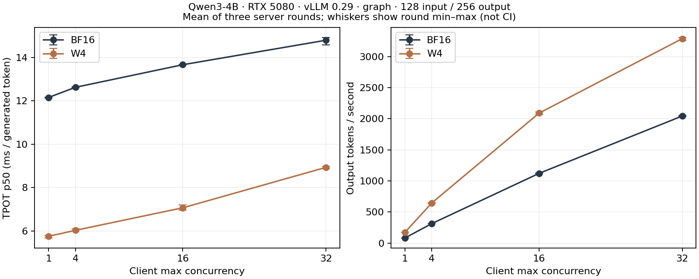

**Munsik-Kim | DIOVA**

[English](README.md) | 한국어

# 모델을 작게 저장하고, 실행하고, 달라진 답변까지 확인합니다.

AI 모델을 작게 만들면 내 컴퓨터에 올라가더라도 답변이 달라지거나 요청한 작업을 끝내지 못할 수 있습니다. 저는 DIOVA에서 **모델을 작게 저장해 다시 실행하는 도구**, **같은 질문의 답변 변화를 찾는 비교 도구**, **AI가 실제로 파일을 고치고 검사했는지 확인하는 평가 도구**를 만들었습니다. 공개 Qwen 모델과 RTX 5080 16GB에서 실행한 기록을 함께 제공합니다.

이 작업은 **로컬 AI 실행**, 학습된 모델이 잘 작동하도록 만드는 **추론 엔지니어링**, **모델 최적화**, 변경 뒤에 원래 맞히던 답을 잃는지 확인하는 **품질 회귀 검사**, **도구 자동화 평가**와 관련됩니다. 직접 만든 코드와 측정 결과에서 구현 범위와 확인한 조건을 볼 수 있습니다.

기술 협업으로 논의할 수 있는 일은 로컬 모델의 실행 실패 원인 찾기, 설정별 메모리·시간·답변 비교, 잘못 바뀐 답변이나 빠진 도구 작업을 찾는 검사 만들기, 저장된 결과를 재사용할 수 있는 보고서로 정리하기입니다. [역량과 코드 근거](docs/ko/PORTFOLIO.md)에서 각 작업의 구현을 확인할 수 있습니다. 실제 서비스 배포 적합성은 평가하지 않았습니다.

[포트폴리오·모델별 안내 (Pages)](https://munsik-kim.github.io/inference-lab/ko/index.html) · [직접 사용: 내 결과 비교 예제](packages/diova-compare/examples/compare/README.ko.md)

## 대표작 A · B · C

| 문제 | 직접 구현 | 근거·사용 경로 |
|---|---|---|
| A. 모델을 작게 저장하고 실제 요청까지 실행하기 | 기존 압축 방법(GPTQ)을 연결하고, 저장 파일 검사·새로 시작한 프로그램에서 재실행·동일 조건의 요청 비교 구현 | [Case008 Q](https://munsik-kim.github.io/inference-lab/ko/case008.html#track-q) → [Case009](https://munsik-kim.github.io/inference-lab/ko/case009.html#serving) |
| B. 바꾼 모델의 답변을 같은 질문 기준으로 비교하기 | 독립 CPU 도구 diova-compare 제작: 질문·정답 기준이 같은지 검사하고, 잃은 정답·새 정답·그 밖의 변경과 원 실행 실패 표시 | [CPU 실행 예제](packages/diova-compare/examples/compare/README.ko.md) · [코드·테스트](packages/diova-compare/README.ko.md#구현) |
| C. 답변이 아니라 실제 도구 작업의 완료를 확인하기 | 사용 가능한 도구 이름으로 호출을 제한하고 오류를 안내하며, 실제 파일 수정·검사 실행 기록을 확인 | [Case013 후속 구현·보고서](research/agent_tool_contract_repair_20261014/README.ko.md) |

현재 모델별 상세 안내는 Qwen3-4B-Instruct-2507과 RTX 5080 16GB의 기록을 다룹니다. 더 작은 Qwen3-0.6B의 구조 변경·압축 오차 보정 연구는 별도로 읽습니다. 명령어로 실행하는 비교 도구(CLI)는 Python 3.10+와 CPU로 작동합니다. 자유롭게 생성한 답변의 정오 판정은 사용자가 제공하며, 모델 실행이나 자동 채점 기능은 아닙니다.

[설치·내 기록 넣기](packages/diova-compare/examples/compare/README.ko.md) · [모델별 실전 안내](docs/ko/LLM_GUIDE.md) · [기술 역량·코드](docs/ko/PORTFOLIO.md) · [재현 안내](docs/ko/GETTING_STARTED.md)

## 직접 구현한 부분과 재사용한 기술

| 프로젝트 구현 | 기존 연구·라이브러리에서 제공 | 코드·테스트 |
|---|---|---|
| 변환해 저장한 모델 파일 검사·불완전한 저장 방지·구조가 맞지 않는 재로딩 거절 | PyTorch · Transformers · safetensors | [코드](tools/modelpack/artifact.py) · [테스트](cases/008-build-reconstruct-reload/tests/test_core.py) |
| Q 모델의 변환·저장·복사·새로 시작한 추론 프로그램에서 실행 검사 | GPTQ · LLM Compressor · compressed-tensors · vLLM/Marlin | [코드](tools/modelpack/quantized.py) · [테스트](cases/008-build-reconstruct-reload/tests/test_boundaries.py) |
| 작은 계산 블록의 출력 오차를 줄이는 가중치 적합(ridge 회귀)·보정 저장 | NumPy 선형대수 · 채널 재구성 선행연구 | [코드](tools/modelpack/numerics.py) · [테스트](cases/008-build-reconstruct-reload/tests/test_core.py) |
| 같은 질문을 짝지어 측정하고 개별 변화를 보여주는 비교 보고서 | vLLM benchmark · lm-evaluation-harness · 비교 지표 선행연구 | [코드](packages/diova-compare/src/diova_compare/core.py) · [테스트](packages/diova-compare/tests/test_compare.py) |
| 모델의 변화하는 기억을 적은 비트로 저장·실패 상태 보존·새 프로그램에서 이어 실행 | NumPy · PyTorch · ComplexKDA recurrence | [구현](cases/010-ckda-finite-precision-memory-horizon/versions/v2/source/online_v2.py) · [합성 재시작 테스트](cases/010-ckda-finite-precision-memory-horizon/versions/v2/tests/test_online_v2.py) |
| 같은 기억에서 답을 읽는 마지막 층만 교체·변경한 두 배열 저장·재적용 | ComplexKDA · PyTorch L-BFGS · NumPy | [모델 연결 코드](cases/011-frozen-state-readout-adaptation/source/adapter.py) · [변경 가중치 저장·재적용 검사](cases/011-frozen-state-readout-adaptation/tests/test_fitting_patch.py) |
| 같은 초기 잡음에서 생성 단계·내부 반복·시간·요청한 개수·색·좌우 조건 충족 여부 비교 | Looped-DiT · FLAN-T5 · PyTorch · Pillow | [모델 연결 코드](cases/012-looped-dit-inference-budget/source/adapter.py) · [CPU 검사](cases/012-looped-dit-inference-budget/tests/test_analysis.py) |
| 배율을 유지하는 4비트 정수(INT4) 변환·저장된 품질 결과 재검산 | DualQuant 공개 수식 · PyTorch · NumPy | [변환](cases/013-dualquant-reference-quality/source/paper_int4.py) · [CPU 검산](cases/013-dualquant-reference-quality/analysis/audit.py) |
| 앞선 층 압축으로 달라진 중간 계산값을 다음 층에서 수집해 보정·INT4 저장/재로딩·모델 전체 문장 품질 비교 | Guo compensation · PyTorch · Transformers · NumPy | [코드](cases/014-quantization-compensation/followups/p2_core/source/run_p2.py) · [테스트](cases/014-quantization-compensation/followups/p2_core/tests/test_p2.py) |
| API 이름 변경·관측 이력·상태 회귀시험 | Qwen · PyTorch · Transformers · Python stdlib | [runner](cases/015-tool-interface-sensitivity/followups/order-api-regression-v1/src/order_regression/runner.py) · [tests](cases/015-tool-interface-sensitivity/followups/order-api-regression-v1/tests/test_order_contracts.py) |

[선행연구와 구현 대응](docs/related-work/README.ko.md) · [CPU 비교 도구](packages/diova-compare/README.ko.md)

[16GB GPU 모델별 실전 안내서](docs/ko/LLM_GUIDE.md) — Qwen3-4B의 실행·품질·실패 기록. [온라인 안내서](https://munsik-kim.github.io/inference-lab/ko/llm-guide.html).

## Case015 — 같은 도구, 다른 이름

API 이름 변경 전후의 주문 조회·계산·저장·검증을 자동 비교합니다. 새 합성 업무 A1에서 BF16은 **15/16→16/16**, RTN은 **16/16→16/16**, D16은 **12/16→12/16**이었습니다. 실제 상태와 생성 전에 받은 정보를 따로 감사합니다. 기존 P1의96개와 A1의96개는 별도 분모입니다.

[Pages](https://munsik-kim.github.io/inference-lab/ko/case015.html#overview) · [Report](cases/015-tool-interface-sensitivity/REPORT.ko.md) · [CPU example](cases/015-tool-interface-sensitivity/REPRODUCE.ko.md) · [Runner](cases/015-tool-interface-sensitivity/followups/order-api-regression-v1/src/order_regression/runner.py)

## 구현 기능

### 모델을 압축하고, 저장하고, 다시 실행합니다

기존 압축 방법인 GPTQ로 모델 파일을 만들고, 요청을 받아 모델을 실행하는 소프트웨어(추론 엔진)에 연결했습니다. Qwen3 모델에서 순방향 계산 블록(MLP) 한 층의 크기를 줄인 모델을 저장·복원하고, 그 작은 블록의 출력 오차를 줄이도록 가중치를 보정하는 도구를 구현했습니다.

LLM Compressor · PyTorch · Transformers · safetensors. [저장본 로더](tools/modelpack/artifact.py) · [저장·재로딩 테스트](cases/008-build-reconstruct-reload/tests/test_core.py)

### GPU 추론 성능과 답변 비교

같은 입력에서 걸린 시간(지연시간)·GPU 메모리·정답 점수를 비교합니다. 한 연산과 모델 전체의 실행 비용을 따로 재서, 일부 계산이 빨라진 것을 답변 전체가 빨라진 것으로 읽지 않게 합니다.

vLLM · CUDA 실행 환경 · NVML · NumPy. [요청·메모리 측정 코드](cases/002-bf16-fp8-document-extraction/scripts/run.py) · [시간 측정 경계](cases/004-low-precision-attention-break-even/src/timing.py)

### 재계산 도구와 결과 탐색기

저장된 측정값을 다시 계산하는 Python 도구와 질문별로 무엇이 달라졌는지 보여주는 웹 화면을 만듭니다. 화면에 표시한 값이 원자료와 맞는지 자동으로 검사합니다.

Python · JavaScript · GitHub Actions · GitHub Pages. [CPU 선택기 재계산](tools/showcase/replay_selection.py) · [표시 계층 검사와 테스트](tests/showcase/test_showcase.py)

## 기술스택별 작업

| 작업 | 기술과 구현 |
|---|---|
| 양자화·압축 저장 | **LLM Compressor / GPTQ / compressed-tensors** — 행렬 변환(Linear)의 가중치를 압축하고, 묶어 저장한 배열(packed tensor)과 변환 설정(recipe)을 검사합니다. |
| 모델 구조·저장·로딩 | **PyTorch / Transformers / safetensors** — 행렬을 자르고 층별 크기를 저장한 뒤 배열 크기(tensor shape)와 공유 가중치를 복원합니다. |
| 수치 보정·그룹 선택 | **NumPy / CPU FP64 / ridge regression / Cholesky** — 64비트 수치 풀이로 작은 MLP의 출력 가중치를 보정하고, 제거할 그룹과 질문별 점수를 비교합니다. |
| GPU 실행·검사 | **vLLM / Marlin / PyTorch SDPA / SageAttention / CUDA runtime / NVML** — 실제 실행 경로를 확인하고 같은 입력의 메모리·전체 호출 비용을 측정합니다. |
| 재계산·결과 화면 | **Python / unittest / GitHub Actions / HTML / CSS / JavaScript** — 개별 수치·모델 파일 검사, 작은 CPU 예제, 한·영 결과 화면을 제공합니다. |

[구현 코드·관련 테스트 읽기](docs/ko/PORTFOLIO.md#code-tour). CUDA는 GPU 실행·측정에, 공개 커널은 연산 교체에 사용했습니다.

## 구현 상세와 연구 기록

### Case 008 — 모델을 변환하고, 복구하고, 다시 실행하기

<!-- claims: c008-tracks c008-artifact-implementation -->
Qwen 4B의 양자화 저장본 제작과 Qwen 0.6B의 작은 MLP 출력 복구를 구현했습니다. 모델과 측정 대상이 다른 두 결과물을 각각 살펴볼 수 있습니다.

#### Q · GPTQ 변환·저장·새 runtime 실행

원본 모델을 GPTQ W4A16으로 변환하고, 압축된 가중치와 설정을 검사한 뒤 새 vLLM 프로세스에서 실행하는 파이프라인을 구현했습니다.

**8.045 GB → 2.652 GB** · 원본 대비 가중치 파일 **67.0% 감소** — 가중치 파일 · 원본 BF16 → GPTQ W4A16 · 십진 GB.

Qwen3-4B-Instruct-2507 · GPTQ W4A16. **LLM Compressor · compressed-tensors · vLLM**.

[변환 코드](tools/modelpack/quantized.py) · [저장·재실행 과정](https://munsik-kim.github.io/inference-lab/ko/case008.html#track-q) · [품질·속도 평가](https://munsik-kim.github.io/inference-lab/ko/case008.html#q-evaluation)

#### R · 구조가 달라진 모델의 저장·재로딩과 가중치 보정

작은 블록의 출력 행렬(down projection)을 원래 출력에 가까워지도록 맞추는 ridge 회귀를 적용했습니다. 저장 파일에는 층별 크기 정보(metadata)를 남깁니다. 로더는 가중치 없는 빈 구조(meta skeleton)를 만든 뒤 저장된 숫자 배열(tensor)을 빠짐없이 대입하고, 공유 가중치와 계산용 보조 배열(buffer)을 복원해 원래 모델 파일(checkpoint) 없이 새 프로그램에서 실행합니다.

Qwen3-0.6B · 한 층 MLP · BF16 · 재구성 평가는 짧은 합성 평가 입력 192개 · **PyTorch · NumPy · safetensors**.

[구조 복원 코드](tools/modelpack/artifact.py) · [보정 방법](https://munsik-kim.github.io/inference-lab/ko/case008.html#track-r) · [품질·속도 평가](https://munsik-kim.github.io/inference-lab/ko/case008.html#r-evaluation)

[설계와 실험 결과](cases/008-build-reconstruct-reload/REPORT.ko.md) · [CPU 데모 실행](docs/ko/GETTING_STARTED.md#tiny-model-demo) · [코드·변환 설정·측정 자료 ZIP](downloads/case008_build_reconstruct_reload_reviewed_publication_v2.zip)

### Case 007 — 채널 선택부터 실제 행렬 축소까지

<!-- claims: c007-implementation -->
각 채널 그룹의 기여와 그룹 간 상호작용을 계산해 제거 대상을 고르고, gate/up/down 행렬을 함께 줄이는 도구를 구현했습니다. 선택 결과를 실제 작은 PyTorch 모듈로 만들고, 원래 모듈에 같은 삭제를 적용한 계산과 비교합니다.

**그룹 선택 → 행렬 축소 → 계산 검증**

Qwen3-0.6B · 한 층 MLP · 16개 채널 그룹. **PyTorch · NumPy · 구조화 pruning**.

[선택기 실행](docs/ko/GETTING_STARTED.md#cpu-selector) · [구조 변경 코드](cases/007-interaction-aware-mlp-pruning/src/surgery.py) · [설계와 실험 결과](https://munsik-kim.github.io/inference-lab/ko/case007.html#design)

### Case 006 — 모델 변경을 질문별로 추적하는 평가 도구

<!-- claims: c006-implementation c006-readout -->
모델의 특정 attention 연산을 교체하고, 같은 질문의 답변 확률·선택·동률을 비교하는 도구를 구현했습니다. 평균 점수에서 가려진 변화를 입력별로 확인하고, 마지막 출력 계산의 정밀도까지 별도로 조사할 수 있습니다.

**정답 손실 · 새 정답 · 다른 오답으로의 변경**

Qwen3-0.6B · 한 층 attention · 고정 합성 질문. **PyTorch · Transformers · SageAttention**.

[비교 화면](https://munsik-kim.github.io/inference-lab/ko/case006.html#results) · [연산 개입 코드](cases/006-attention-decision-stability/src/intervention.py) · [설계와 실험 결과](https://munsik-kim.github.io/inference-lab/ko/case006.html#design)

## 새 측정 — 긴 decode와 동시 요청

Case009는 기존 Qwen3-4B의 16비트 가중치 모델(BF16)과 4비트 가중치 모델(W4)을 비교합니다. 요청마다 텍스트 처리 단위인 토큰 256개를 생성하고, 최대 1/4/16/32개 요청을 동시에 보냈습니다. GPU 실행 순서를 미리 준비하는 graph와 매번 연산을 호출하는 eager 방식에서 서버 3라운드의 기록을 모두 남겼습니다. 공식 품질 과제는 별도 실행이며, 점수가 계산됐어도 프로그램이 비정상 종료한 경우를 함께 표시합니다.

영어 축 라벨입니다. [두 입력 길이와 품질표](cases/009-q-serving-quality/REPORT.ko.md) · [CPU 재계산·영어](cases/009-q-serving-quality/REPRODUCTION.md) · [설치해서 쓰는 질문별 비교 도구](packages/diova-compare/README.ko.md)

## Case 010 — 저정밀 state의 저장·재시작과 기억 수명

<!-- claims: c010-state-bytes -->
모델이 입력마다 갱신하는 기억(recurrent state)을 적은 비트로 저장하고, 수치 실패와 난수 생성 상태도 보존해 새로 시작한 프로그램에서 이어 실행하는 도구를 구현했습니다. 같은 저장 한도에서 첫 오답까지의 길이와 계산 비용을 비교합니다.

**입력 흐름(stream) 하나의 상태 저장량 12,305 → 3,137 bytes, 약 74.5% 감소** · 원래 32비트 형식(Native FP32) → 8비트 정수(INT8). 상태 추적용 CKDA 모델 세 개의 새 입력에서, 처음부터 연속해서 맞힌 평균 길이의 추정 차이는 각각 1토큰 미만이었습니다. 전체 RAM·VRAM이나 품질 동등성을 나타내는 수치는 아닙니다.

[실패를 보존하는 구현](cases/010-ckda-finite-precision-memory-horizon/versions/v2/source/online_v2.py) · [CPU 검산](cases/010-ckda-finite-precision-memory-horizon/REPRODUCTION.ko.md) · [두 단계의 방법과 결과](cases/010-ckda-finite-precision-memory-horizon/REPORT.ko.md)

## Case 011 — 같은 상태, 다른 판독기

모델이 저장한 상태는 유지하고, 답을 읽는 마지막 층만 교체하는 도구를 만들었습니다. 보정한 두 숫자 배열(tensor)을 변경 가중치 파일(patch)로 저장하고 새 프로그램에서 다시 적용해 비교합니다.

**마지막 층 1,158개 값 · 변화하는 모델 기억의 추가 저장 0 B · 새 프로그램에서 재적용**

정답 확률 점수는 개선됐지만, 처음부터 연속해서 맞히는 평균 길이는 짧아졌습니다. 같은 상태에서도 정답에 높은 점수를 주는 것과 첫 오류를 늦추는 것은 달랐습니다.

CKDA 기호 상태추적 · 기존 checkpoint 3개 · 마지막 선형층만 지도 보정. 상태는 입력마다 갱신되며, 같은 저장 방식의 판독기들이 그 상태를 공유합니다.

[쉽게 살펴보기](https://munsik-kim.github.io/inference-lab/ko/case011.html#overview) · [구현 코드](cases/011-frozen-state-readout-adaptation/source/adapter.py) · [상세 결과](https://munsik-kim.github.io/inference-lab/ko/case011.html#results)

## Case 012 — 이미지 생성 시간, 어디에 계산을 더 쓸까?

이미지를 고치는 생성 단계와 각 단계의 내부 반복에 시간을 나눠 쓰는 도구를 구현했습니다. 같은 초기 잡음의 세 이미지를 저장하고, 개수·색·좌우 요구와 실제 시간을 함께 비교할 수 있습니다.

**동일 초기 잡음 · 설정별 시간·메모리 · 조건을 가린 평가 화면**

L1·L2·L4는 한 생성 단계 안에서 핵심 계산을 각각 1·2·4번 반복한 설정입니다.

MAIN 192장의 사람 체크를 마쳤습니다. 직접 체크한 100장의 답을 비슷한 사진 92장에도 적용했습니다. 모든 요청 조건을 맞힌 장수는 **L1 52/64장, L2 51/64장, L4 53/64장**입니다. L4는 L1보다 4개를 얻고 3개를 잃어 순차이는 한 장이었습니다. 요청 시간 중앙값은 L2가 가장 짧았습니다. 묶음 답을 적용한 관측 장수이며, 기존 AI 점수도 별도로 보존했습니다.

[쉽게 살펴보기](cases/012-looped-dit-inference-budget/README.ko.md) · [모든 이미지 비교](cases/012-looped-dit-inference-budget/publication/IMAGES.ko.md) · [실행 코드](cases/012-looped-dit-inference-budget/source/adapter.py) · [설계와 결과](cases/012-looped-dit-inference-budget/REPORT.ko.md)

[완료한 사람 평가](presentation/evaluations/case012-human-v1/README.ko.md) · [사이트에서 직접 정답 체크하기](https://munsik-kim.github.io/inference-lab/ko/case012-annotate.html) · [결과 페이지](https://munsik-kim.github.io/inference-lab/ko/case012.html). 진행 중에도 JSON을 다운로드하고 나중에 가져와 이어서 체크할 수 있습니다. 브라우저 기록은 자동 업로드되지 않으며, 사람의 평가는 AI 점수와 별도로 검산합니다.

## Case 013 — 가중치 오차가 줄면 실제 답변도 좋아질까?

가중치를 4비트 정수(INT4)로 묶어 저장하고 다시 읽는 도구, 배율을 보존해 모델에 적용하는 연결 코드(adapter), 같은 입력의 문장 점수·장문 답·로컬 도구 검사를 구현했습니다. RTX 5080에서 Qwen 0.6B와 4B의 네 방법을 모두 기록했습니다. D16은 가중치를 INT4로 저장하고 계산 입력은 BF16으로 유지합니다. D4는 같은 가중치에 계산 입력까지 INT4로 바꿉니다. 두 품질 경로 모두 압축 값을 BF16으로 복원해 계산하는 참조 계산(reference)이며, 두 이름은 가중치 압축 강도를 뜻하지 않습니다.

D16의 가중치 오차는 두 모델에서 줄었습니다. 다음 토큰을 예측하는 점수인 PPL(낮을수록 좋음)은 0.6B에서 좋아졌지만 4B에서는 조금 나빠졌습니다. 자유 도구 작업은 **RTN 8/8 대비 D16 6/8**을 완료했습니다. RTN은 가까운 허용값으로 단순 반올림하는 비교 방법입니다. 압축된 값을 직접 처리하는 GPU 연산을 쓴 전체 모델은 사전 수치 기준을 통과하지 못해 요청 처리 가속은 확인되지 않았습니다. 설정 조정에 쓰던 기존 문제(DEV)를 활용한 작은 품질 실험입니다.

[쉬운 소개](cases/013-dualquant-reference-quality/README.ko.md) · [변환·모델 연결 코드](cases/013-dualquant-reference-quality/source/paper_int4.py) · [CPU 재계산](cases/013-dualquant-reference-quality/REPRODUCTION.ko.md) · [정식 보고서](cases/013-dualquant-reference-quality/REPORT.ko.md)

### 후속 구현 — 도구 이름 오류와 실제 작업 성공

기존 결과를 CPU 비교 도구에 연결하고, 사용 가능한 이름만 도구 호출에 넣는 제한(enum decoding)과 오류 안내를 구현했습니다. 같은 기존 DEV 8개에서 가중치를 유지한 D16은 **6/8→8/8**, D4는 **0/8→2/8**로 바뀌었습니다. 이름 제한 조건의 미등록 호출은 0회였고, D4의 나머지 6개 실패는 남았습니다. 성공 판정에는 완료했다는 최종 답변뿐 아니라 실제 수정·검사 기록이 필요했습니다. 새 문제에서도 같은 효과가 있는지는 확인하지 않았습니다.

[쉽게 살펴보기](research/agent_tool_contract_repair_20261014/README.ko.md) · [전체 결과·한영 보고서](research/agent_tool_contract_repair_20261014/records/REPORT_KO.md) · [앞선 원인 진단](research/agent_stability_20261013/README.ko.md) · [기록 비교 CLI](packages/diova-compare/README.ko.md#case013-export)

<!-- case014-entry -->
## 연구·수치 엔지니어링 — Case014

앞선 층을 압축하면서 달라진 중간 계산값을 다음 층에서 수집해 오차를 보정하는 별도 연구 도구를 만들었습니다. 보정한 가중치를 INT4로 저장·재로딩하고, 모델 전체의 텍스트 예측 품질을 비교했습니다.

**PG19 텍스트 예측 점수(PPL) 12.92% 감소 · 64/64 문서 구간의 정답 토큰 손실(NLL) 개선 · 변환한 행렬의 저장 바이트 동일**

Qwen3-0.6B · 학습된 행렬 변환(Transformer projection) 196개 · 새 PG19 64책의 256토큰 구간. ArXiv 글에서는 같은 이득이 확인되지 않았습니다. BF16으로 복원한 품질 평가이며 속도·GPU 메모리(VRAM) 절감은 측정하지 않았습니다. 행렬 저장량이 같다는 결과를 전체 모델 파일 크기가 같다는 뜻으로 넓히지 않습니다.

[결과 비교하기](https://munsik-kim.github.io/inference-lab/ko/case014.html#results) · [구현과 재현](cases/014-quantization-compensation/REPRODUCE.md) · [연구 과정](cases/014-quantization-compensation/STAGE_MAP.md)

## 질문과 구현물

| 쉬운 질문 | 이 사례에서 볼 수 있는 것 |
|---|---|
| [001 — GPU에서 모델이 실행되지 않는다면?](docs/ko/CASEBOOK.md#case-001) | 기존 실행 경로 수정의 전후 비교 도구. 기술명: SM120, vLLM, W8A8. |
| [002 — 적은 비트로 저장하면 메모리와 시간이 줄까?](docs/ko/CASEBOOK.md#case-002) | 공식 모델의 문서 추출 비교. 자원 사용은 줄었지만 과제 정답률은 낮았습니다. 기술명: BF16, FP8. |
| [003 — 간단해진 계산은 원래 값과 얼마나 비슷할까?](docs/ko/CASEBOOK.md#case-003) | 비교 기준의 scale을 나누어 검사한 수치 오차. 기술명: EFQ-Softmax, FP32 모의 계산. |
| [004 — 핵심 연산이 빠르면 호출 전체도 빨라질까?](docs/ko/CASEBOOK.md#case-004) | 준비 비용을 포함한 attention 시간. 긴 입력 일부는 빨랐지만 출력 오차는 고정 기준을 넘었습니다. 기술명: kernel, 전체 호출 비용. |
| [005 — 속도와 오차를 함께 만족하는 설정이 있을까?](docs/ko/CASEBOOK.md#case-005) | 측정한 절충 관계. 바꿔 본 설정 중 두 조건을 만족한 것이 없어 새 확인 단계로 넘어가지 않았습니다. 기술명: 정밀도, 국소 오차. |
| [006 — 어느 질문의 답이 바뀌는가?](docs/ko/CASEBOOK.md#case-006) | 입력별 답변 점수·선택·최고점 동률 진단. 기술명: NLL, top-score tie. |
| [007 — 작은 계산 블록에 어느 그룹을 남길까?](docs/ko/CASEBOOK.md#case-007) | 그룹 선택, 실제 행렬 축소, 선택에 쓰지 않은 입력의 평가. 기술명: MLP, pruning. |
| [008 — 바꾼 모델을 저장하고 다시 실행할 수 있을까?](docs/ko/CASEBOOK.md#case-008) | GPTQ 저장·실행 통합과 고정 MLP ridge 복구. Q 파일과 R 국소 오차가 감소했고 정답 점수 변화는 혼재. |
| [009 — 긴 decode와 동시 요청에서 비용은 어떻게 바뀔까?](cases/009-q-serving-quality/README.ko.md) | 같은 조건의 graph/eager 요청 비용과 공식 품질 계산. 비정상 프로세스 종료 기록도 함께 표시. |
| [010 — 저비트 state를 실패 이후에도 재시작할 수 있는가?](docs/ko/CASEBOOK.md#case-010) | 실제 bit packing, 실패 상태 직렬화, 최초 판독 실패와 저장 예산 비교. |
| [011 — 같은 상태에서 판독기만 바꾸면?](docs/ko/CASEBOOK.md#case-011) | 마지막 층 두 tensor 보정·재적용, 정답 점수와 첫 오류 길이의 비교. |
| [012 — 이미지 생성 시간을 어디에 더 쓸까?](docs/ko/CASEBOOK.md#case-012) | 같은 초기 잡음에서 생성 단계·내부 반복·시간을 비교하는 도구. 전체 192장의 개수·색·좌우 요청 조건 충족 여부와 조건별 획득·손실 평가. |
| [013 — 가중치 오차가 줄면 실제 답도 좋아질까?](docs/ko/CASEBOOK.md#case-013) | INT4 스케일 보존·저장·재로딩과 동일 입력 품질 기록. Packed 전체 모델 수치 기준 미통과. |
| [014 — 같은 INT4 저장량에서 품질을 개선할 수 있는가?](docs/ko/CASEBOOK.md#case-014) | 자체 경로 보정·INT4 저장/재로딩·전층 품질 비교. PG19 이득과 ArXiv 한계를 함께 기록. |

## 더 깊게 보기

5분 [처음 보기](docs/ko/START_HERE.md)에서 시작하거나 [용어집](docs/ko/GLOSSARY.md)에서 궁금한 말을 찾아보세요. [사례 안내](docs/ko/CASEBOOK.md)는 방법·소스·정확한 결과로, [이용 안내](docs/ko/GETTING_STARTED.md)는 ZIP 다운로드·로컬 HTML·CPU 검사로 이어집니다. 탐색기는 저장된 측정값을 보여주므로 GPU가 필요 없습니다. GitHub의 HTML 미리보기는 작동 화면이 아닌 소스 코드입니다. 기존 탐색기 UI와 상세 기술 원문은 영어입니다.

## 기여와 출처

DIOVA는 **Deep-learning Inference Optimization, Validation & Analysis**의 약자입니다.

공개 모델과 실행 라이브러리에 비교 실행기, 행렬 축소 도구, 수치 검사와 근거 탐색기를 연결했습니다. [포트폴리오의 기여·출처](docs/ko/PORTFOLIO.md#contribution-and-reuse)에서 Qwen, Transformers, PyTorch, vLLM, SageAttention 및 기존 방법·수정의 저자를 확인할 수 있습니다. OpenAI Codex가 구현·실행·분석·작성을 지원했습니다. 프로젝트 자료는 [Apache-2.0](LICENSE)을 따르며 사례별 고지에 upstream 조건을 남겼습니다. 이 작업은 모델 변경 평가와 추론 문제 진단에 연결되며, 배포 적합성은 평가하지 않았습니다.

[수정판 CPU wheel 0.1.1](downloads/diova_compare-0.1.1-py3-none-any.whl) · [Case009 공개 자료](downloads/case009_serving_quality_reviewed_publication_v2.zip) · [메타데이터](downloads/case009_serving_quality_reviewed_publication_v2.json)
