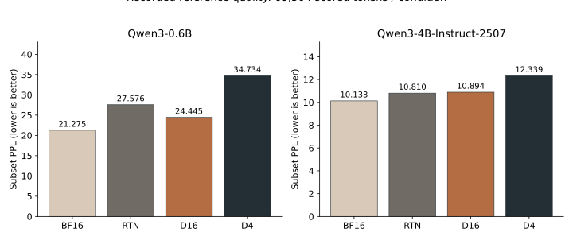
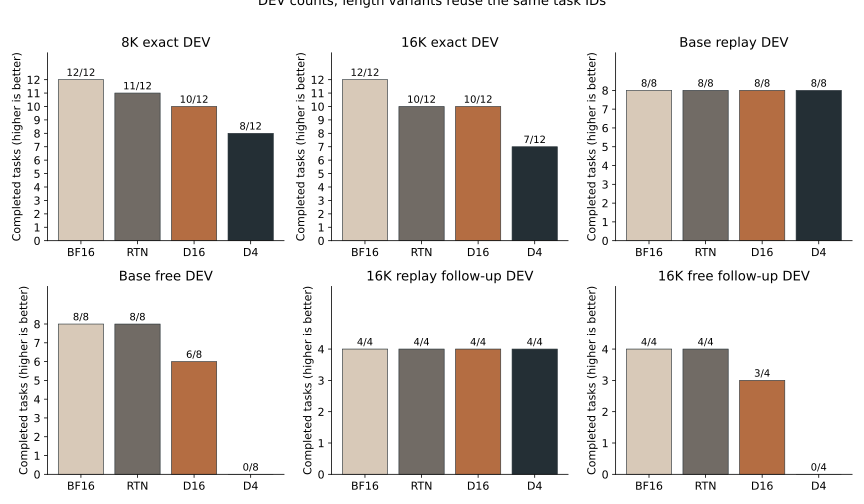
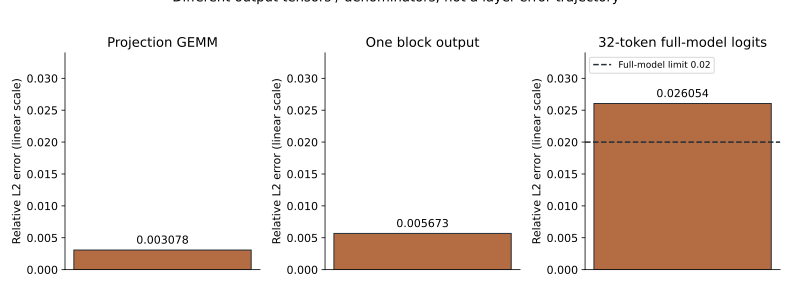

# Recorded-results figures / 저장 기록의 세 그림

Generated by [plot_results.py](../publication/plot_results.py) from the independent audit of original compact records. [Figure hashes/source/environment](figure_manifest.json). No new GPU run, fitted setting, confidence interval or performance selection.

## 1. PPL: separate model panels

낮을수록 좋은 PPL을 모델별로 나눴습니다. D16은 0.6B에서 RTN보다 낮고 4B에서는 조금 높습니다. 모델/방법당 65,504 loss 위치입니다. Full WikiText benchmark나 모델 간 능력 순위가 아닙니다. Exact values: [0.6B](../records/quality_06b.csv), [4B](../records/quality_4b.csv).

## 2. Exact answers and tool use: k/n DEV counts

각 막대에 k/n을 표시합니다. 장문 8K/16K는 고유 12task의 변경본, 기본 agent는 8task, 16K 후속은 그중 4task입니다. 서로 독립 표본으로 합치지 않습니다. 32K는 BF16 10/12만 추가 실행했고 다른 방법은 정책 미실행이므로 그림에0으로 채우지 않았습니다. Replay와 자유 실행도 구분합니다. [Whole table and actual per-ID paired counts](../summary/paired_dev.json).

## 3. Packed numerical gates

Linear scale; relative L2 error = sqrt(SSE of differences / reference squared energy). 서로 다른 출력 tensor의 분모입니다. Layer별 누적 오차 궤적이 아닙니다. 전체 모델 panel에만 그 사전 기준0.02를 표시했고 마지막 full error0.026054는 기준을 넘었습니다. GEMM/block도 각각의2% gate에서PASS였다는 기술 기록은 [PACKED_PROBE](../PACKED_PROBE.md)에 있습니다. [Unrounded receipt](../records/diagnostics/packed_precision_aligned_03.json).

English interpretation: PPL improves only in the small-model D16 comparison; exact/free-task counts are descriptive DEV with reused IDs; the full packed-model gate fails. Colors do not replace labels or numeric values. No time/memory missing values are plotted as zero.
