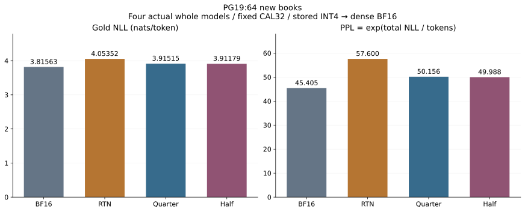
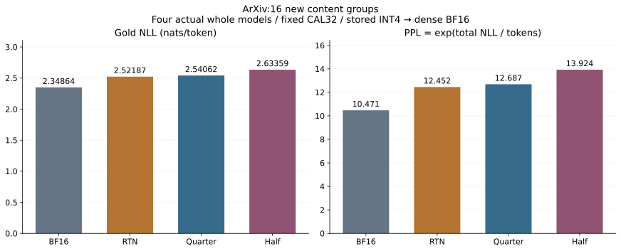

# Case 014 — 같은 INT4 저장량으로 모델 품질 개선하기

양자화 오차 보정의 상쇄·재양자화·일반화 분석

[English](REPORT.md) · [Stage map](STAGE_MAP.md) · [CPU/GPU reproduction](REPRODUCE.md)

양자화된 모델의 실제 입력 경로를 따라 가중치를 보정하고, 같은 INT4 형식으로 저장하는 도구를 구현했습니다. Qwen3-0.6B의196개 Transformer projection에 고정된 약한 보정을 적용해, 새 PG19 64책의256-token 평가 구간에서 RTN 대비 PPL을12.92% 낮췄습니다. Projection 저장량은 그대로 유지했습니다.

ArXiv에서는 같은 이득이 확인되지 않았습니다. 이 결과는 저장본을 BF16으로 복원한 품질 평가이며, 실행 속도·VRAM 절감은 별도로 측정하지 않았습니다.

[1. 배경](#background) · [2. 질문과 가설](#questions) · [3. 이론과 구현 계약](#contract) · [4. 방법](#methods) · [5. 실험](#experiments) · [6. 실험 결과](#results) · [7. 결과 분석](#analysis) · [8. 결론](#conclusion) · [9. 재현과 참고자료](#references)

<a id="background"></a>
## 1. 배경

작은 가중치 오차가 언제 실제 출력 개선으로 이어지는지 조사했습니다. 앞선 층에서 전달되는 입력 오차를 보정하더라도 기존 상쇄·재양자화·새 문서의 변화가 이득을 바꿀 수 있습니다. P1의 실패가 P1b의 독립 선택을, 그 관측이 P2의 고정 약한 전층 비교를 동기화했습니다. 전체가 처음부터 정해진 단일 사전등록 실험은 아닙니다.

<a id="questions"></a>
## 2. 질문과 가설

Q1: 상속오차 개선이 유리한 상쇄를 깨뜨리는가? Q2: 저장 scale/code를 다시 계산하면 방향이 달라지는가? Q3: 보정량과 강도의 선택이 새 문서에 전이되는가? P2의 별도 주 질문은 같은 형식의 전층 QUARTER가 전체 RTN보다 새 PG19 NLL을 낮추는가입니다. HALF는 보조이며, 결과를 보고 주 후보를 바꾸지 않았습니다.

<a id="contract"></a>
## 3. 이론과 구현 계약

```text
W[out,in], X/Z[in,tokens], Wstar=W+alpha*K
A=W(X-Z); C=alpha*KZ
B=(What-Wstar)Z; B0=(What0-W)Z
R=A-C-B; R0=A-B0
Delta = ||R||²-||R0||²
T_inherited = ||C||²-2<A,C>
T_cancellation = 2<B0,C>
T_requant = ||B-B0||²-2<R0-C,B-B0>
Delta = T_inherited+T_cancellation+T_requant
```

CAL에서 full-input Gram G=ZZᵀ, λ=0.001 trace(G)/d_in의 CPU FP64 Cholesky·triangular solve로 K를 적합합니다. 명시 inverse·block-diagonal 근사는 없습니다. Ridge H는 일반적으로 projector가 아닙니다. 평가에서는 CAL의 K를 고정하며 AP_eval로 다시 적합하지 않습니다.

고정-B 반사실 A−C−B0와 실제 고정밀 Wstar control은 다른 대상입니다. 저장 What의 FP32 표현값을 FP64로 올린 대수와 실제 BF16 출력 차이·weight cast·arithmetic residual을 분리합니다. P2의 B0는 각 방법의 현재 Z 위의 국소 RTN 대조이며, 전체 RTN 모델 오차가 아닙니다.

<a id="methods"></a>
## 4. 방법

공통 encoder는 signed INT4[−8,7], input group64, output-row/group FP32 absmax/7, nearest-even, 진짜 zero group만 scale1, low-nibble-first, header36B입니다. pack→디스크→독립 decode→BF16 설치를 확인했습니다. Runtime에 K를 별도 GEMM으로 더하지 않습니다. Embedding/lm_head tie·norm·attention·RoPE 등 공통 경로는 유지합니다.

P2는 매 그룹마다 native 전체 CausalLM forward로 실제 입력을 캡처합니다. q/k/v → 실제 attention → o → residual/norm → gate/up → SiLU 곱 → down 순서입니다. 같은 입력 그룹만 Gram factor를 공유하며 QUARTER/HALF는 각자 원형에서 시작해 새로운 Z·K를 만듭니다.

<a id="experiments"></a>
## 5. 실험

단계별 문서·선택·원형은 [STAGE_MAP](STAGE_MAP.md)에 있습니다. P1: CAL32/DEV16/EVAL32/SHIFT16,6표적×5alpha. P1b: 기존 K6개와 저장본30개를 유지하고 새 SELECT32/EVAL64/SHIFT16. P2: 원 CAL32 재사용, 별도의 새 PG19 64책·ArXiv16 content group,196개 projection 전체 비교입니다. 문서와 원문 창의 과거 사용은 확인 가능한 manifest 합집합에서 제외했습니다. Pile는 article ID가 없어 content-group 기준입니다. 사전학습 미노출을 주장하지 않습니다.

모든 LM 점수는 chat/BOS/EOS 추가 없는256 input tokens의 다음255원문 tokens입니다. KL은 고정16위치의 전체 어휘 BF16∥후보, argmax flip은255위치입니다. P2는 BF16/batch1/SDPA/use_cache=False/전체256 head/TF32·reduced reduction OFF입니다. 모든 artifact 동결 당시 fresh forward0회였고, 그 후 평가했습니다.

<a id="results"></a>
## 6. 실험 결과

### P2 — 전층 모델의 대표 결과

PG19 ·64 book excerpts ·16,320 valid next tokens/method

| Method | NLL ↓ (nats/token) | PPL ↓ | KL(BF16∥method) ↓ | Argmax flip |
| --- | ---: | ---: | ---: | ---: |
| BF16 | 3.815629 | 45.405313 | 0.000000 | 0.000% |
| RTN | 4.053521 | 57.599922 | 0.438809 | 31.740% |
| COMP_QUARTER | 3.915147 | 50.156465 | 0.290688 | 25.447% |
| COMP_HALF | 3.911792 | 49.988432 | 0.236665 | 24.179% |

ArXiv ·16 content groups ·4,080 valid next tokens/method

| Method | NLL ↓ (nats/token) | PPL ↓ | KL(BF16∥method) ↓ | Argmax flip |
| --- | ---: | ---: | ---: | ---: |
| BF16 | 2.348638 | 10.471299 | 0.000000 | 0.000% |
| RTN | 2.521869 | 12.451842 | 0.320093 | 22.549% |
| COMP_QUARTER | 2.540615 | 12.687474 | 0.310653 | 23.162% |
| COMP_HALF | 2.633587 | 13.923621 | 0.318018 | 24.975% |

| Cohort | Candidate−RTN | ΔNLL (nats/token) | 95% paired CI | PPL change |
| --- | --- | ---: | --- | ---: |
| EVAL-ID | COMP_QUARTER | -0.138374 | [-0.149414, -0.127515] | -12.923% |
| EVAL-ID | COMP_HALF | -0.141730 | [-0.156537, -0.126159] | -13.214% |
| SHIFT | COMP_QUARTER | +0.018747 | [-0.005723, +0.044885] | +1.892% |
| SHIFT | COMP_HALF | +0.111718 | [+0.072058, +0.153853] | +11.820% |

주 비교의 PPL 감소는 RTN 대비12.92%이며 정답률·속도 증가가 아닙니다. 64/64는 각 책의 고정 구간 NLL이 낮았다는 뜻입니다. PG19 QUARTER의 RTN 추가 NLL 손실 회복은58.17%이며 상세 진단 분모는 RTN−BF16 gap입니다. 원 BF16을 능가한 결과는 아닙니다.

원래 seed6101523으로10,000회 문서 paired bootstrap을 재계산했습니다. 구간은 이 모델·CAL32·고정 강도에 조건화합니다. HALF/SHIFT는 보조 pointwise입니다. HALF−QUARTER의 새 게시 사후 점추정은 PG19−0.003356, ArXiv+0.092972 nats/token입니다. 독립 검토 code/seed가 없어 해당 과거 CI를 붙이지 않았습니다.





### P0→P1→P1b의 관측

P0의 고정 오차 유리수 예,2bit4-code 예, 무한 격자 dither는 서로 다른 모형입니다. dither는 ridge0·clipping 없음·조건당2,000개 저장 seed의 양성 대조입니다. 이번 게시에서는 저장 SSE/SE를 검산했으며 Monte Carlo를 다시 돌리지 않았습니다.

P1의 CAL 선택은 EVAL 국소 SSE를6/6에서 높였고, 사후 확인한0.25는6/6에서 낮췄습니다. 아래 합산 항의 단위는 해당 표적의32문서 local squared energy입니다. 연속 보정 전이 손실이 큰 양의 항이며 상쇄를 주원인으로 단정하지 않습니다.

| Target | CAL alpha | EVAL selected ΔSSE | EVAL alpha0.25 ΔSSE | T_inherited | T_cancellation | T_requant |
| --- | ---: | ---: | ---: | ---: | ---: | ---: |
| 12.mlp.down_proj | 1 | +36.68% | -7.78% | 1.15e+05 | -1.25e+03 | 9.48e+03 |
| 12.self_attn.o_proj | 1 | +43.26% | -6.86% | 7.17e+04 | 2.31e+02 | 7.79e+03 |
| 20.mlp.down_proj | 0.75 | +14.29% | -6.45% | 4.08e+05 | -7.39e+02 | 1.96e+05 |
| 20.self_attn.o_proj | 1 | +5.11% | -16.07% | 9.29e+04 | -1.23e+04 | 1.72e+04 |
| 4.mlp.down_proj | 1 | +45.40% | -5.97% | 2.92e+04 | 5.51e+01 | 2.95e+03 |
| 4.self_attn.o_proj | 1 | +10.98% | -10.59% | 2.91e+03 | -5.52e+01 | 2.71e+02 |

P1b는 기존 K와 저장본을 유지하고 선택 문서를 분리했습니다. 여섯 독립 개입의 비율 평균이며 하나의 전층 모델 결과가 아닙니다.

| Target | OLD_FIT | SELECT_SSE | SELECT_NLL |
| --- | ---: | ---: | ---: |
| 12.mlp.down_proj | 1 | 0.25 | 0 |
| 12.self_attn.o_proj | 1 | 0.25 | 0.75 |
| 20.mlp.down_proj | 0.75 | 0.25 | 0.5 |
| 20.self_attn.o_proj | 1 | 0.5 | 1 |
| 4.mlp.down_proj | 1 | 0.25 | 0.25 |
| 4.self_attn.o_proj | 1 | 0.5 | 1 |

| SELECT_SSE versus | ΔSSE / alpha0 SSE, target mean | ΔNLL, target mean | NLL95% pointwise CI |
| --- | ---: | ---: | --- |
| OLD_FIT | -36.078 baseline-SSE pp | -0.003735 | [-0.004858, -0.002605] |
| BASE_ZERO | -10.172 baseline-SSE pp | -0.001055 | [-0.001743, -0.000416] |
| FIXED_QUARTER | -1.122 baseline-SSE pp | -0.000275 | [-0.000628, +0.000077] |

고정0.25 대비 추가 SSE 이득은 block4/20 o_proj의0.5 선택에 집중됐고 나머지 네 표적은 같은0.25 artifact입니다. 추가 NLL 이득의 구간은0을 포함합니다. ArXiv에서는 두 selector 모두 alpha0보다 평균 SSE/NLL이 악화했습니다.

<a id="analysis"></a>
## 7. 결과 분석

국소 SSE를 줄이는 것과 실제 다음 토큰 NLL을 낮추는 것은 다른 목표입니다. P1b의 여섯 효과를 더해 P2를 예측하지 않았습니다. P2는 새 자체 경로 K를 사용한 실제 전층 모델에서 PG19 이득을 직접 확인했으며, ArXiv의 손실·불확실성도 남았습니다.

FP32 대수 부호와 BF16 실측 부호, 보수적 bound 인증은 구분했습니다. P1은 저장된2,304비교 모두 실측 방향이 같고2,195개가 bound 인증됐습니다. P1b fresh EVAL은1,536개 중1,535개 방향 일치·1,396개 인증입니다. 인증되지 않았다는 것은 실측 방향이 없거나 반대라는 뜻이 아닙니다. 사후 선택 민감도를 새 학습·보장으로 승격하지 않았습니다.

<a id="conclusion"></a>
## 8. 결론

같은 INT4 저장 형식의 고정 약한 자체 경로 보정은 이번 PG19 전층 비교에서 유효했습니다. ArXiv에서는 같은 이득을 확보하지 못했으므로 도메인 의존을 함께 보고합니다. 좋은 결과를 얻기 위한 추가 선택·실험 없이 P2를 완료했습니다.

| Axis | Scope |
| --- | --- |
| Capture/fit/serialization/reload |196 projections/model,588 historical files,392 K fits; implementation completed |
| PG19 whole-model quality |Registered QUARTER−RTN LOWER_NLL |
| ArXiv |QUARTER higher point estimate/CI crossing0; HALF higher NLL |
| Native packed serving / VRAM savings / agent / other model |NOT_EVALUATED |
| Publication |New GPU inference/K fits/requantization0; CPU scalar/interval/unit checks only |


<a id="references"></a>
## 9. 재현과 참고자료

원 연구 상위 문서6개는 교체 전 바이트를 보존했습니다. 원형579파일 중578개는 공개 사본과 byte-identical이며 환경 기록1개는 개인 model path 필드만 이전 공개 ZIP의 sanitized 값으로 대체했습니다. 원 raw는 로컬에서 그대로 보존했습니다. [대응표](publication/provenance/ORIGINAL_MAP.json)와 [단계 복원](publication/scripts/restore_stage.py)으로 추적할 수 있습니다.

[CPU/GPU reproduction](REPRODUCE.md) · [Stage map](STAGE_MAP.md) · [Publication checks](publication/verification/cpu-recalculation.json) · [Raw-derived display](publication/summary/project.json)

Guo의 [v1 논문](https://arxiv.org/html/2610.16020v1), [기존 source audit](references/source_audit.json), [공식 코드 식별자](https://github.com/tellsgo/quantization-compensation/tree/1e5dea93dfd9466ce0569fc8dde55ef8c2fcb9e0)를 구분합니다. 본문 절은 과거 HTML 대조 기록이며 PDF 페이지 별도 rendering은 미실행입니다. 저자의 HALF/새 문서 선택 전이는 선행 결과이며 이번 새 발견으로 주장하지 않습니다. 자체 capture·fit orchestration·codec/reload·분해·평가·auditor를 공개합니다. Qwen 모델·PyTorch·Transformers·NumPy와 보정 아이디어는 upstream/선행 연구입니다. Codex 보조와 별도 CPU 계산 경로 검산을 기록하며 사람의 독립 심사·외부 GPU 재현·공식 저자 승인으로 표시하지 않습니다.


저장 장부: RTN=QUARTER=HALF247,733,136B; headers7,056 + scales27,525,120 + codes220,200,960B. BF16 projection tensors880,803,840B; unchanged common tensors311,296,000B (ties counted once). Core reduction71.874%.

Offline 구축: RTN9.898s / QUARTER546.999s / HALF515.160s. Capture·FP64 solve·진단·I/O 포함, serving 시간 아님.
