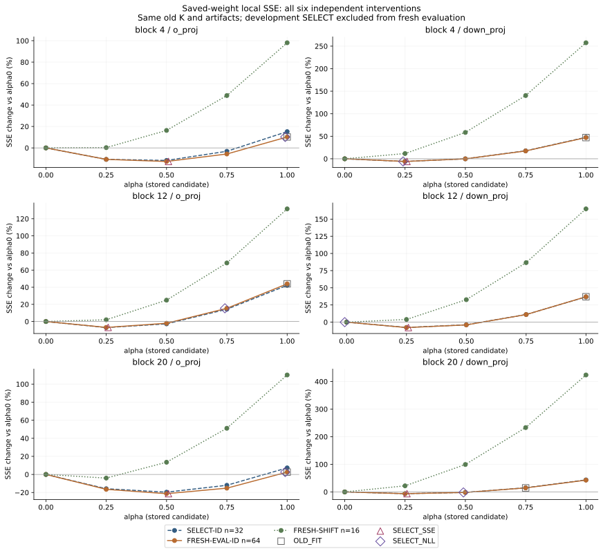
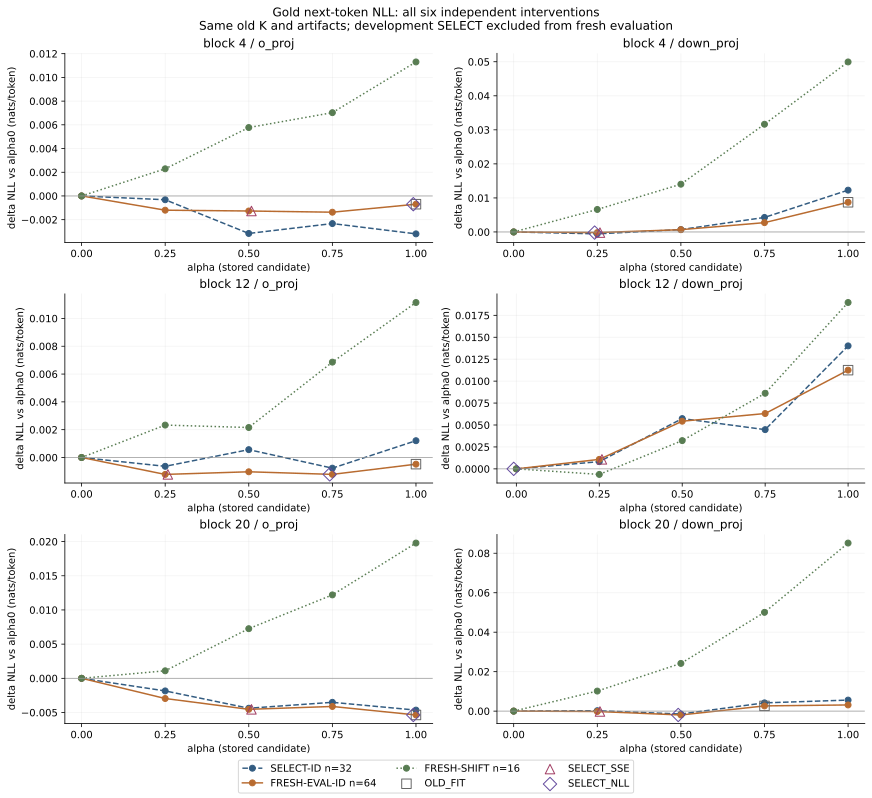
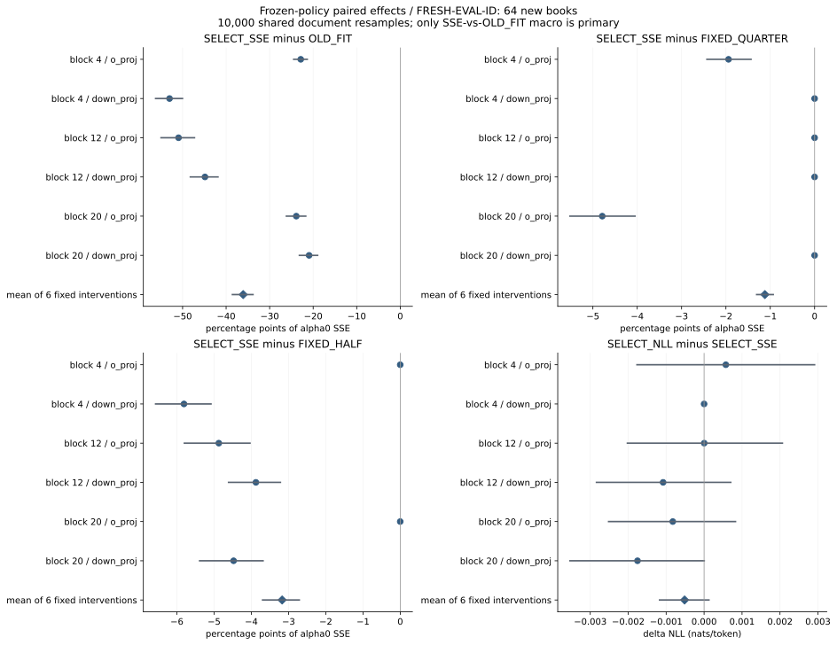
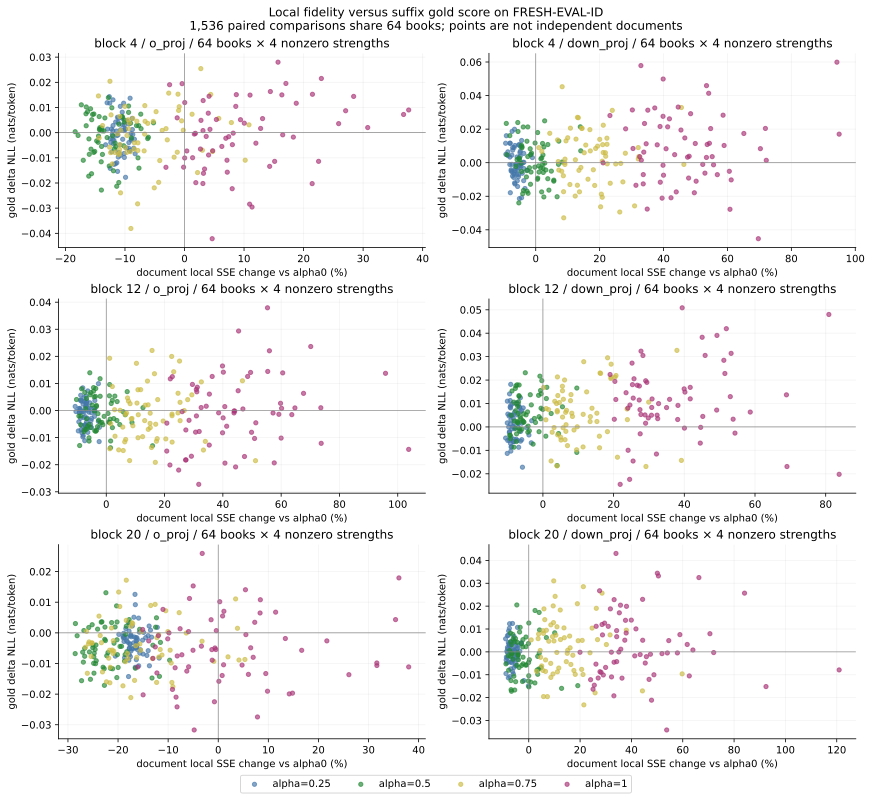

# Case014 P1b — 보정 강도 선택의 전이

2026-10-15 KST · p1b_r2

[한눈에 보기](#section-1) · [문제·가설](#section-2) · [변경/고정 요소](#section-3) · [데이터·선택 규칙](#section-4) · [결과](#section-5) · [기전·불확실성](#section-6) · [P2 전 판단](#section-7) · [재현·출처](#section-8)

## 1. 한눈에 보기

보정량 K를 만드는 문서와 강도 alpha를 고르는 문서를 분리하고, 고정된 INT4 후보가 새 문서에서도 도움이 되는지 확인했습니다. Qwen3-0.6B의 기존 K 6개와 후보 30개를 그대로 읽어 새 SELECT32책에서 두 선택 규칙을 동결한 뒤, 다른 PG19 64책과 ArXiv 16개 content group에서 실제 모델 출력을 비교했습니다. **실행 상태: COMPLETED_P1B.**

**Q1:** 새 SELECT_SSE는 새 ID 문서에서 OLD_FIT보다 국소 SSE를 여섯 표적 모두 줄였습니다. 일차 D_macro=−0.360780,95% CI[−0.385582,−0.338209]입니다. alpha0 SSE를100으로 보았을 때 차이가 −36.078[−38.558,−33.821]인 단위입니다.

**Q2:** 고정0.25 대비 국소 SSE의 추가 감소는 −1.122[−1.307,−0.933] baseline-SSE percentage points입니다. 그러나 NLL 추가 이득 −0.000275 nats/token의95% CI[−0.000628,+0.000077]은0을 포함합니다. 고정0.5 대비 보조 구간은 SSE와 NLL 모두 음수입니다.

**Q3:** 두 selector는5/6표적에서 다른 강도를 골랐습니다. SELECT_NLL의 SELECT_SSE 대비 새 ID NLL 차이는 −0.000514[−0.001174,+0.000128]로 불확정입니다. SELECT_NLL은 alpha0 대비 국소 SSE를 거시 요약에서 오히려 높였습니다.

**SHIFT 한계:** SELECT_SSE는 alpha0 대비 SSE+11.578%, NLL+0.005248 nats/token, SELECT_NLL은 SSE+64.595%, NLL+0.011454였습니다. 독립 선택이 모든 도메인의 과보정을 해결한 결과는 아닙니다.

| scope | status |
| --- | --- |
| K fit / target quantization | P1 artifacts reused;0 new calls |
| candidate rows / policy aliases | 3,360 /4,704; aliases are shared measurements |
| documents | SELECT32 / fresh ID64 / fresh SHIFT16; smoke reused |
| runtime | stored INT4 → FP32 decode → dense BF16 full hybrid forward |
| inference unit | one target intervention; different prefixes for blocks4/12/20 |
| P2 / P3 / remote publication | NOT_RUN_SCOPE / NOT_RUN_SCOPE / NOT_RUN |

[Reproduce](REPRODUCE.md) · [Frozen spec](specs/p1b.json) · [Frozen selection](../../results/p1b_r2/selection_frozen.json) · [All policy summaries](../../results/p1b_r2/policy_summary.csv) · [All paired contrasts](../../results/p1b_r2/paired_contrasts.csv) · [All3360 raw rows](../../results/p1b_r2/cells) · [Independent audit](../../results/p1b_r2/independent_audit.json) · [Preservation](../../results/p1b_r2/preservation.json) · [Historical P1 motivation](../../results/p1b_r2/historical_P1_reference.json)

## 2. 문제·가설

P1에서 CAL-FIT으로 고른 강도는 새 EVAL의 국소 SSE를 모두 높였고, 사후 확인한0.25는 여섯 표적 모두 낮췄습니다. 이 관측을 본 뒤 설계한 별도 후속입니다. 새 selector가 OLD_FIT만 이기는지, 단순한 약한 강도보다 추가 정보가 있는지, SSE와 gold NLL 목적이 어떻게 다른지 분리했습니다. 이전 EVAL의 최솟값·alpha_cont_star는 selector에 입력하지 않았습니다.

## 3. 변경/고정 요소

표적은 zero-based4/12/20의 o_proj[1024,2048]와 down_proj[1024,3072]입니다. grid=[0,.25,.5,.75,1], K/lambda6개, prefix140개, target30개는 원 P1 manifest와 전체 해시를 대조했습니다. prefix는 block<l의 q/k/v/o/gate/up/down만 바꾸고 target block의 나머지와 전체 suffix는 원형입니다. 각 alpha의 target 입력 Z가 같음을 실제 검사했습니다.

BF16/batch1/seq256/SDPA/use_cache=False, TF32=False, BF16·FP16 reduced-precision reduction=False, native 전체256위치 head를 유지했습니다. chat/BOS/EOS 없이255개 gold next-token NLL·argmax와 고정16개 위치의 full-vocabulary KL(BF16||candidate)을 계산했습니다. 기존 SMOKE의 대수 허용오차1e−10, 부호 범위1e−9×SSE scale을 재사용했습니다. K 재적합·encode 호출은 runtime guard로 거절합니다.

| policy | rule |
| --- | --- |
| BASE_ZERO | 0 (prefix+target RTN hybrid) |
| OLD_FIT | P1 CAL-FIT selected value |
| FIXED_QUARTER / HALF / FULL | .25 / .5 /1 |
| SELECT_SSE | SELECT raw SSE argmin |
| SELECT_NLL | SELECT gold next-token NLL argmin |

## 4. 데이터·선택 규칙

PG19는 기존 로컬 train 첫 shard의 canonical ebook ID hash 순서에서96책을 뽑고 seed6101517로 SELECT32/EVAL64에 배정했습니다. 이전 P1은 test의81책을 사용했습니다. 새 pool의 source split은 다르며 엄밀한 동일분포를 보장하지 않습니다. Pile는 기존16개를 제외한 새 ArXiv content group16개입니다. 원 article ID는 없습니다. 새 전송은0 bytes입니다.

확인한 과거97입력과 새112입력 사이에서 canonical ID/content/token/정규화 window와5gram 중복을 검사했습니다.17,080쌍의 최대 Jaccard는0.010460이고0.8이상인 쌍은 없습니다. 전체 원문 근접중복·확인 범위 밖 과거 사용·사전학습 미노출은 검증하지 않았습니다. 모든 입력은256tokens, 동일 마스크·position 정책입니다.

SELECT_SSE는 SELECT의 실제 저장본 국소 SSE 합, SELECT_NLL은 같은 SELECT의 sumNLL/sumValidTokens를 최소화합니다. 정확한 동률만 작은 alpha를 고릅니다. 전체12선택을 동결할 때 fresh forward는0회였습니다. 이후에만 EVAL64와 SHIFT16을 실행했습니다. 동일 alpha 정책은 동일 row/artifact를 참조합니다. 선택 뒤 core bytes는 그대로입니다.

| target | OLD_FIT | SELECT_SSE | SELECT_NLL | SSE artifact SHA prefix | NLL artifact SHA prefix |
| --- | --- | --- | --- | --- | --- |
| 4/o_proj | 1 | 0.5 | 1 | c07a339024a6 | 2e890ab723ad |
| 4/down_proj | 1 | 0.25 | 0.25 | 7f066ce3fb9e | 7f066ce3fb9e |
| 12/o_proj | 1 | 0.25 | 0.75 | ffea19addbf6 | 31d0c99e7bc6 |
| 12/down_proj | 1 | 0.25 | 0 | f85c528d2363 | bad898512d21 |
| 20/o_proj | 1 | 0.5 | 1 | 70a65a6cf833 | 837da86808e0 |
| 20/down_proj | 0.75 | 0.25 | 0.5 | 06f7096db00a | 0bd88e9338f3 |

## 5. 결과

S0=같은 표적·문서의 alpha0 SSE입니다. ΔSSE/S0는 후보−비교군 차이를 alpha0로 나눈 값이며 OLD_FIT 대비 상대감소율이 아닙니다. 위 값은 여섯 독립 개입의 동일가중 평균입니다. 각 표적 표·paired 문서별 개선/악화/동률·중앙값·구간은 CSV에 전부 있습니다. 이들 PPL은 해당 hybrid target 모델마다 계산하며 표적 PPL을 평균하지 않습니다.

| cohort | contrast | ΔSSE/S0 ×100 | 95% CI | ΔNLL nats/token | 95% CI |
| --- | --- | --- | --- | --- | --- |
| FRESH-EVAL-ID | SELECT_SSE − OLD_FIT | -36.078 | [-38.558, -33.821] | -0.003735 | [-0.004858, -0.002605] |
| FRESH-EVAL-ID | SELECT_SSE − BASE_ZERO | -10.172 | [-10.712, -9.613] | -0.001055 | [-0.001743, -0.000416] |
| FRESH-EVAL-ID | SELECT_SSE − FIXED_QUARTER | -1.122 | [-1.307, -0.933] | -0.000275 | [-0.000628, 0.000077] |
| FRESH-EVAL-ID | SELECT_SSE − FIXED_HALF | -3.173 | [-3.698, -2.711] | -0.000608 | [-0.001158, -0.000069] |
| FRESH-EVAL-ID | SELECT_NLL − BASE_ZERO | 3.404 | [2.002, 4.869] | -0.001570 | [-0.002602, -0.000534] |
| FRESH-EVAL-ID | SELECT_NLL − SELECT_SSE | 13.576 | [12.683, 14.521] | -0.000514 | [-0.001174, 0.000128] |
| FRESH-EVAL-ID | SELECT_NLL − FIXED_HALF | 10.403 | [9.910, 10.913] | -0.001122 | [-0.001929, -0.000358] |
| FRESH-SHIFT | SELECT_SSE − OLD_FIT | -154.292 | [-172.864, -136.662] | -0.021617 | [-0.027313, -0.016272] |
| FRESH-SHIFT | SELECT_SSE − BASE_ZERO | 11.578 | [8.693, 14.547] | 0.005249 | [0.003806, 0.006684] |
| FRESH-SHIFT | SELECT_SSE − FIXED_QUARTER | 5.598 | [4.691, 6.508] | 0.001607 | [0.000875, 0.002363] |
| FRESH-SHIFT | SELECT_SSE − FIXED_HALF | -29.302 | [-33.877, -25.075] | -0.004185 | [-0.005875, -0.002424] |
| FRESH-SHIFT | SELECT_NLL − BASE_ZERO | 64.595 | [55.514, 74.349] | 0.011454 | [0.008136, 0.014990] |
| FRESH-SHIFT | SELECT_NLL − SELECT_SSE | 53.017 | [46.772, 59.847] | 0.006205 | [0.003701, 0.008656] |
| FRESH-SHIFT | SELECT_NLL − FIXED_HALF | 23.715 | [21.406, 26.152] | 0.002020 | [0.000022, 0.004155] |

선택 기호의 작은 가로 offset은 동률 가독성용이며 실제 alpha는 선택 표에 있습니다.

### FRESH-EVAL-ID /64 books

#### 4/o_proj

| policy | α | ΔSSE/S0 % | NLL | ΔNLL | PPL | KL | flip % | core bytes |
| --- | --- | --- | --- | --- | --- | --- | --- | --- |
| BASE_ZERO | 0 | 0.000 | 3.873390 | 0.000000 | 48.1052 | 0.152956 | 17.237 | 1179684 |
| OLD_FIT | 1 | 10.204 | 3.872694 | -0.000696 | 48.0717 | 0.156363 | 17.610 | 1179684 |
| FIXED_QUARTER | 0.25 | -10.712 | 3.872189 | -0.001201 | 48.0474 | 0.152732 | 17.053 | 1179684 |
| FIXED_HALF | 0.5 | -12.653 | 3.872121 | -0.001269 | 48.0442 | 0.151412 | 16.967 | 1179684 |
| FIXED_FULL | 1 | 10.204 | 3.872694 | -0.000696 | 48.0717 | 0.156363 | 17.610 | 1179684 |
| SELECT_SSE | 0.5 | -12.653 | 3.872121 | -0.001269 | 48.0442 | 0.151412 | 16.967 | 1179684 |
| SELECT_NLL | 1 | 10.204 | 3.872694 | -0.000696 | 48.0717 | 0.156363 | 17.610 | 1179684 |

#### 4/down_proj

| policy | α | ΔSSE/S0 % | NLL | ΔNLL | PPL | KL | flip % | core bytes |
| --- | --- | --- | --- | --- | --- | --- | --- | --- |
| BASE_ZERO | 0 | 0.000 | 3.872847 | 0.000000 | 48.0791 | 0.152909 | 17.279 | 1769508 |
| OLD_FIT | 1 | 47.077 | 3.881571 | 0.008724 | 48.5004 | 0.176804 | 18.971 | 1769508 |
| FIXED_QUARTER | 0.25 | -5.924 | 3.872658 | -0.000190 | 48.0700 | 0.152164 | 17.169 | 1769508 |
| FIXED_HALF | 0.5 | -0.115 | 3.873519 | 0.000672 | 48.1114 | 0.156825 | 17.567 | 1769508 |
| FIXED_FULL | 1 | 47.077 | 3.881571 | 0.008724 | 48.5004 | 0.176804 | 18.971 | 1769508 |
| SELECT_SSE | 0.25 | -5.924 | 3.872658 | -0.000190 | 48.0700 | 0.152164 | 17.169 | 1769508 |
| SELECT_NLL | 0.25 | -5.924 | 3.872658 | -0.000190 | 48.0700 | 0.152164 | 17.169 | 1769508 |

#### 12/o_proj

| policy | α | ΔSSE/S0 % | NLL | ΔNLL | PPL | KL | flip % | core bytes |
| --- | --- | --- | --- | --- | --- | --- | --- | --- |
| BASE_ZERO | 0 | 0.000 | 3.936941 | 0.000000 | 51.2616 | 0.231821 | 24.246 | 1179684 |
| OLD_FIT | 1 | 44.008 | 3.936462 | -0.000479 | 51.2370 | 0.235120 | 24.320 | 1179684 |
| FIXED_QUARTER | 0.25 | -6.920 | 3.935726 | -0.001215 | 51.1993 | 0.230117 | 24.112 | 1179684 |
| FIXED_HALF | 0.5 | -2.047 | 3.935915 | -0.001026 | 51.2090 | 0.230502 | 24.026 | 1179684 |
| FIXED_FULL | 1 | 44.008 | 3.936462 | -0.000479 | 51.2370 | 0.235120 | 24.320 | 1179684 |
| SELECT_SSE | 0.25 | -6.920 | 3.935726 | -0.001215 | 51.1993 | 0.230117 | 24.112 | 1179684 |
| SELECT_NLL | 0.75 | 15.417 | 3.935728 | -0.001213 | 51.1994 | 0.232002 | 24.112 | 1179684 |

#### 12/down_proj

| policy | α | ΔSSE/S0 % | NLL | ΔNLL | PPL | KL | flip % | core bytes |
| --- | --- | --- | --- | --- | --- | --- | --- | --- |
| BASE_ZERO | 0 | 0.000 | 3.937767 | 0.000000 | 51.3039 | 0.232531 | 24.161 | 1769508 |
| OLD_FIT | 1 | 36.963 | 3.949020 | 0.011253 | 51.8845 | 0.246556 | 25.496 | 1769508 |
| FIXED_QUARTER | 0.25 | -7.896 | 3.938848 | 0.001081 | 51.3594 | 0.232247 | 24.259 | 1769508 |
| FIXED_HALF | 0.5 | -4.019 | 3.943200 | 0.005432 | 51.5834 | 0.235857 | 24.724 | 1769508 |
| FIXED_FULL | 1 | 36.963 | 3.949020 | 0.011253 | 51.8845 | 0.246556 | 25.496 | 1769508 |
| SELECT_SSE | 0.25 | -7.896 | 3.938848 | 0.001081 | 51.3594 | 0.232247 | 24.259 | 1769508 |
| SELECT_NLL | 0 | 0.000 | 3.937767 | 0.000000 | 51.3039 | 0.232531 | 24.161 | 1769508 |

#### 20/o_proj

| policy | α | ΔSSE/S0 % | NLL | ΔNLL | PPL | KL | flip % | core bytes |
| --- | --- | --- | --- | --- | --- | --- | --- | --- |
| BASE_ZERO | 0 | 0.000 | 3.978386 | 0.000000 | 53.4307 | 0.301128 | 27.855 | 1179684 |
| OLD_FIT | 1 | 2.597 | 3.973023 | -0.005364 | 53.1449 | 0.297084 | 27.537 | 1179684 |
| FIXED_QUARTER | 0.25 | -16.501 | 3.975430 | -0.002956 | 53.2730 | 0.298955 | 27.831 | 1179684 |
| FIXED_HALF | 0.5 | -21.290 | 3.973848 | -0.004538 | 53.1888 | 0.296659 | 27.641 | 1179684 |
| FIXED_FULL | 1 | 2.597 | 3.973023 | -0.005364 | 53.1449 | 0.297084 | 27.537 | 1179684 |
| SELECT_SSE | 0.5 | -21.290 | 3.973848 | -0.004538 | 53.1888 | 0.296659 | 27.641 | 1179684 |
| SELECT_NLL | 1 | 2.597 | 3.973023 | -0.005364 | 53.1449 | 0.297084 | 27.537 | 1179684 |

#### 20/down_proj

| policy | α | ΔSSE/S0 % | NLL | ΔNLL | PPL | KL | flip % | core bytes |
| --- | --- | --- | --- | --- | --- | --- | --- | --- |
| BASE_ZERO | 0 | 0.000 | 3.977987 | 0.000000 | 53.4094 | 0.301802 | 27.947 | 1769508 |
| OLD_FIT | 0.75 | 14.585 | 3.980627 | 0.002640 | 53.5506 | 0.299831 | 27.616 | 1769508 |
| FIXED_QUARTER | 0.25 | -6.349 | 3.977787 | -0.000201 | 53.3987 | 0.299447 | 27.610 | 1769508 |
| FIXED_HALF | 0.5 | -1.873 | 3.976032 | -0.001956 | 53.3051 | 0.299008 | 27.702 | 1769508 |
| FIXED_FULL | 1 | 42.716 | 3.981113 | 0.003125 | 53.5766 | 0.304467 | 27.966 | 1769508 |
| SELECT_SSE | 0.25 | -6.349 | 3.977787 | -0.000201 | 53.3987 | 0.299447 | 27.610 | 1769508 |
| SELECT_NLL | 0.5 | -1.873 | 3.976032 | -0.001956 | 53.3051 | 0.299008 | 27.702 | 1769508 |

### FRESH-SHIFT /16 content groups

#### 4/o_proj

| policy | α | ΔSSE/S0 % | NLL | ΔNLL | PPL | KL | flip % | core bytes |
| --- | --- | --- | --- | --- | --- | --- | --- | --- |
| BASE_ZERO | 0 | 0.000 | 2.667016 | 0.000000 | 14.3969 | 0.139474 | 13.015 | 1179684 |
| OLD_FIT | 1 | 98.084 | 2.678320 | 0.011304 | 14.5606 | 0.153362 | 13.750 | 1179684 |
| FIXED_QUARTER | 0.25 | 0.264 | 2.669307 | 0.002291 | 14.4300 | 0.141895 | 13.088 | 1179684 |
| FIXED_HALF | 0.5 | 16.319 | 2.672786 | 0.005770 | 14.4803 | 0.142927 | 13.284 | 1179684 |
| FIXED_FULL | 1 | 98.084 | 2.678320 | 0.011304 | 14.5606 | 0.153362 | 13.750 | 1179684 |
| SELECT_SSE | 0.5 | 16.319 | 2.672786 | 0.005770 | 14.4803 | 0.142927 | 13.284 | 1179684 |
| SELECT_NLL | 1 | 98.084 | 2.678320 | 0.011304 | 14.5606 | 0.153362 | 13.750 | 1179684 |

#### 4/down_proj

| policy | α | ΔSSE/S0 % | NLL | ΔNLL | PPL | KL | flip % | core bytes |
| --- | --- | --- | --- | --- | --- | --- | --- | --- |
| BASE_ZERO | 0 | 0.000 | 2.666970 | 0.000000 | 14.3963 | 0.139638 | 12.500 | 1769508 |
| OLD_FIT | 1 | 257.519 | 2.716914 | 0.049944 | 15.1335 | 0.211419 | 17.843 | 1769508 |
| FIXED_QUARTER | 0.25 | 11.641 | 2.673579 | 0.006609 | 14.4917 | 0.159106 | 13.603 | 1769508 |
| FIXED_HALF | 0.5 | 58.470 | 2.680998 | 0.014028 | 14.5997 | 0.171326 | 14.338 | 1769508 |
| FIXED_FULL | 1 | 257.519 | 2.716914 | 0.049944 | 15.1335 | 0.211419 | 17.843 | 1769508 |
| SELECT_SSE | 0.25 | 11.641 | 2.673579 | 0.006609 | 14.4917 | 0.159106 | 13.603 | 1769508 |
| SELECT_NLL | 0.25 | 11.641 | 2.673579 | 0.006609 | 14.4917 | 0.159106 | 13.603 | 1769508 |

#### 12/o_proj

| policy | α | ΔSSE/S0 % | NLL | ΔNLL | PPL | KL | flip % | core bytes |
| --- | --- | --- | --- | --- | --- | --- | --- | --- |
| BASE_ZERO | 0 | 0.000 | 2.718075 | 0.000000 | 15.1511 | 0.201826 | 17.549 | 1179684 |
| OLD_FIT | 1 | 131.526 | 2.729219 | 0.011144 | 15.3209 | 0.215492 | 18.407 | 1179684 |
| FIXED_QUARTER | 0.25 | 2.033 | 2.720406 | 0.002331 | 15.1865 | 0.202429 | 17.377 | 1179684 |
| FIXED_HALF | 0.5 | 24.920 | 2.720232 | 0.002157 | 15.1838 | 0.204196 | 17.721 | 1179684 |
| FIXED_FULL | 1 | 131.526 | 2.729219 | 0.011144 | 15.3209 | 0.215492 | 18.407 | 1179684 |
| SELECT_SSE | 0.25 | 2.033 | 2.720406 | 0.002331 | 15.1865 | 0.202429 | 17.377 | 1179684 |
| SELECT_NLL | 0.75 | 68.371 | 2.724932 | 0.006857 | 15.2554 | 0.210709 | 17.819 | 1179684 |

#### 12/down_proj

| policy | α | ΔSSE/S0 % | NLL | ΔNLL | PPL | KL | flip % | core bytes |
| --- | --- | --- | --- | --- | --- | --- | --- | --- |
| BASE_ZERO | 0 | 0.000 | 2.718607 | 0.000000 | 15.1592 | 0.202827 | 17.328 | 1769508 |
| OLD_FIT | 1 | 164.908 | 2.737573 | 0.018966 | 15.4494 | 0.218471 | 19.338 | 1769508 |
| FIXED_QUARTER | 0.25 | 3.915 | 2.717974 | -0.000633 | 15.1496 | 0.198836 | 17.475 | 1769508 |
| FIXED_HALF | 0.5 | 32.711 | 2.721828 | 0.003221 | 15.2081 | 0.200325 | 17.525 | 1769508 |
| FIXED_FULL | 1 | 164.908 | 2.737573 | 0.018966 | 15.4494 | 0.218471 | 19.338 | 1769508 |
| SELECT_SSE | 0.25 | 3.915 | 2.717974 | -0.000633 | 15.1496 | 0.198836 | 17.475 | 1769508 |
| SELECT_NLL | 0 | 0.000 | 2.718607 | 0.000000 | 15.1592 | 0.202827 | 17.328 | 1769508 |

#### 20/o_proj

| policy | α | ΔSSE/S0 % | NLL | ΔNLL | PPL | KL | flip % | core bytes |
| --- | --- | --- | --- | --- | --- | --- | --- | --- |
| BASE_ZERO | 0 | 0.000 | 2.757428 | 0.000000 | 15.7593 | 0.239492 | 21.471 | 1179684 |
| OLD_FIT | 1 | 110.122 | 2.777213 | 0.019785 | 16.0742 | 0.247573 | 21.691 | 1179684 |
| FIXED_QUARTER | 0.25 | -4.026 | 2.758526 | 0.001098 | 15.7766 | 0.238910 | 21.250 | 1179684 |
| FIXED_HALF | 0.5 | 13.509 | 2.764687 | 0.007259 | 15.8741 | 0.242520 | 21.078 | 1179684 |
| FIXED_FULL | 1 | 110.122 | 2.777213 | 0.019785 | 16.0742 | 0.247573 | 21.691 | 1179684 |
| SELECT_SSE | 0.5 | 13.509 | 2.764687 | 0.007259 | 15.8741 | 0.242520 | 21.078 | 1179684 |
| SELECT_NLL | 1 | 110.122 | 2.777213 | 0.019785 | 16.0742 | 0.247573 | 21.691 | 1179684 |

#### 20/down_proj

| policy | α | ΔSSE/S0 % | NLL | ΔNLL | PPL | KL | flip % | core bytes |
| --- | --- | --- | --- | --- | --- | --- | --- | --- |
| BASE_ZERO | 0 | 0.000 | 2.758914 | 0.000000 | 15.7827 | 0.238076 | 20.858 | 1769508 |
| OLD_FIT | 0.75 | 233.057 | 2.808963 | 0.050049 | 16.5927 | 0.284965 | 22.574 | 1769508 |
| FIXED_QUARTER | 0.25 | 22.050 | 2.769068 | 0.010155 | 15.9438 | 0.245546 | 21.176 | 1769508 |
| FIXED_HALF | 0.5 | 99.350 | 2.783083 | 0.024169 | 16.1688 | 0.254569 | 21.936 | 1769508 |
| FIXED_FULL | 1 | 423.746 | 2.844071 | 0.085157 | 17.1856 | 0.314905 | 23.750 | 1769508 |
| SELECT_SSE | 0.25 | 22.050 | 2.769068 | 0.010155 | 15.9438 | 0.245546 | 21.176 | 1769508 |
| SELECT_NLL | 0.5 | 99.350 | 2.783083 | 0.024169 | 16.1688 | 0.254569 | 21.936 | 1769508 |

## 6. 기전·불확실성

C=alpha K_old Z이며 새 문서로 K를 다시 풀지 않았습니다. A=W(X−Z), B=(What−W−alpha K)Z, B0=(What0−W)Z에 대해 Delta=T_inherited+T_cancellation+T_requant를 실제 저장FP32 What의 FP64 계산에서 확인했습니다. 새 입력의 alpha_cont_star는 설명용 연속 진단이며 후보 생성이나 재선택에 쓰지 않았습니다. 아래 비교 수는 문서×6표적×비영alpha4개이고 독립 문서 수와 다릅니다. 유형은 겹칩니다.

A: 상속오차는 줄지만 fixed-B 상쇄 손실로 T_cont>0. B: T_cont<0이나 실제 재양자화 뒤 Delta>0. C: 기존 CAL의 연속 보정 개선이 새 문서에서는 악화. D: local SSE 개선과 suffix gold NLL 악화가 공존. B는 scale 재계산·round·clip·codec을 포함한 재양자화이며 rounding만의 원인으로 좁히지 않습니다.
| cohort | independent docs | comparisons | A | B | C | D |
| --- | --- | --- | --- | --- | --- | --- |
| SELECT-ID | 32 | 768 | 0 | 10 | 344 | 188 |
| FRESH-EVAL-ID | 64 | 1536 | 1 | 23 | 685 | 366 |
| FRESH-SHIFT | 16 | 384 | 0 | 1 | 360 | 17 |

실측 BF16 방향 일치와 보수적 산술 bound 인증은 별개입니다. EVAL1536개 중1535개는 방향이 같았고139개는 방향은 같지만 bound로는 비인증입니다.1개는 실제 방향이 달랐습니다. bound 미통과를 미측정·반대 방향으로 바꾸지 않습니다. 드문 A/B 건수만으로 오차 상쇄가 흔하거나 전체 모델의 유일한 원인이라고 해석하지 않습니다.
| cohort | comparisons | measured same direction | bound certified | same direction / uncertified |
| --- | --- | --- | --- | --- |
| SELECT-ID | 768 | 768 | 700 | 68 |
| FRESH-EVAL-ID | 1536 | 1535 | 1396 | 139 |
| FRESH-SHIFT | 384 | 384 | 351 | 33 |

일차 D_macro만 사전 지정 primary입니다. 나머지는 보조·탐색적 pointwise 구간입니다. 문서 paired bootstrap10,000회/seed6101519에서 모든 표적·정책에 같은 문서 index를 쓰고 분자·분모를 다시 합산했습니다. 선택은 bootstrap 안에서 다시 하지 않았습니다. 구간은 기존 K와 이번 SELECT에 조건화하며 선택 문서·재적합·모델 모집단의 불확실성은 포함하지 않습니다.0포함은 불확정입니다.

| target | cohort | α_cont raw | α_cont clipped | pooled cosine A,U | ||A||/||U|| |
| --- | --- | --- | --- | --- | --- |
| 4/o_proj | SELECT-ID | 0.4020 | 0.4020 | 0.3619 | 1.1108 |
| 4/down_proj | SELECT-ID | 0.2563 | 0.2563 | 0.2545 | 1.0072 |
| 12/o_proj | SELECT-ID | 0.2854 | 0.2854 | 0.2763 | 1.0329 |
| 12/down_proj | SELECT-ID | 0.2931 | 0.2931 | 0.2727 | 1.0748 |
| 20/o_proj | SELECT-ID | 0.4598 | 0.4598 | 0.4481 | 1.0261 |
| 20/down_proj | SELECT-ID | 0.2858 | 0.2858 | 0.2637 | 1.0839 |
| 4/o_proj | FRESH-EVAL-ID | 0.4289 | 0.4289 | 0.3700 | 1.1591 |
| 4/down_proj | FRESH-EVAL-ID | 0.2571 | 0.2571 | 0.2541 | 1.0119 |
| 12/o_proj | FRESH-EVAL-ID | 0.2773 | 0.2773 | 0.2703 | 1.0260 |
| 12/down_proj | FRESH-EVAL-ID | 0.2935 | 0.2935 | 0.2744 | 1.0699 |
| 20/o_proj | FRESH-EVAL-ID | 0.4856 | 0.4856 | 0.4673 | 1.0391 |
| 20/down_proj | FRESH-EVAL-ID | 0.2886 | 0.2886 | 0.2645 | 1.0912 |
| 4/o_proj | FRESH-SHIFT | 0.1191 | 0.1191 | 0.1420 | 0.8388 |
| 4/down_proj | FRESH-SHIFT | 0.0380 | 0.0380 | 0.0664 | 0.5726 |
| 12/o_proj | FRESH-SHIFT | 0.0913 | 0.0913 | 0.1175 | 0.7767 |
| 12/down_proj | FRESH-SHIFT | 0.0797 | 0.0797 | 0.1133 | 0.7035 |
| 20/o_proj | FRESH-SHIFT | 0.1629 | 0.1629 | 0.2152 | 0.7568 |
| 20/down_proj | FRESH-SHIFT | 0.0234 | 0.0234 | 0.0509 | 0.4601 |

## 7. P2 전 판단

독립 선택의 ID 국소 전이는 확인했지만, 고정0.25 대비 gold NLL의 추가 이득과 도메인 전이의 실용성은 확보하지 못했습니다. 현재 여섯 alpha를 전체 모델 기본값으로 채택하지 않습니다. P2를 검토한다면 별도 승인·등록 아래 각 방법의 자체 입력 경로, 새 평가 분할과 출력 지표를 유지해야 합니다. 앞층을 순차 보정하면 Z가 달라지므로 이번 여섯 효과를 합쳐 P2 개선량을 예측할 수 없습니다. P2/P3는 실행하지 않았습니다.

## 8. 재현·출처

기존 검사15개를 재실행했고 새 고유 검사10개가 통과했습니다. 반복 실행을 새 테스트로 합산하지 않았습니다. 원 P1 저장 기록2880행·120요약의 간단 auditor가 통과했으며 P0 MC·P1 GPU sweep은 재실행하지 않았습니다. 새 원행3360개,216요약,12선택,정책alias4704개와462구간을 독립 CPU 구현으로 다시 계산했습니다. 추가로 private 행렬9행을 독립 nibble decoder와 Torch CPU FP64로 대조하고 작은 실제 SMOKE slice의 항등식을 확인했습니다. 공개 scalar 감사는 GPU NLL/KL 계산 자체를 재현하지 않습니다.

원 Case014236파일, tracked6351파일, 원 P0 private33파일, P1 private2148파일과 모델6파일의 해시가 보존됐습니다. 모델 전체 weight SHA도 기존 로컬 manifest와 대조했습니다. 공식 외부 digest 신규 검증이나 D 원본 비교는 수행하지 않았습니다. 설치·환경 업그레이드·stage/commit/push/PR/merge/Pages/Drive는0회입니다.

첫 worker는 저장되지 않은 과거 SMOKE prefix 배열 비교에서 exit1로 끝났습니다.3 forward·7.042초와 source/log를 보존했습니다. 해당 가용성만 고친 r2는 exit0/3813 forward/512.949초였습니다. 새 선택용 출력 전의 수정이며 spec·입력·K·quantizer는 그대로입니다.

Torch peak allocated1,613,842,432 B, reserved1,845,493,760 B입니다. 장치 사용량은 forward 뒤 샘플이며 전체 Windows peak가 아닙니다. INT4 core는 o_proj1,179,684 B/down_proj1,769,508 B로 alpha별 동일합니다. 이는 dense BF16 품질 경로의 비용이며 packed serving 속도·VRAM 이득은 측정하지 않았습니다.

| timing scope | seconds |
| --- | --- |
| data_prepare (outside worker) | 33.492 |
| validation (outside worker) | 1.956 |
| load (inside worker) | 1.612 |
| SELECT_forward + local metrics/I/O | 152.325 |
| select_compute | 0.004995 |
| EVAL_forward + local metrics/I/O | 244.339 |
| SHIFT_forward + local metrics/I/O | 106.597 |
| metric (included in phase totals) | 202.912 |
| saved scalar analysis (outside worker) | 1.473 |
| independent scalar audit (outside worker) | 0.471 |
| failed worker attempt | 7.042 |
| successful worker subprocess | 512.949 |
| all worker attempts total | 519.991 |

| identity | value |
| --- | --- |
| branch | research/case014-quantization-compensation |
| Git HEAD/base | 09194c3f2e2c991feff5b6abab0cf8ab81a07052 |
| GPU execution source SHA256 | 19ed11ef4246a36b1d5a68c3f6ba62146c0cea15c556dae8c6879eb1c0bca8eb |
| P1b spec SHA256 | 0d11679fbecef6c077cd55c85715a6daf1656a063f4f39171bc1028b58d46a69 |
| input manifest SHA256 | 1e08e292c742f20df04325739fc71ab2adbb892f347eb318a955987ff4c879e9 |
| selection file SHA256 | 82bd0827bb05f649d1ea71893449db15f46fb4f7262176fa900a759fa0f3738e |
| model revision | c1899de289a04d12100db370d81485cdf75e47ca |
| model full local weight SHA256 | f47f71177f32bcd101b7573ec9171e6a57f4f4d31148d38e382306f42996874b |

[Reproduce](REPRODUCE.md) · [Frozen spec](specs/p1b.json) · [Frozen selection](../../results/p1b_r2/selection_frozen.json) · [All policy summaries](../../results/p1b_r2/policy_summary.csv) · [All paired contrasts](../../results/p1b_r2/paired_contrasts.csv) · [All3360 raw rows](../../results/p1b_r2/cells) · [Independent audit](../../results/p1b_r2/independent_audit.json) · [Preservation](../../results/p1b_r2/preservation.json) · [Historical P1 motivation](../../results/p1b_r2/historical_P1_reference.json)

Sources: [PG19](https://huggingface.co/datasets/pg19), [cached PG19 mirror](https://huggingface.co/datasets/emozilla/pg19/tree/c021754c8e01c5b1cc83a1f549c1f97fbbb756b8), [Pile10k](https://huggingface.co/datasets/NeelNanda/pile-10k/tree/127bfedcd5047750df5ccf3a12979a47bfa0bafa), [Qwen3-0.6B](https://huggingface.co/Qwen/Qwen3-0.6B/tree/c1899de289a04d12100db370d81485cdf75e47ca), [Guo2026v1](https://arxiv.org/html/2610.16020v1). Dataset license cards were read from pinned local caches; raw text is excluded. This is a fixed-artifact ridge/RTN follow-up, not an official full QEP reproduction or a new quantizer. Codex assisted implementation, analysis and documentation; no independent human review is claimed.
