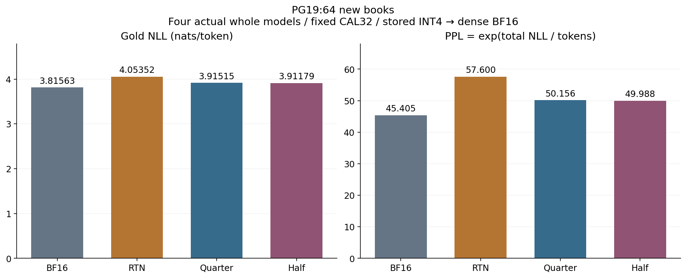
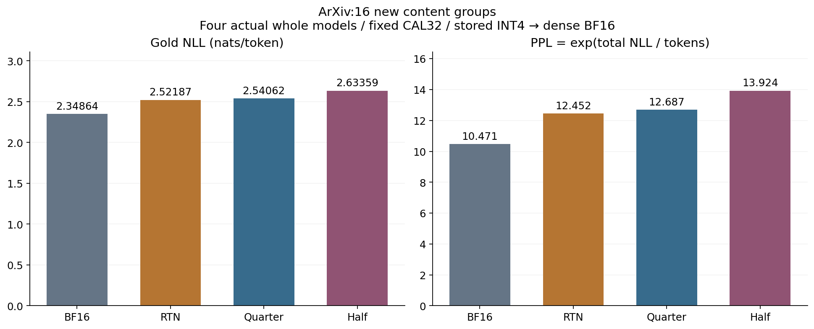
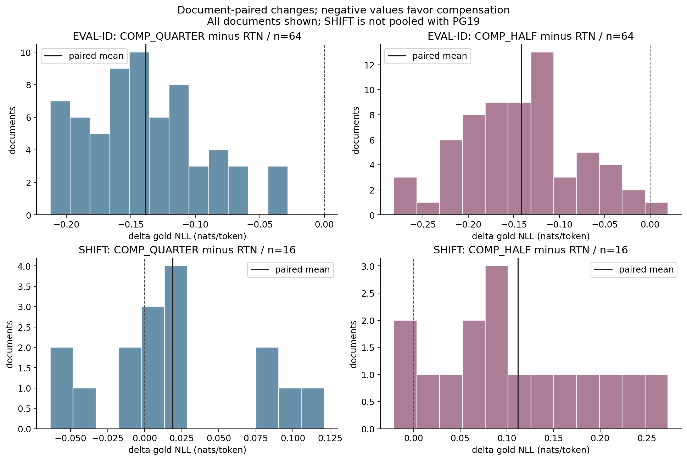
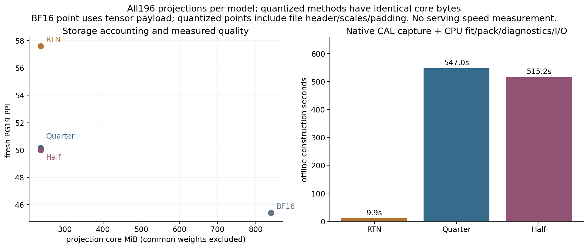

# Does weak quantization compensation help a whole model?

Case014 P2 · 2026-10-15 · `COMPLETED_P2_CORE` · [한국어](REPORT.ko.md)

## At a glance

This tool refits compensation on each quantized model's current input trajectory, writes the
result into the same INT4 format, reloads it, and measures actual whole-model outputs.
On64 fresh PG19 books, Qwen3-0.6B QUARTER lowered gold NLL against RTN by
**-0.138374 nats/token (95% CI [-0.149414, -0.127515])**. PPL fell from
**57.600 to 50.156, -12.923%**. All64 books had lower NLL.
On16 fresh ArXiv content groups, QUARTER had a higher point estimate with a CI crossing zero;
HALF had higher NLL with its auxiliary CI above zero. Domain transfer remains limited.

All three quantized models have **247,733,136 actual projection-core bytes**. Runtime is
stored INT4 decoded into dense BF16 weights. [Raw results](../../results/p2_r1/summary.json) ·
[Independent audit](../../results/p2_r1/independent_audit.json) · [Reproduce](REPRODUCE.md) ·
[Code](source/run_p2.py) · [Small results table](demo/index.html).

Contents: [Questions](#questions) / [Implementation](#implementation) / [Data and experiment](#data-and-experiment) /
[Results](#results) / [Analysis](#analysis) / [Conclusion](#conclusion) / [Reproduction and sources](#reproduction-and-sources).

## Questions

P1b measured six independent local interventions, rather than a complete compensated model.
P2 was designed after observing P1/P1b. Fixed QUARTER replaces the earlier FULL proposal as
the primary candidate; fixed HALF is auxiliary. No selector, strength grid or ridge search was run.
The question is whether a whole model following its own compensated path improves fresh-document
NLL at identical INT4 core bytes, and whether that transfers beyond the PG19 calibration domain.

## Implementation

BF16 is unchanged. RTN quantizes all196 original q/k/v/o/gate/up/down projections.
QUARTER and HALF independently start from the original checkpoint. Each group captures current
CAL Z with the native entire CausalLM forward. Teacher X always comes from the complete BF16
model. The order is q/k/v → native attention → o → residual/norm → gate/up → SiLU product → down.
Shared-input qkv and gate/up use one factorization within a method. No K/Z is shared across strengths.
There is no blockwise shortcut, skipped residual, or shortened suffix.

Numerical contract

W[out,in], X/Z[in,tokens]. G=ZZᵀ, λ=.001 trace(G)/d_in.
CPU FP64 Cholesky plus triangular solves compute (G+λI)Kᵀ=[W(X−Z)Zᵀ]ᵀ using the full input
Gram and output-row chunks128. Wstar=W+αK uses the original BF16-representable W once.
Each compensated model fits196 new K matrices with112 group factorizations. First-block qkv
has X=Z and K=0, with byte-identical RTN artifacts.

FP32(Wstar) is encoded as signed[−8,7], input group64, per-output-row/group FP32 absmax/7,
nearest-even, true-zero-only unit scales, low-nibble-first, header36B. Every file is saved,
independently decoded, and installed as BF16(What). K is not a runtime residual.
CAL uses A=W(X−Z), C=αKZ, B=(What−Wstar)Z and B0=(Q(W)−W)Z.
The three-term identity is Δ=T_inherited+T_cancellation+T_requant. B0 is local to the method's
current Z, not the separate whole-RTN path. Across392 CAL decompositions, maximum scaled gap
was 2.294e-15; maximum solve residual was 1.970e-14, passing the preregistered1e−10 gates.
Actual module arithmetic/cast residuals are separate in the [fixed-SMOKE record](../../results/p2_r1/smoke_matrix_verification.json).

Embedding/lm_head tying, norms, RoPE, attention and bias policy are preserved. Runtime is
BF16, batch1, seq256, SDPA, eval/no_grad, use_cache=False, TF32 and BF16/FP16 reduced
reduction OFF, native full256-position head for every arm.

## Data and experiment

| Purpose | Documents | Use |
| --- | ---: | --- |
| CAL-FIT | Original P1 PG19 32 books | Same tokens/offsets, new own-trajectory P2 fitting |
| Fresh EVAL-ID | 64 new PG19 books | 16,320 valid next tokens per method |
| Fresh SHIFT | 16 new ArXiv content groups | 4,080 valid next tokens per method, separate cohort |
| SMOKE | Reused original1 | Validation only; excluded from evaluation denominators |

Known prior manifests excluded209 unique inputs (177 PG19 books and32 ArXiv groups).
All sources were cached; new transfer was0 bytes. Canonical book IDs, content/token hashes,
normalized windows and token5-gram overlap were checked. The maximum window Jaccard across
19,880 comparisons was 0.014799. Full-document near-duplicate
and pretraining exposure guarantees are unavailable. Pile grouping is by content, without article IDs.

Spec preceded new-data preparation. After CPU/SMOKE checks, construction ran RTN → HALF →
QUARTER. All588 artifacts were frozen at **zero fresh forwards**, then evaluation ran BF16 →
QUARTER → HALF → RTN. Seeds: data6101521, order6101522, bootstrap6101523. The fit interface
rejects non-CAL inputs. No chat/BOS/EOS is added; add_special_tokens=False. The255 original
next tokens provide gold NLL and argmax changes; fixed16 positions provide full-vocabulary
KL(BF16∥method). These are teacher-forced measures, not free generation or agent success.

## Results

### Fresh PG19,64 books

| Method | NLL (nats/token) ↓ | PPL ↓ | KL(BF16∥method) ↓ | Argmax flip | ΔNLL vs RTN |
| --- | ---: | ---: | ---: | ---: | ---: |
| BF16 | 3.815629 | 45.405313 | 0.000000 | 0.000% | -0.237892 |
| RTN | 4.053521 | 57.599922 | 0.438809 | 31.740% | +0.000000 |
| QUARTER (0.25) | 3.915147 | 50.156465 | 0.290688 | 25.447% | -0.138374 |
| HALF (0.5) | 3.911792 | 49.988432 | 0.236665 | 24.179% | -0.141730 |

QUARTER recovers 58.17% of the RTN−BF16 NLL gap; HALF recovers
59.58%. Both remain above BF16 NLL. Recovery uses a loss-gap denominator,
not task accuracy. HALF's slightly lower point estimate does not replace the registered primary.

### Fresh ArXiv,16 content groups

| Method | NLL (nats/token) ↓ | PPL ↓ | KL(BF16∥method) ↓ | Argmax flip | ΔNLL vs RTN |
| --- | ---: | ---: | ---: | ---: | ---: |
| BF16 | 2.348638 | 10.471299 | 0.000000 | 0.000% | -0.173230 |
| RTN | 2.521869 | 12.451842 | 0.320093 | 22.549% | +0.000000 |
| QUARTER (0.25) | 2.540615 | 12.687474 | 0.310653 | 23.162% | +0.018747 |
| HALF (0.5) | 2.633587 | 13.923621 | 0.318018 | 24.975% | +0.111718 |

### Paired document comparisons

| Corpus | Candidate − RTN | Mean ΔNLL | Paired 95% CI | PPL change | Lower / higher / tie docs | Verdict |
| --- | --- | ---: | --- | ---: | --- | --- |
| PG19 | QUARTER (0.25) | -0.138374 | [-0.149414, -0.127515] | -12.923% | 64 / 0 / 0 | LOWER_NLL |
| PG19 | HALF (0.5) | -0.141730 | [-0.156537, -0.126159] | -13.214% | 63 / 1 / 0 | LOWER_NLL |
| ArXiv | QUARTER (0.25) | +0.018747 | [-0.005723, +0.044885] | +1.892% | 5 / 11 / 0 | INCONCLUSIVE |
| ArXiv | HALF (0.5) | +0.111718 | [+0.072058, +0.153853] | +11.820% | 2 / 14 / 0 | HIGHER_NLL |

PG19 QUARTER−RTN is the single primary contrast. Other intervals are auxiliary pointwise.
The10,000 paired document bootstrap resamples condition on this model, original CAL32 and
fixed strengths. They do not cover calibration refitting or a model population. PPL is
exp(totalNLL/validTokens), not mean document PPL. The project1% PPL reference is separate
from measured effect size; the primary reduction here is 12.923%.

### Storage and offline costs

| Item | Actual measurement |
| --- | ---: |
| INT4 core files per method | 196 |
| Core bytes: RTN = QUARTER = HALF | 247,733,136 B each |
| Header total / scales total / packed codes total | 7,056 / 27,525,120 / 220,200,960 B |
| BF16 projection tensors, calculated from actual tensors | 880,803,840 B |
| Common unchanged parameters, counted once with tied weights | 311,296,000 B |
| RTN offline construction | 9.898 s |
| QUARTER offline construction | 546.999 s |
| HALF offline construction | 515.160 s |
| Cumulative worker wall, all 3 processes | 1141.530 s / 10,800 s |
| Torch peak allocated / reserved | 1,634,240,512 / 1,845,493,760 B |
| Maximum observed post-forward whole-device used sample | 3,331,915,776 B |
| Native whole-model forwards / fresh metric rows | 7,535 / 320 |

Projection core excludes common embedding/head/norm parameters and is not a standalone model.
Construction includes native CAL captures, FP64 fitting, packing/reloading, local diagnostic
reductions and I/O. Cumulative worker time adds the main/reload lifetimes and registered SMOKE
process. Data preparation took 15.606s; CPU audit/plots/documentation are separate.
Inclusive internal timings overlap and must not be summed again. Whole-device samples are
post-forward observations, not a continuous Windows peak. Torch allocator peaks are distinct.

## Analysis

Weak full-model compensation substantially reduced RTN's fresh PG19 loss at identical core bytes.
ArXiv QUARTER had a slightly smaller teacher KL while gold NLL increased in point estimate;
HALF combined a strong PG19 result with a larger ArXiv loss. These observations are consistent
with calibration-domain dependence, without identifying a unique causal layer or a universal rule.
CAL local decomposition terms are not additive whole-model NLL contributions. The six P1b
interventions and this whole-model evaluation use different units; their effects are not summed.

## Conclusion

The registered primary verdict is **LOWER_NLL** for PG19. SHIFT is **INCONCLUSIVE with a
higher point estimate** for QUARTER and **HIGHER_NLL** for HALF. All four arms,320 evaluation
rows and588 new artifacts are complete; missing/failed model cells:0.

| Axis | Evidence and scope |
| --- | --- |
| Implementation | 196 projections/model;588 files;392 K fits; own-trajectory order and CAL-only guards PASS |
| Tests | 9 unique new P2 tests PASS; original15 and P1b10 rerun as regressions |
| Independent scalar audit | 320 rows,8 summaries,10 comparisons,20 interval fields,392 local decompositions,56 checkpoints PASS |
| Separate actual checks | Fresh GPU process independently decoded588 files and exactly matched4 whole-model SMOKE output hashes; CPU3 full-SMOKE matrix checks and8 selected CAL normal equations PASS |
| Preservation | Original case423 files, private4482 files, tracked6351 files, model6 files including whole local weight file, prior P1b ZIP, Git index/HEAD/remotes unchanged |
| Runtime | Packed storage → dense BF16 quality reference; serving speed/capacity, TTFT/TPOT and GPU busy time unmeasured |
| Out of scope | P3,4B,agent,new selector,package changes,git stage/commit/push/PR/merge,Pages/Drive |

## Reproduction and sources

[Actual commands](REPRODUCE.md) · [Spec](specs/p2.json) · [Raw metrics](../../results/p2_r1/metrics/) ·
[Decision](../../results/p2_r1/decision.json) · [Preservation](../../results/p2_r1/preservation.json) ·
[Resources](../../results/p2_r1/resource_summary.json).

Branch research/case014-quantization-compensation, base/current Git HEAD
09194c3f2e2c991feff5b6abab0cf8ab81a07052. Execution source SHA256:
`0bb627be395672209a1fc7aa5d6c9801a8486b0511bc21545ad252ddedb1eca4`. Git commit, source-tree digest, model revision and artifact
hashes are separate identities. Model revision: c1899de289a04d12100db370d81485cdf75e47ca.
Local whole-weight SHA256: f47f71177f32bcd101b7573ec9171e6a57f4f4d31148d38e382306f42996874b.
These verify local identity; no new official external digest or D-origin comparison was required.

Guo's [paper v1](https://arxiv.org/html/2610.16020v1) and the historical
[source audit](../../references/source_audit.json) provide the theoretical/prior-experiment context.
P2 is an independent project ridge/RTN implementation, not a complete official QEP reproduction.
The historical HTML/PDF audit is not counted as new P2 source retrieval. Codex assisted code,
analysis and reporting; no independent human review is claimed.

The review bundle contains source, small fixtures, scalar records, specs, manifests, reports and
figures. Model/K/INT4 weights/X/Z/logits/source texts are excluded. Public scalar reanalysis does
not reproduce private GPU calculations. Private material locations/inventory remain outside the ZIP.
