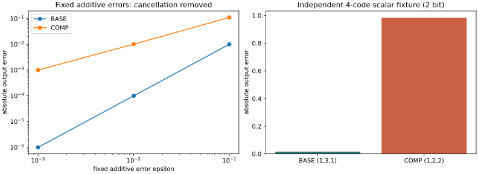

# Case014 — Quantization Compensation: Cancellation, Re-quantization, and Generalization

[한국어](REPORT.ko.md)

1. [Background](#s1)
2. [Questions](#s2)
3. [Theory and implementation contract](#s3)
4. [Method](#s4)
5. [Experiments](#s5)
6. [Results](#s6)
7. [Analysis](#s7)
8. [Conclusion](#s8)
9. [Reproduction and references](#s9)

## Background

A diagnostic tool for checking what survives after quantization compensation is saved again. It separates inherited error, existing cancellation and re-quantization on common inputs, with a controlled path toward held-out document quality evaluation.

## Questions

Q1: can correction disrupt beneficial cancellation? Q2: can actual re-quantization reverse the gain? Q3: does CAL selection transfer to new documents? P0 checks the possibility and diagnostic machinery; model evidence for Q2/Q3 requires P1.

## Theory and implementation contract

W[out,in], X/Z[in,tokens]. CAL only: G=ZZᵀ, λ=10⁻³trace(G)/d, (G+λI)Kᵀ=[W(X−Z)Zᵀ]ᵀ. δW=αK, W*=W+δW.

CPU FP64 Cholesky + triangular solves, full-input Gram, row chunks128. Quantizer input is FP32(W*). Reloaded FP32 What supplies algebra; BF16(What) supplies dense quality execution. Bias remains unchanged.

A=W(X−Z), C=δWZ, B=(What−W*)Z, B₀=(What₀−W)Z, R=A−C−B, R₀=A−B₀.

Δ=||R||²−||R₀||²=T_inherited+T_cancellation+T_requant.

T_inherited=||C||²−2⟨A,C⟩; T_cancellation=2⟨B₀,C⟩; T_cont=||C||²−2⟨R₀,C⟩; T_requant=||ΔB||²−2⟨R₀−C,ΔB⟩.

T_cont holds B₀ fixed: a counterfactual, not a measured continuous model. Actual BF16 arithmetic residual and weight-cast residual are separate. Ridge H is not generally a projector. Evaluation never refits K, scale or codes.

## Method

The encoder uses signed INT4[-8,7], input group64, output-row FP32 absmax/7 scales and ties-to-even rounding. Only true zero groups get unit scales; nonzero underflow is rejected. A36-byte header precedes4-byte row/group scales and half-byte low-nibble-first codes, including padding.

Planned core payload is1,179,684bytes for o_proj and1,769,508bytes for down_proj. These are shape calculations, not measured model artifacts. Equal-shape strengths have equal core bytes.

## Experiments

P0 ran both rational error signs, exhaustive four-code losses, NumPy/Torch FP64 identities, codec boundaries/fresh-process reload, ridge/non-projector and leakage checks. Dither covers depths 2/8/16, steps 0.01/0.1 and strengths 0/0.5/1, with 2,000 seeds per cell.

P1 preparation verified the existing revision, six weight shapes and PG19 CAL32/DEV16/EVAL32 plus Pile ArXiv SHIFT16 and one smoke input. Pile uses content groups without original article IDs. Prior use outside the bounded audit and pretraining exposure are unknown. Model forwards:0; all 30 required cells remain unrun.

## Results

**Completed:** exact rational examples, INT4 save/fresh-process reload, independent NumPy/Torch FP64 checks and 2,000-seed dither controls per cell. Fifteen unique CPU tests pass.

**P1 not run:** the six-target/five-strength runner and document splits are prepared. The required D-original location is unconfirmed. There is no measured LLM improvement, regression or transfer result yet.

For fixed errors with ε=0.01, absolute error changes from 0.0001 to 0.0101 after compensation: removing one error disrupts existing cancellation. With the other sign, error improves from 0.0201 to 0.0101.

The independent four-code example gives teacher 3.016, BASE 3 and COMP 4: error 0.016→0.984. Final-layer inputs differ (3 versus2). This is a two-bit scalar illustration, not a frequency estimate for INT4 language models.

|Depth|Step|alpha|Mean SSE|Paired Δ vs0|SE|95% MC interval|
|---:|---:|---:|---:|---:|---:|---|
|2|0.01|0|0.0041733059|0|0|[0, 0]|
|2|0.01|0.5|0.0026607099|-0.0015125961|2.9735e-05|[-0.00157088, -0.00145432]|
|2|0.01|1|0.0020843085|-0.0020889974|3.2047e-05|[-0.00215181, -0.00202619]|
|8|0.01|0|0.017054555|0|0|[0, 0]|
|8|0.01|0.5|0.0028151943|-0.014239361|0.00014652|[-0.0145265, -0.0139522]|
|8|0.01|1|0.0021202522|-0.014934303|0.00014596|[-0.0152204, -0.0146482]|
|16|0.01|0|0.033926054|0|0|[0, 0]|
|16|0.01|0.5|0.0028265192|-0.031099535|0.00029548|[-0.0316787, -0.0305204]|
|16|0.01|1|0.0021048641|-0.03182119|0.00029528|[-0.0323999, -0.0312424]|
|2|0.1|0|0.41820752|0|0|[0, 0]|
|2|0.1|0.5|0.26557389|-0.15263364|0.0030126|[-0.158538, -0.146729]|
|2|0.1|1|0.21140704|-0.20680048|0.0032177|[-0.213107, -0.200494]|
|8|0.1|0|1.7273954|0|0|[0, 0]|
|8|0.1|0.5|0.28456538|-1.44283|0.015438|[-1.47309, -1.41257]|
|8|0.1|1|0.21303847|-1.5143569|0.015393|[-1.54453, -1.48419]|
|16|0.1|0|3.4784585|0|0|[0, 0]|
|16|0.1|0.5|0.28332275|-3.1951357|0.032556|[-3.25895, -3.13133]|
|16|0.1|1|0.21112725|-3.2673312|0.032548|[-3.33113, -3.20354]|

## Analysis

Every nonzero-strength dither cell had lower paired mean SSE than alpha0. This is an observation for a small linear network with fixed-step, conditionally unbiased noise. MC intervals describe independent noise seeds on one fixed input, not document generalization or finite-INT4 LLM quality.

The three-term expansion quantifies correction, existing cancellation and re-quantization on common inputs; it does not establish a unique network cause. CAL continuous residual contraction does not ensure held-out or suffix-NLL gains. A/B/C/D event counts and CAL→EVAL rankings are currently unmeasured.

## Conclusion

P0 implementation passes. Exact negative examples and a positive noise control coexist. P1 model phenomena, P2 quality signals, practical utility and packed speed remain separate, unestablished claims.

P1 is blocked specifically by model-storage identity: the existing WSL snapshot and small-file hashes are verified, but its D-original location is not established. Confirming cache use or providing the D location resolves that gate.

## Reproduction and references

See [commands](REPRODUCE.md), [input manifest](provenance/input_manifest.json), [source audit](references/source_audit.json) and [decision](results/local_r1/decision.json). Scalar audit cannot re-evaluate unavailable private weights, activations or logits.

Theory reference: [Guo2026 v1](https://arxiv.org/html/2610.16020v1). The user-supplied independent codebook numbers and this ridge/RTN implementation are distinct from official full QEP reproduction. HALF and calibration transfer were already studied by the author. Source/license identities are recorded separately.

Original cases/common code/environments are preserved. Codex assisted implementation, documentation and automated checks; no independent human review is claimed.

