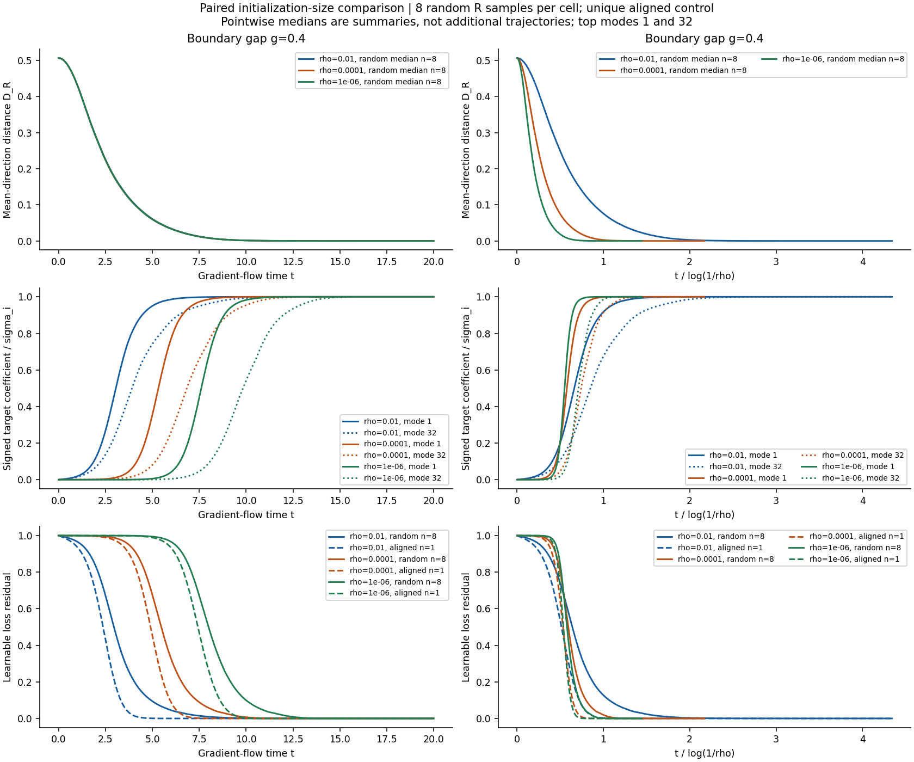

# Case019 — 손실은 그대로인데 학습은 진행될까?

두 층 선형망의 방향·크기 시간 분리 재현과 방향 개입 CPU 실험

손실이 거의 변하지 않는 동안에도 모형 내부의 방향은 목표에 가까워질 수 있습니다. 두 층 선형망을 CPU로 독립 구현해 이 현상을 재현하고, 학습 중 예측 크기를 보존한 채 방향을 바꾸어 이후 손실 경로가 어떻게 달라지는지 확인했습니다.

실험은 whitened 두 층 선형망의 FP64 gradient flow를 유한 차원에서 푼 것입니다. 방향은 목표 matrix의 singular subspace와의 관계, 크기는 주로 예측 Z=UVᵀ의 singular value, 손실은 목표와의 제곱 오차입니다.

1. 작은 초기화에서는 평균 정렬과 손실 변화 시점이 갈라졌습니다. 큰 초기화에서는 손실 변화가 먼저였습니다.
2. 좁은 경계에서는 평균에 작게 드러나는 느린 방향이 오래 남았습니다. R2의 긴 지연과 재하강을 별도 계산으로 확인했습니다.
3. 같은 예측 크기에서도 방향 개입 뒤 경로가 달라졌습니다. 초기 이득이 나중에 줄거나, 교란 뒤 손실 순서가 뒤집히는 조건도 있었습니다.

처음부터 목표 방향에 놓은 aligned 대조군에서도 작은 크기가 자라는 지연이 남았습니다. 방향 정렬과 크기 성장은 따로 관측했습니다.



이 그림은 저자 그림을 복사한 것이 아니라 자체 유한 차원 설정의 저장자료로 만든 그림입니다. 곡선의 pointwise median과 개별 궤적에서 먼저 구한 사건 시각 통계는 구분합니다.

직접 구현: ODE·초기화·rank-aware 방향/크기 지표, oracle/회전 대조군, checkpoint 분기, J/G/A 분석, 별도 수치 경로와 기록 재생 도구. NumPy가 선형대수를, SciPy가 적응형 수치 적분을, Matplotlib이 그림을 처리합니다.

빠른 검산은 아래 고정 CPU 환경에서 공개 소스와 명시된 작은 raw slice를 사용합니다. 전체 기록 검산에는 별도 evidence가 필요합니다.

```sh
python3 -I -B cases/019-silent-alignment-dynamics/publication/run_checks.py --output /tmp/case019-quick-new --mode quick --tests
```

[결과와 방법](REPORT.ko.md) · [환경·quick/full 재현](REPRODUCE.ko.md) · [Source map](SOURCE_MAP.md) · [Paper v1](https://arxiv.org/abs/2610.29864v1)

[CPU 재현·전체 evidence](REPRODUCE.ko.md)에서 quick/full 범위와 전용 Release의 bytes·SHA256을 확인할 수 있습니다. [P3 로컬 준비 이력](publication/history/P3_LOCAL_PREPARATION.md)은 당시 기록으로 보존했습니다.
