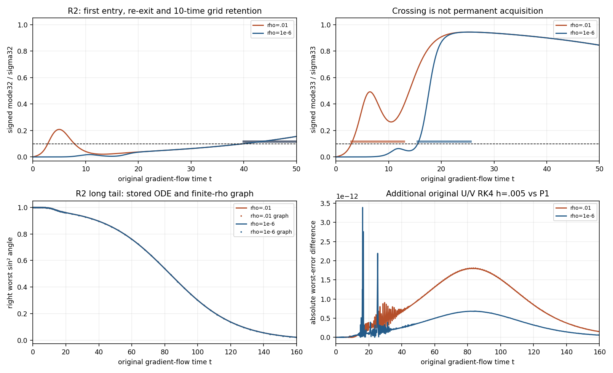
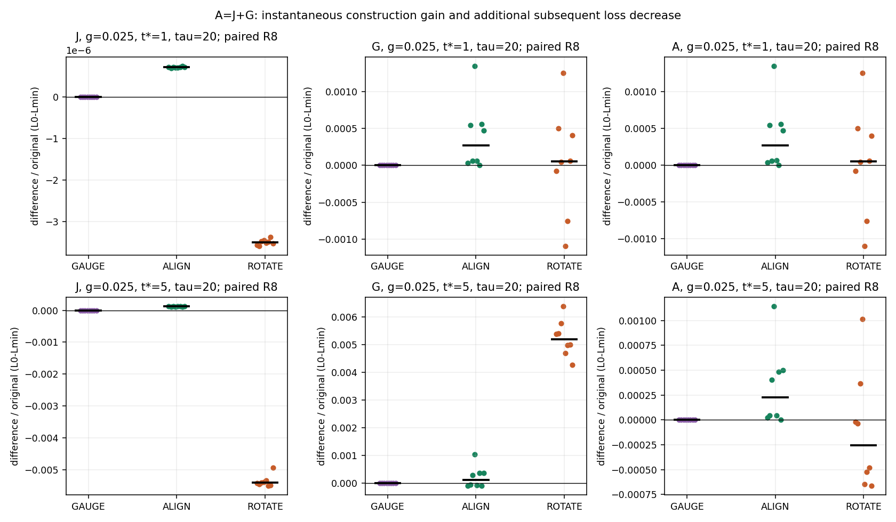

# Case019 — Learning Before the Loss Moves

A CPU reproduction of alignment–amplitude time separation with checkpoint interventions

A model’s learned directions can approach a target while its loss barely moves. We independently implemented a two-layer linear network on CPU, reproduced this time separation, and changed directions at saved checkpoints while preserving prediction size to observe subsequent loss paths.

These are finite-dimensional FP64 gradient-flow experiments on a whitened two-layer linear network. Direction means relation to the target matrix’s singular subspaces; size mainly means singular values of Z=UVᵀ; loss is squared matrix error.

1. Smaller initialization separated mean-alignment and visible-loss times. With larger initialization, the loss moved first.
2. A narrow boundary left a slow direction that the average partly hid. Separate calculations confirmed R2’s long tail and mode re-exit.
3. Directions changed subsequent paths at the same prediction size. Some early gains shrank, and some perturbed paths later overtook the original.

The aligned control starts in the target directions and still shows an amplitude-growth delay at small initialization. Alignment and size growth are measured separately.

## When did the two times separate?

| g | rho | T_align_half median | T_visible10 median | S median | R |
| --- | --- | --- | --- | --- | --- |
| 0.4 | 0.01 | 2.260022 | 1.642175 | -0.622727 | 8/8 |
| 0.4 | 0.0001 | 2.247329 | 4.158588 | 1.908582 | 8/8 |
| 0.4 | 1e-06 | 2.247202 | 6.622546 | 4.373821 | 8/8 |
| 0.1 | 0.01 | 2.297640 | 1.641471 | -0.661481 | 8/8 |
| 0.1 | 0.0001 | 2.284612 | 4.158919 | 1.873717 | 8/8 |
| 0.1 | 1e-06 | 2.284482 | 6.621101 | 4.338883 | 8/8 |
| 0.025 | 0.01 | 2.307623 | 1.640637 | -0.672651 | 8/8 |
| 0.025 | 0.0001 | 2.294509 | 4.158098 | 1.862787 | 8/8 |
| 0.025 | 1e-06 | 2.294378 | 6.620116 | 4.327983 | 8/8 |

Times use gradient-flow units. T_align_half is the first halving of right mean directional error; T_visible10 is the first10% decrease of learnable loss above the rank-constrained floor. Halving does not mean complete alignment. rho parameterizes U₀=0,V₀=√(2rho)R; it is not the amplitude itself. The same eight R starts are paired across rho/g.

## A slow direction hidden by the average

At g=.025,rho=1e-6,R2, worst-half occurred at83.061701, within the saved83.0–83.2 bracket. A finite-rho graph on137862 original saved times and four additional original U/V RK4 paths corroborated the tail and nonmonotonicity. At rho=.01, mode32 crossed.1 at2.815288, exited at7.859546 and entered again at39.969691. The first saved-grid retention interval of10 gradient-flow units was39.969691–49.969691. Original first crossing and posthoc persistence remain separate.

The boundary-pair design changes only target singular values32/33 to.6±g/2. The other62 values and bases stay fixed, while boundary amplitudes, target norm and optimum loss L_min also change. Each target uses its actual loss floor.

## Changing direction at fixed prediction size

Sixteen original P1 paths provide checkpoints at t*=1/5, giving32 parents and128 continuations. CONTINUE restarts unchanged with a new solver. GAUGE jointly rotates hidden coordinates: Z and physical subspaces are unchanged, while Grams undergo orthogonal conjugacy. ALIGN places current singular values on oracle target top pairs. ROTATE changes ambient directions with the target fixed. ALIGN/ROTATE preserve both actual Grams and prediction singular values.

ALIGN’s instantaneous loss bound follows from its target-SVD construction. Subsequent paths were integrated anew. Starting loss and gradients are not matched. One rotation triple and the same R8/target/parents are shared.

J is the immediate difference, G the subsequent difference in cumulative loss decrease versus CONTINUE, and A=J+G the total difference at that time. All use the parent’s original D=L_orig0−L_min. The table reports means after computing each R’s paired difference at tau5.

| g | t* | arm | mean J/D | mean G/D | mean A/D |
| --- | --- | --- | --- | --- | --- |
| 0.4 | 1 | ALIGN | 7.0715178e-07 | 0.017319575 | 0.017320282 |
| 0.4 | 1 | ROTATE | -3.4774016e-06 | -0.021678511 | -0.021681988 |
| 0.4 | 5 | ALIGN | 0.00011944011 | 0.0030392404 | 0.0031586805 |
| 0.4 | 5 | ROTATE | -0.0053405449 | -0.19634004 | -0.20168059 |
| 0.025 | 1 | ALIGN | 7.1230319e-07 | 0.017424919 | 0.017425631 |
| 0.025 | 1 | ROTATE | -3.4937498e-06 | -0.021810957 | -0.02181445 |
| 0.025 | 5 | ALIGN | 0.00011943048 | 0.0064885595 | 0.00660799 |
| 0.025 | 5 | ROTATE | -0.0053611267 | -0.19549883 | -0.20085995 |

For ALIGN at g=.025,t*=5, mean A/D is about0.6608% of the original learnable loss. It is not a learning-speed improvement rate. Early benefits include subsequent decrease G; at g=.4 the long-term difference shrank to roundoff, while finite-horizon differences remained at g=.025. Starting closer to the floor can leave less loss to reduce and make G negative.

ROTATE had higher loss for all32 parents at tau5. At g=.025,t*=1,tau20, however, five had lower loss and three higher; at t*=5, two had lower and six higher. A path difference is distinct from an improved final optimum or an average over independent perturbation rotations.

## Methods, implementation and units

P0 contains17 pilots: six scalar, nine small matrix and two64-dimensional paths. P1 has72 random and nine unique aligned paths; aligned controls are not duplicated eight times. P2 branches reuse16 paths/32 parents from the same eight R starts. Numerical integration counts are not pooled as independent datasets. Crossings are computed per trajectory from linear interpolation within saved brackets; non-reached values stay null/NOT_REACHED. Sorted prediction singular values differ from signed mode coefficients lᵢᵀZrᵢ.

The paper reproduction covers gradient flow, structured initialization and numerical finite-dimensional alignment/amplitude separation. Boundary-pair controls, worst-angle diagnostics and checkpoint interventions are local controlled experiments. The paper’s small-rho, late-time and high-dimensional limits differ from the finite64-dimensional experiment. Measurements concern training error to a fixed matrix, not task accuracy or generalization risk.

Original records and phase sources are retained byte-exactly in separate evidence. Quick checks cover a small slice; full recorded checks use source plus explicit evidence. Unsaved full factor paths are not reconstructed; GAUGE/CONTINUE replay checks retained error series and checkpoints. Original P0 failure, P1 launcher error and P2 posthoc selection/helper timing remain historical evidence.

[Reproduction](REPRODUCE.md) · [Source map](SOURCE_MAP.md) · [Reuse](REUSE_MAP.md) · [Distribution](publication/distribution.json) · [Facts](publication/facts.json)
