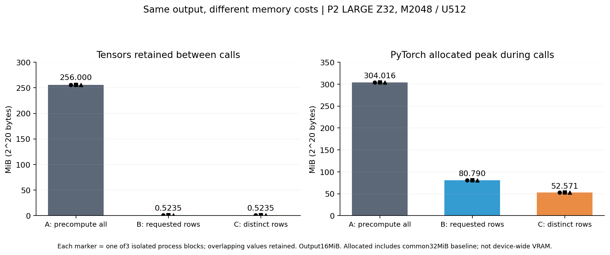

# Case020 — 임베딩을 작게 보관하면 실행도 빨라질까?

[English](README.md) · [상세 보고서](REPORT.ko.md) · [CPU 검산](REPRODUCE.ko.md)

AI 모델은 토큰마다 각 층에서 쓸 추가 숫자 벡터를 보관하기도 합니다. 토큰은 모델이 처리하는 글의 작은 단위이고, 임베딩은 토큰을 나타내는 숫자 벡터입니다. 이 실험에서는 그 벡터를 전부 미리 계산해 둘지, 필요한 번호만 받을 때 계산할지 비교했습니다.

실제 LLM을 불러오는 대신, **공식 OPTIC 복원 코드와 합성 임베딩 표**를 사용했습니다. RTX 5080에서 같은 압축 표현과 같은 번호를 세 방법에 넣고, 모든 층의 같은 크기 출력을 확인했습니다. A도 같은 압축 표현에서 계산한 표이므로 원래 미압축 임베딩과 같다는 뜻은 아닙니다.

| 방법 | 하는 일 | 호출 사이에 남는 것 |
|---|---|---|
| A · 전체를 미리 계산 | 같은 압축 표현의 모든 항목을 계산한 뒤 번호로 조회 | 큰 재구성 표 |
| B · 요청한 항목만 계산 | 공식 복원 코드로 요청한 M개를 계산 | 작은 코드·사전·복원 계산 값 |
| C · 중복 항목은 한 번만 계산한 뒤 원래 순서로 복구 | 매번 중복을 찾고 U개 계산 후 M개로 되돌림 | B와 같은 작은 자료 |

**메모리는 줄었지만, 작은 자료가 더 싼 호출을 보장하지는 않았습니다.**

- **메모리:** LARGE/Z32/M2048/U512에서 A의 약304MiB가 B의 약81MiB로 줄었습니다. 약73% 감소한 대상은 **PyTorch tensor 등의 allocated peak**이며, GPU 전체 메모리 사용량은 아닙니다.
- **한 번의 호출:** 방법을 같은 process에 함께 두고 순서를 바꿔 비교한 P4의7조건·30개 process block에서 C가 B보다 빠른 block은 **0/30**이었습니다. block은 같은 실험을 새 process로 반복한 단위이지 독립 사용자 작업이 아닙니다.
- **오래 재사용:** 준비부터 실제 N회 호출과 정리까지 잰 세션에서 N1024·4096은 A가 B보다 세 block 모두 빨랐습니다. N128의 세션은 A/B 우열이 섞였습니다. Python 시작·공통 CUDA 초기화·종료까지 포함한 전체 process는 N128에서 B가3/3 빨랐지만 중앙값 차이는 약17ms였습니다.

왼쪽은 호출 사이에도 GPU에 남는 숫자 배열인 **상주 tensor**, 오른쪽은 호출 중 PyTorch가 기록한 할당 최대값입니다. 검은 점은 세 process block입니다. 같은 값은 겹칩니다. C는 이 조건에서 B보다 임시 할당 최대값이 작았지만 호출 시간까지 짧아지지는 않았습니다. 재사용하려고 확보한 메모리인 reserved는 별도 보고합니다.

## 실제 호출은 얼마나 걸렸을까?

아래는 각 block의 host 중앙값을 먼저 구한 뒤, 그 중앙값들을 다시 요약한 값입니다. 단위는 µs(백만분의1초)입니다. 같은 process에서 A/B/C 호출 순서를 바꿨고, 호출 완료를 기다리는 시간도 포함했습니다.

| Z / M / U | A | B | C |
|---|---|---|---|
| 32/1/1 | 26.50 | 98.25 | 230.02 |
| 32/2048/512 | 40.23 | 151.52 | 264.42 |
| 644/2048/512 | 54.04 | 330.87 | 431.95 |

앞의 두 조건은6 block, 마지막은3 block이며, 각 block 안에서 방법별120회를 측정했습니다. p95와 모든 block 원점·범위는 [직접 시간표](summary/representative_direct_summary.csv)와 [보고서](REPORT.ko.md)에 있습니다. 짝지은 C/B 비율의 중앙값은 이 표의 C 중앙값을 B 중앙값으로 나눈 값과 다를 수 있습니다.

## 언제 어느 방법을 생각할까?

**GPU에 큰 표를 계속 두기 어렵다면 B**가 단순한 선택입니다. 작은 자료로 요청한 항목을 복원하되 매 호출 계산 비용을 지불합니다. **같은 표를 충분히 오래 재사용한다면 A**의 초기 준비 비용을 나눠 부담할 수 있습니다. 이번 실제 세션은128과1024 사이에서 중앙값 순서가 바뀌었지만 정확한 운영 교차 횟수를 추정하지 않았습니다.

**C는 메모리와 총시간을 함께 확인해야 합니다.** 중복 덕분에 복원 행 수가 줄어도 중복 찾기·순서 복구가 추가됩니다. 중간 벡터 폭 Z를32에서644로 키운 반복 입력에서도 C/B 주 비율의 중앙값은1.142로, C가 빨라지지는 않았습니다. 기존 상주 tensor 약489배 차이는 Z32에 한정되며 Z644에서는 약24.65배였습니다.

직접 구현한 부분은 합성 입력, 비교 wrapper, 시간·메모리 계측, 독립 NumPy 검산과 공개용 재현 도구입니다. OPTIC 복원 코드와 Torch의 행렬곱·메모리 관리 기능을 재사용했습니다. Codex가 구현·분석·문서화를 보조했습니다. [기여 구분](REUSE_MAP.md)에서 코드로 이어집니다.

## 실행과 원자료

GPU나 모델 없이 [clone → 새 CPU 환경 → quick/full 검산](REPRODUCE.ko.md)을 실행할 수 있습니다. 원본 source·입력·두 P2 run·P4 raw·과거 문서는 [원형 보관본](publication/originals/pre-publication/README.ko.md)과 [대응표](publication/preservation_map.json)에 남겼습니다. 이번 공개 작업의 새 GPU 실행은0회입니다.

[한영 보고서와 검증 범위](REPORT.ko.md) · [새 요약 CSV](summary/) · [그림4종](figures/) · [원 연구 이력](publication/HISTORY.md) · [출처](SOURCE_MAP.md)
