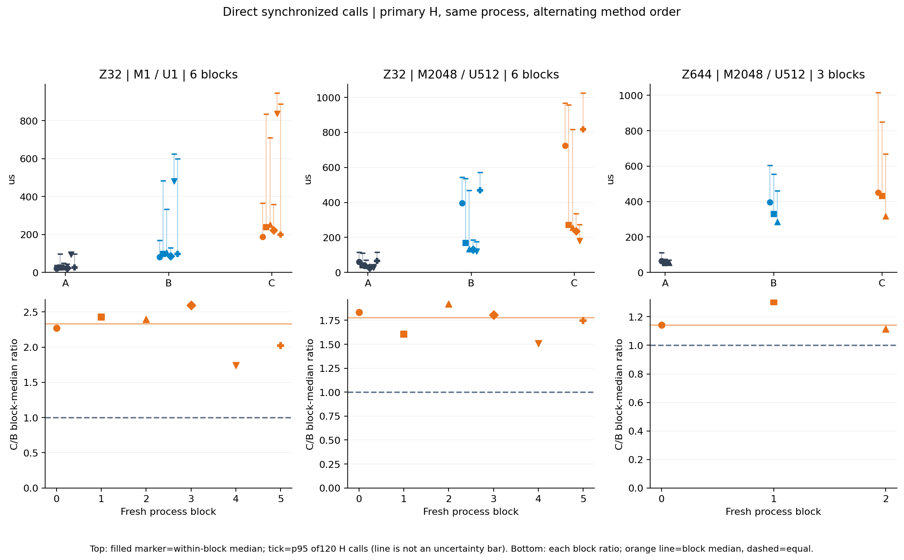
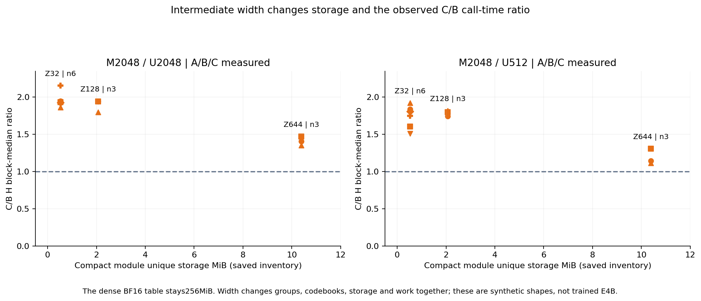
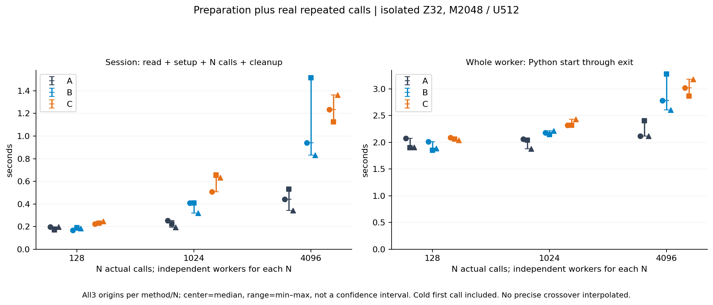

# Case020 — Comparing compact embedding storage with its execution costs

[한국어](REPORT.ko.md) · [Overview](README.md) · [CPU reproduction](REPRODUCE.md)

## 1. Question and observations

Does smaller embedding storage also run faster? B retained much less state and had a smaller allocation peak than A. But C beat B in 0/30 primary P4 H process-block comparisons. When setup and actual calls were measured together, A/B session ordering was mixed at N128; A won all blocks at N1024 and 4096. The historical operator runtime was RTX5080/sm_120, Python3.12.14, Torch2.13.0+cu130, CUDA13.0, driver621.01. Publication reanalyzes saved records on CPU.

## 2. Methods and shared output contract

| Method | What happens | Kept between calls |
|---|---|---|
| A · Precompute all | Reconstruct the same compressed representation once, then look up rows | A large reconstructed table |
| B · Compute requested rows | Call the official decoder for all M requested rows | Small codes, codebooks and decoder values |
| C · Compute distinct rows, then restore order | Find duplicates on every call, decode U rows and return M rows | The same compact state as B |

M is the number of requested IDs; U is their actual distinct count. All methods use identical artifacts/IDs/device, BF16 output, all layers and raw unscaled order. `[M,L*H]` is interpreted as `[M,L,H]`. A reconstructs the whole table using the official decoder in fixed256-row chunks and removes its build decoder before steady lookup. B directly calls the unchanged pinned forward. C recomputes `torch.unique(sorted=True,return_inverse=True)`, decodes U rows and inverse-gathers M output rows on every call. No precomputed unique results or cross-call caching.

S appears only at Z32/M2048/U2048: sort IDs, decode M rows and restore their order. It does not reduce reconstructed rows and is not a dedup optimization. S/B1.763 and C/S1.133 are separate medians of paired block ratios, not ratios obtained by dividing other medians. Different sorting/allocation/operator paths prevent interpreting C−S as unique's pure causal cost.

## 3. P2 method-isolated memory

The following LARGE/Z32/M2048/U512 values matched across all three original blocks. MiB=2^20 bytes. These are original isolated-method workers, not P4's shared latency-worker memory.

| method | NPZ bytes | resident B | allocated peak MiB | reserved peak MiB | baseline-subtracted peak MiB* |
|---|---|---|---|---|---|
| B | 550998 | 548928 | 80.790 | 82.000 | 48.790 |
| A | 550998 | 268435456 | 304.016 | 338.000 | 272.016 |
| C | 550998 | 548928 | 52.571 | 102.000 | 20.571 |

*The final column subtracts the common 32 MiB baseline from total peak; it is derived accounting, not new measurement or device VRAM.* The common NPZ is 550998 bytes. The489.02-fold resident-module ratio and about 73.4% A→B allocated-peak reduction describe different quantities. Output16 MiB, IDs16 KiB, FP32 intermediates and library/allocator memory matter. C's allocated peak was about 34.9% below B, while reserved increased82→102 MiB. Reserved includes memory held for reuse.

## 4. P4 direct A/B/C calls and separate clocks

Primary H keeps A and one B/C-shared compact module in one process, alternating method order. After a pre-call synchronize, host timing covers fn and completion synchronize. Each method has 120 rounds; core has 6 blocks and each new-width input 3. The table summarizes the median and range of within-block medians and p95s. Inner calls are not independent models or tasks.

| Z / M / U | method | blocks | host median* µs [block range] | host p95* µs [block range] |
|---|---|---|---|---|
| 32/1/1 | A | 6 | 26.50 [21.43, 95.95] | 72.74 [37.56, 103.64] |
| 32/1/1 | B | 6 | 98.25 [82.27, 480.79] | 408.44 [130.23, 624.36] |
| 32/1/1 | C | 6 | 230.02 [187.00, 837.36] | 773.21 [359.71, 945.78] |
| 32/2048/512 | A | 6 | 40.23 [27.04, 66.13] | 90.82 [43.91, 116.19] |
| 32/2048/512 | B | 6 | 151.52 [119.79, 468.28] | 503.02 [176.25, 571.07] |
| 32/2048/512 | C | 6 | 264.42 [181.06, 817.64] | 886.94 [274.65, 1025.40] |
| 644/2048/512 | A | 3 | 54.04 [53.23, 65.53] | 75.47 [71.17, 113.12] |
| 644/2048/512 | B | 3 | 330.87 [284.31, 395.95] | 555.54 [460.30, 605.68] |
| 644/2048/512 | C | 3 | 431.95 [316.99, 452.08] | 850.13 [669.42, 1014.48] |

*Starred columns take the median of block statistics; p95 ranges are not confidence intervals.* [Every direct block](summary/representative_direct_block.csv) and [paired B/A, C/B and absolute differences](summary/P4_paired_H.csv) remain available. B's direct time is never reverse-engineered from a ratio/difference median.

| Z | input | blocks | C/B* | range | C−B* µs | C faster |
|---|---|---|---|---|---|---|
| 32 | m1 | 6 | 2.333 | 1.742–2.595 | +138.17 | 0/6 |
| 32 | repeat2048 | 6 | 1.777 | 1.511–1.920 | +114.27 | 0/6 |
| 32 | unique2048 | 6 | 1.936 | 1.864–2.155 | +140.92 | 0/6 |
| 128 | repeat2048 | 3 | 1.800 | 1.745–1.817 | +119.73 | 0/3 |
| 128 | unique2048 | 3 | 1.942 | 1.799–1.943 | +265.92 | 0/3 |
| 644 | repeat2048 | 3 | 1.142 | 1.115–1.306 | +56.13 | 0/3 |
| 644 | unique2048 | 3 | 1.409 | 1.350–1.470 | +130.53 | 0/3 |

Starred ratios/differences are formed within each block before taking medians. They differ from dividing marginal method medians. C won0/30 H blocks. None met the fixed descriptive benefit rule (median ratio<=.90 and core>=5/6 wins or width3/3). This is not an implementation-failure gate or significance test. Slow samples were retained.

The representative B/A and C/B comparisons below also start from direct times inside each block. All origins and differences remain in CSV.

| Z / M / U | comparison | blocks | paired median ratio | block range | paired median difference µs |
|---|---|---|---|---|---|
| 32/1/1 | B/A | 6 | 3.708 | 3.456–5.011 | +71.75 |
| 32/1/1 | C/B | 6 | 2.333 | 1.742–2.595 | +138.17 |
| 32/2048/512 | B/A | 6 | 4.454 | 3.439–7.081 | +114.35 |
| 32/2048/512 | C/B | 6 | 1.777 | 1.511–1.920 | +114.27 |
| 644/2048/512 | B/A | 3 | 6.042 | 5.261–6.215 | +277.64 |
| 644/2048/512 | C/B | 3 | 1.142 | 1.115–1.306 | +56.13 |

D records two clocks on the same call, but its host interval includes two event records and a wait. E uses common K16 stream elapsed/16 for every method/input/width. Launch gaps and C's internal waits are not subtracted; this is not a sum of pure kernel durations. D/E are separate passes and do not replace H. [All clock statistics](summary/all_P4_clock_statistics.csv) separate mean/median/p95/min/IQR. E's p95 of bracket averages is not single-request tail p95.

## 5. Intermediate width and observed storage

Z is the intermediate vector width used by reconstruction. V32768/L16/H256/K256/group_width4 stay fixed; groups become Z/4. The observed column sums unique underlying storage from actual saved module-buffer inventories, excluding A's table and common IDs, after dtype/shape/alias checks. NPZ arrays are read with `allow_pickle=False`. Theory was not copied into an observed column.

| Z | groups | NPZ bytes | array payload B | observed unique module B | theory B | inventory count | MiB | dense / module |
|---|---|---|---|---|---|---|---|---|
| 32 | 8 | 550998 | 548864 | 548928 | 548928 | 18 | 0.5235 | 489.02 |
| 128 | 32 | 2173022 | 2170880 | 2171136 | 2171136 | 6 | 2.0706 | 123.64 |
| 644 | 161 | 10891362 | 10889216 | 10890504 | 10890504 | 6 | 10.3860 | 24.65 |

Theory is `V*G + 2*K*Z + 2*L*H*Z + 2*L*H + 8*G`. The final term includes non-persistent group_offsets, which still uses GPU memory. Saved inventories18/6/6 per width agree. A's dense table is 256 MiB. The489-fold Z32 ratio does not apply to Z644 or a trained model. Z644/U512 narrowed C/B to 1.142, but C remained slower in 3/3 blocks. Width changes groups, codebook, storage and work together, rather than isolating one causal factor. Z644 matches only E4B's latent width, not its full shape or quality.

## 6. Cold calls and real cumulative sessions

The input is Z32/M2048/U512. A/B/C×N128/1024/4096×3 blocks gives27 fresh processes. There is no warm-up; the first cold call is part of N. Setup includes artifact read/transfer, IDs read/H2D and A's full-table build/compact cleanup. Session runs from before artifact reading through N synchronized calls and final owned-tensor cleanup. Whole-worker wall is parent-observed Python spawn through exit, including common CUDA initialization and result writing. Session is inside worker wall; first call is inside loop, never added twice.

| N | method | session median s [range] | whole worker median s [range] |
|---|---|---|---|
| 128 | A | 0.196438 [0.169624, 0.196851] | 1.904284 [1.898246, 2.072030] |
| 128 | B | 0.185433 [0.168025, 0.190640] | 1.887632 [1.854379, 2.009308] |
| 128 | C | 0.229143 [0.224380, 0.245484] | 2.058524 [2.039747, 2.086732] |
| 1024 | A | 0.223652 [0.195350, 0.252050] | 2.041846 [1.878002, 2.060568] |
| 1024 | B | 0.410242 [0.318430, 0.410329] | 2.180281 [2.144023, 2.216770] |
| 1024 | C | 0.632942 [0.507840, 0.655918] | 2.321995 [2.318672, 2.431254] |
| 4096 | A | 0.442087 [0.342683, 0.530962] | 2.118920 [2.117734, 2.402362] |
| 4096 | B | 0.941224 [0.832234, 1.514844] | 2.781958 [2.605198, 3.278795] |
| 4096 | C | 1.234773 [1.125446, 1.362115] | 3.017688 [2.867949, 3.179739] |

Each entry is a median/range of three blocks for that method. At N4096, A was53.0% cheaper than B by session medians and 23.8% by whole-worker medians. These compare marginal method medians, not median paired-block reductions. N128 sessions favored B in 2/3 blocks; whole workers favored B in 3/3 with only about 17 ms median difference. N1024/4096 sessions favored A in 3/3. C's session median was higher than B at every N, but one N4096 block had C<B.

First calls were about 92–119 ms for B,122–164 ms for C, and 1.2–2.1 ms for A's first gather after decoder execution during table setup. No unprofiled cause is assigned to cold-call overhead. OS caches may be warm. The earlier setup+N×warm-median scenario remains historical at about 920–2319 calls. New median ordering changes between tested128 and 1024; no exact operational crossover is interpolated. Session/N is an amortized mean, not per-call p95.

### All27 actual lifecycle origins

| N | method | block | setup s | first call ms* | loop s | cleanup s | session s | whole worker s |
|---|---|---|---|---|---|---|---|---|
| 128 | A | 0 | 0.172204 | 1.382 | 0.006935 | 0.017712 | 0.196851 | 2.072030 |
| 128 | A | 1 | 0.145470 | 1.269 | 0.009035 | 0.015118 | 0.169624 | 1.898246 |
| 128 | A | 2 | 0.172367 | 1.230 | 0.008422 | 0.015649 | 0.196438 | 1.904284 |
| 128 | B | 0 | 0.007671 | 114.576 | 0.131618 | 0.028736 | 0.168025 | 2.009308 |
| 128 | B | 1 | 0.007145 | 94.650 | 0.157005 | 0.026490 | 0.190640 | 1.854379 |
| 128 | B | 2 | 0.006620 | 91.668 | 0.150932 | 0.027881 | 0.185433 | 1.887632 |
| 128 | C | 0 | 0.006985 | 159.428 | 0.188944 | 0.028452 | 0.224380 | 2.086732 |
| 128 | C | 1 | 0.007767 | 164.234 | 0.194021 | 0.027356 | 0.229143 | 2.058524 |
| 128 | C | 2 | 0.007117 | 157.317 | 0.210479 | 0.027887 | 0.245484 | 2.039747 |
| 1024 | A | 0 | 0.177001 | 1.341 | 0.055451 | 0.019597 | 0.252050 | 2.060568 |
| 1024 | A | 1 | 0.159116 | 1.257 | 0.044071 | 0.020464 | 0.223652 | 2.041846 |
| 1024 | A | 2 | 0.134004 | 1.407 | 0.044340 | 0.017006 | 0.195350 | 1.878002 |
| 1024 | B | 0 | 0.006997 | 94.243 | 0.375753 | 0.027492 | 0.410242 | 2.180281 |
| 1024 | B | 1 | 0.007051 | 96.987 | 0.373124 | 0.030154 | 0.410329 | 2.144023 |
| 1024 | B | 2 | 0.007223 | 119.102 | 0.282036 | 0.029172 | 0.318430 | 2.216770 |
| 1024 | C | 0 | 0.007660 | 162.138 | 0.473359 | 0.026822 | 0.507840 | 2.318672 |
| 1024 | C | 1 | 0.006886 | 124.134 | 0.622151 | 0.026881 | 0.655918 | 2.321995 |
| 1024 | C | 2 | 0.006784 | 155.697 | 0.596419 | 0.029739 | 0.632942 | 2.431254 |
| 4096 | A | 0 | 0.148713 | 1.713 | 0.271678 | 0.021697 | 0.442087 | 2.117734 |
| 4096 | A | 1 | 0.189215 | 2.146 | 0.313820 | 0.027926 | 0.530962 | 2.402362 |
| 4096 | A | 2 | 0.145145 | 1.452 | 0.178727 | 0.018811 | 0.342683 | 2.118920 |
| 4096 | B | 0 | 0.006987 | 119.536 | 0.905788 | 0.028449 | 0.941224 | 2.781958 |
| 4096 | B | 1 | 0.007127 | 100.663 | 1.477490 | 0.030228 | 1.514844 | 3.278795 |
| 4096 | B | 2 | 0.007122 | 94.333 | 0.796052 | 0.029060 | 0.832234 | 2.605198 |
| 4096 | C | 0 | 0.006376 | 139.928 | 1.198612 | 0.029784 | 1.234773 | 3.017688 |
| 4096 | C | 1 | 0.006568 | 122.086 | 1.088481 | 0.030397 | 1.125446 | 2.867949 |
| 4096 | C | 2 | 0.006426 | 141.263 | 1.324288 | 0.031401 | 1.362115 | 3.179739 |

*First call is already included in loop.* [lifecycle_block.csv](summary/lifecycle_block.csv) contains detailed artifact/H2D/dense intervals, process CPU time and peak RSS. CPU/RSS are final-report samples before JSON/exit, not complete parent-side process accounting.

## 7. Where the common 32 MiB appeared

All90 historical final records had32 MiB allocated after common library initialization, before artifact/IDs. Warm−baseline−module−IDs left0–952 bytes. Separate historical after-load/output-release endpoints and allocation stacks were absent. New P4 A/B/C diagnostics show context0→small FP16 GEMM32 MiB→module/ID removal32 MiB. Remaining active-block stack frames include setWorkspaceForHandle/getCurrentCUDABlasHandle and the FP16 cuBLAS GEMM helper, identifying **Torch cuBLAS handle workspace in the new replay**. It is not a recovered historical allocation stack. See [stages](summary/memory_stages.csv) and [preserved P4 stack raw](publication/originals/pre-publication/followup/p4_speed_cost/results/p4-20261026-1451/memory_B.json).

## 8. Validation, denominators, history and reproduction

Final P2 has 10 inputs×3 methods×3 blocks=90 cell-blocks. The earlier90 with a verification-order deviation remain diagnostic. Historical C wins were host5/30, event mean4/30, intersection0/30; three host wins had U=M. Those results are retained rather than deleted or pooled into P4. P4 core3 inputs×6 blocks and width4 inputs×3 blocks yield30 C/B comparisons, not30 independent workloads. Timing30 workers/96 method-blocks, lifecycle27, preflight3+smoke1+memory3 sum to 64 new workers. GPU failures/retries/missing=0; profiling workers0.

Historical GPU-related worker wall is 196 workers457.424303870s plus64 workers265.775915436s, totaling 260 workers723.200219306s and 1076.799780694s left from 1800s. Publication adds no GPU execution. Worker wall is not GPU busy time. Tiny GEMM probes are already inside each worker and are not double-debited.

The publication calculator reads raw H/D/E, original P2 statistics, storage, lifecycle intervals and ledgers. Full mode restores the exact 747-file historical scope in a temporary external directory for the unchanged P2 auditor, invokes the unchanged P4 auditor in portable mode, and cross-checks an alternative NumPy statistics path. Frozen source is not edited. [Preservation mapping](publication/preservation_map.json) retains all original Case and referenced external analysis/handoff bytes. Historical NOT_RUN receipts remain historical; new verification receipts record current checks. See [quick/full reproduction](REPRODUCE.md), [reuse](REUSE_MAP.md) and [sources](SOURCE_MAP.md).

Scope is one RTX5080, identical synthetic IDs reused in warm-cache calls, unfixed CPU/GPU clocks and Linux/WSL memory attribution. LLM inference, trained-artifact quality, TTFT/TPOT, KV redistribution, server concurrency, electricity and cloud billing are unmeasured. Official codec/Torch GEMM/allocator and authored harness/audit are distinguished. Publication commits are new packaging; historical executions have separate source bundles. Native Windows was not validated.
