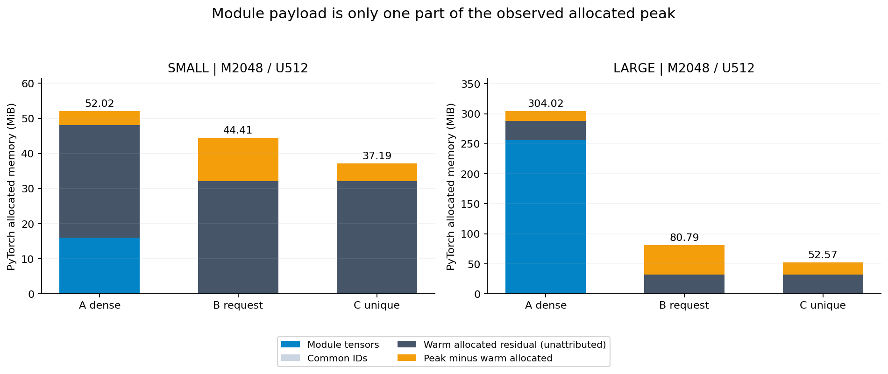
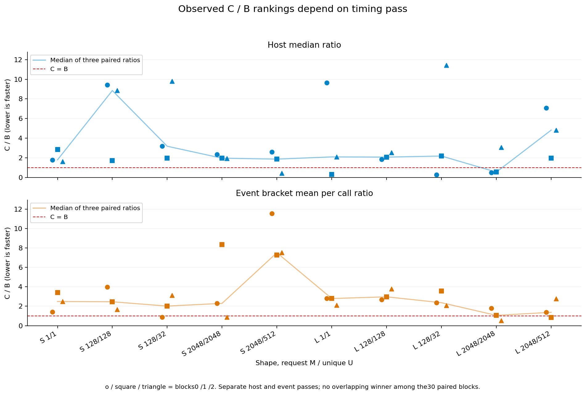
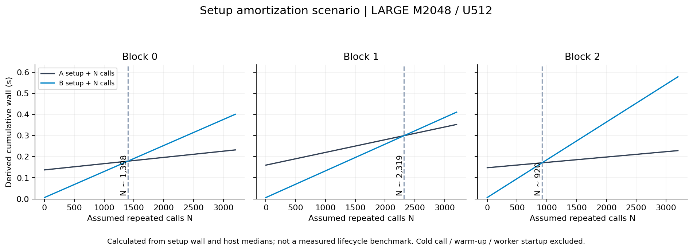

# OPTIC 압축 PLE 실행 비용 결과 분석

같은 압축 표현에서 복원 시점과 중복 처리가 메모리와 호출 비용에 미친 영향

작성일: 2026-10-26 KST | 측정 장치: RTX 5080, sm_120 | 분석 기준: 수정 본 run 20261026-1235

## 1. 핵심 결론

**필요한 임베딩만 복원하는 B는 메모리를 줄였지만, 이번 실험에서 중복 제거 C의 안정적인 속도 이득은 확인되지 않았다.** LARGE의 M2048/U512 조건에서 module 상주량은 256MiB에서 0.523MiB로 작아졌다. 그러나 출력과 임시 할당까지 포함한 allocated peak는 304.02MiB에서 80.79MiB로 감소했다. 따라서 약 489배의 payload 차이와 약 3.76배의 allocated peak 차이를 구분해야 한다.[S1, S2]

C가 B보다 빠른 host block은 30개 중 5개였다. 이 중 3개는 **U=M, 즉 요청에 중복이 없는 경우**였다. host와 event 계측에서 C가 동시에 빨랐던 동일 짝은 0개였다. 이 관측은 일부 빠른 실행을 중복 제거의 계산량 절감으로 곧바로 설명하기 어렵다는 뜻이다. 현 상태의 판정은 실행 경로·수치·메모리 효과 검증, 그리고 **중복 제거 속도 이득의 미확정**이다.[S1, S3]

30개 cell을 3개 process block으로 반복한 본 90 cell-block은 모두 수치 gate를 통과했고 worker 실패·누락은 없었다. 아래 분석은 이미 보존된 raw를 CPU에서 재계산한 것이며 새로운 GPU 실험은 하지 않았다.[S4, S5]

## 2. 비교 대상과 결과를 읽는 범위

PLE는 token이 각 layer에서 사용하는 추가 임베딩이다. codebook은 코드 번호로 조회하는 작은 벡터 모음이고, decoder는 이 벡터를 layer 임베딩으로 바꾸는 affine 식이다. resident는 호출 사이에도 남는 상태, workspace는 호출 도중 쓰는 작업 공간이다.

- A: 공식 decoder로 모든 token을 먼저 복원한 BF16 table에서 요청 행을 읽는다.
- B: 고정한 공식 decoder가 요청된 token만 복원한다.
- C: 매번 unique와 inverse를 계산하고 U개를 공식 decoder로 복원한 뒤 원래 M개 출력 순서를 되살린다.

A의 table도 **같은 압축 artifact의 재구성**이다. 원래 미압축 PLE와 압축 PLE를 비교한 실험은 아니다. 세 경로는 같은 ID, 전체 layer, raw unscaled BF16 출력 계약을 사용한다. SMALL은 V8192/L8/H128, LARGE는 V32768/L16/H256이며 모두 Z32이다. 실모델 shape나 학습된 OPTIC artifact의 품질 실험으로 해석하지 않는다.[S4, S6]

## 3. 메모리 효과는 어느 지표를 보는지에 따라 달라진다

아래는 LARGE M2048/U512 조건이다. 메모리 값은 세 block에서 동일했다. 상주 module은 실제 parameter와 buffer의 고유 storage 합계이며, allocated/reserved는 PyTorch 계측값이다.[S2]

| 방법 | 상주 module MiB | warm allocated MiB | timed allocated peak MiB | reserved peak MiB |
| --- | --- | --- | --- | --- |
| A | 256.000 | 288.02 | 304.02 | 338.00 |
| B | 0.523 | 32.54 | 80.79 | 82.00 |
| C | 0.523 | 32.54 | 52.57 | 102.00 |

A/B의 차이는 module payload 기준 **489.02배**, warm allocated 기준 **8.85배**, timed allocated peak 기준 **3.76배**다. peak 감소율은 **73.43%**이다. 세 수치는 서로 다른 질문에 답하며, 장치 전체 VRAM 사용량의 감소율로 바꿔 쓰면 안 된다.

그림의 잔류량은 `warm allocated - module storage - ID payload`, 호출 중 증가량은 `timed peak - warm allocated`로 계산했다. module과 ID로 설명되지 않는 약 32MiB의 allocated가 남았다. 정확한 소유자는 추적하지 않았으므로 이를 특정 GEMM kernel이나 allocator 자체의 고정 비용으로 단정하지 않는다. 이 그림은 상태 간 차이를 맞춘 회계이며, 각 할당의 생존 구간을 추적한 결과는 아니다.

### 3.1 상주량이 크게 줄어든 구조적 이유

모든 token을 복원한 table은 `2 × V × L × H bytes`가 필요하다. 이번 uint8 코드/FP16 배열 계약의 compact 상태는 `V×G + 2×G×K×D + 2×L×H×Z + 2×L×H + 8×G bytes`다. 뒤의 64bytes가 non-persistent group offsets이며, upstream compact_resident_bytes만 사용할 때 빠지는 항목이다.[S2, S6]

| 구성 | SMALL bytes | LARGE bytes |
| --- | --- | --- |
| token별 코드 | 65,536 | 262,144 |
| codebook | 16,384 | 16,384 |
| layer decoder weight | 65,536 | 262,144 |
| decoder bias | 2,048 | 8,192 |
| group offsets | 64 | 64 |
| 합계 | 149,568 | 548,928 |

SMALL에서 LARGE로 바꾸면서 dense table은 16배 커졌지만 compact 상태는 약 3.67배 커졌다. V·L·H가 커지는 동안 Z32와 codebook 폭을 고정했기 때문이다. 이는 선택한 형식의 저장 비용을 설명하지만 학습된 표현의 압축 품질을 검증하지는 않는다.

### 3.2 중복 제거는 속도와 별개로 allocated peak를 낮췄다

같은 LARGE M2048/U512에서 C는 B보다 allocated peak를 **34.93%** 낮췄다. B의 FP32 복원 중간 결과는 32MiB이고 최종 BF16 출력은 16MiB다. U512만 복원하면 FP32 중간 결과는 8MiB, U개 BF16은 4MiB로 줄어든다. inverse gather 중에는 U개 decoded 4MiB와 최종 M개 출력 16MiB가 겹칠 수 있다. 주요 tensor 크기는 B의 약 48MiB와 C의 약 20MiB 호출 중 증가량을 이해하는 데 도움이 된다. 정확한 peak에는 다른 중간 tensor도 포함된다.[S2, S6]

반면 C의 reserved peak는 82MiB에서 102MiB로 **24.39% 증가**했다. reserved에는 allocator의 이전 사용 이력이 남으므로 작은 live tensor 합계와 같은 방향으로 움직일 필요가 없다. 이번 자료는 C가 allocated peak를 더 낮췄다는 점과 reserved가 더 컸다는 점을 함께 보여 준다. 장치 전체 메모리의 연속 peak는 측정하지 않았다.

## 4. 지연시간의 결론은 메모리보다 약하다

주 지표는 함수 호출부터 완료 synchronize까지 포함한 host wall이다. 입력과 출력은 GPU에 있고 I/O·전송·검산은 timed function 밖이다. 각 block의 100개 host 표본에서 median/p95를 구했다. 다음 표는 LARGE M2048/U512의 실제 block 통계이며 서로 다른 block의 표본을 합치지 않았다.[S1]

| Block | A median / p95 us | B median / p95 us | C median / p95 us | C/B median |
| --- | --- | --- | --- | --- |
| 0 | 29.55 / 58.45 | 123.14 / 176.42 | 869.78 / 1054.56 | 7.064 |
| 1 | 60.16 / 84.50 | 126.41 / 558.16 | 247.07 / 346.12 | 1.955 |
| 2 | 25.35 / 39.85 | 178.65 / 394.14 | 860.85 / 1008.38 | 4.819 |

이 조건에서 C는 B보다 세 block 모두 느렸고 C/B는 1.955-7.064였다. 같은 조건의 C median도 247.07-869.78us로 변했다. 따라서 중앙값 하나만 골라 대표적인 처리 시간을 확정하기 어렵다.

비율 비교의 30개 짝은 10개 입력 조건×3개 block이다. 각 짝은 같은 입력과 block에서 별도 process로 실행한 B와 C의 통계를 비교한다. 개별 timing sample100개를 서로 짝지은 분석은 아니다.

전체 grid에서는 B가 A보다 빠른 host 짝이 4/30, C가 B보다 빠른 host 짝이 5/30였다. C가 세 block 모두 빠른 입력 조건은 0/10이었다. 세 block의 방향을 함께 보는 규칙은 첫 진단 run 관측 뒤 수정 본 run 전에 정한 서술적 기준이며, 통계적 유의성 기준은 아니다. 이는 이번 grid에서 C를 기본적인 latency 개선책으로 채택할 근거가 약하다는 판단을 지지한다. 더 넓은 요청분포나 다른 decoder 폭에서도 C가 느리다는 보편 명제로 확대하지 않는다.[S1, S3]

### 4.1 빠른 다섯 block을 중복 제거 효과로 세기 어려운 이유

host에서 C가 빠른 5개 중 3개는 U=M이었다. LARGE M1/U1의 block1, LARGE M2048/U2048의 block0·1이다. 이 경우 C가 복원하는 행 수는 B와 같다. 따라서 이 3개 승리는 복원 행 수 감소로 설명할 수 없다. 나머지 2개 중복 조건도 다른 block에서는 같은 방향의 개선을 보이지 않았다.

repeat75는 복원할 행 수와 GEMM의 명목 연산량을 4분의 1로 줄인다. 예를 들어 LARGE M2048에서 GEMM 산술량을 FMA당 2연산으로 세면 B는약 0.537GFLOP, C(U512)는약 0.134GFLOP다. 하지만 C는 unique·정렬·inverse와 최종 M개 tensor 생성의 비용을 추가로 낸다. 이 산술량 비율은 전체 operator latency의 4배 개선을 보장하지 않는다. 어떤 비용이 지배적인지는 별도 진단이 필요하다.[S6]

### 4.2 host와 event의 승자도 일치하지 않았다

event는 100개 bracket의 경과시간을 공통 호출 수 K로 나눈 보조 값이다. host pass와 별도로 실행됐으며 K는 M1/128/2048에서 32/8/1이다. stream idle이나 CPU launch gap도 포함할 수 있어 순수 kernel 시간의 합계로 읽지 않는다.

host에서는 C가 5/30개, event에서는 4/30개 짝에서 빨랐다. 두 집합의 교집합은 0개이고, 승자 방향이 다른 짝은 9/30개다. 이것은 같은 호출에 대한 두 타이머의 모순이라는 뜻은 아니다. 서로 다른 pass의 관측이다. 다만 C의 이득이 timing pass를 바꿔도 안정적으로 나타났다고 주장할 근거는 없다.[S1, S3]

수동 clock 고정이나 scheduler 원인 진단을 하지 않았으므로 변동을 특정 원인으로 단정하지 않는다. floor를 임의로 빼거나 느린 sample을 제거하지 않았다. 세 block과 내부 100회 반복으로 일반적인 서비스의 신뢰구간을 만들지도 않았다.

### 4.3 성분 진단은 본 latency의 정확한 분해가 아니다

C의 unique/decode/inverse는 본 측정 뒤 추가 synchronize가 있는 진단 pass에서 측정했다. 각 성분의 합이 본 C와 같을 필요가 없다. 특히 `C - B`를 그대로 unique의 순수 비용으로 부르면 inverse·출력 재구성·pass 간 상태 차이를 누락한다. 기존 기술 보고서의 성분 그림은 원인 후보를 살피는 자료로 쓰고, 주 비교는 분해하지 않은 host 총시간을 유지한다.[S6, S7]

## 5. 전체 복원의 setup 비용은 얼마나 상각돼야 하는가

A는 요청 조회가 가벼운 대신 먼저 전체 table을 복원하고 compact 상태를 정리한다. B는 더 작은 setup 뒤 요청마다 복원한다. 이 절충을 보기 위해 `T_A(N)=setup_A + N×host_median_A`, `T_B(N)=setup_B + N×host_median_B`를 계산했다. **아래는 측정값을 상수로 대입한 시나리오이며, 실제 N회 수명주기를 측정한 결과가 아니다.**[S1]

| Block | A setup ms | B setup ms | B - A median us | 계산된 교차 호출 수 |
| --- | --- | --- | --- | --- |
| 0 | 137.28 | 6.48 | 93.58 | 1,398 |
| 1 | 159.88 | 6.30 | 66.24 | 2,319 |
| 2 | 147.49 | 6.53 | 153.30 | 920 |

이 단순 계산의 교차점은 약 920-2,319회다. block마다 약 2.5배 차이가 난다. 첫 cold call·warm-up·worker 시작/종료·요청 간 idle·파일 cache 상태를 포함한 실제 lifecycle을 재현하지 않았으므로 운영 임계점으로 사용하지 않는다. 다만 메모리가 허용되고 table을 오래 재사용하는 상황에서는 초기 전체 복원 비용도 비교해야 한다는 점을 보여 준다.

## 6. 검증의 강도와 남은 불확실성

작은 fixture는 저장된 FP16 배열 값을 FP64로 올린 독립 참조로 검사했다. seed0/1/2, 전체 257token·3layer, 비영 bias와 0대조, shape/order/반복/경계 입력을 포함했다. FP64 loop/vector는 rtol1e-10·atol1e-12, BF16은 overall/layer별 relative L2≤1e-2와 finite 조건을 사용했다. 정확히 0인 참조는 max_abs≤1e-6으로 판단했다.[S5]

본 P2는 모든 10개 입력의 A/B/C 직접 대조를 전용 process에서 먼저 수행하고, 각 worker가 input/source preflight hash를 확인한 뒤 timing했다. 본 90 cell-block은 모두 통과했다. A/B/C가 관측된 90개 method-pair에서 bit-identical했지만 이를 필수 gate로 삼지는 않았다. 저장된 B block0 전체 요청 출력도 Torch를 부르지 않는 별도 NumPy 식으로 재검산했다.[S4, S5]

첫 run은 직접 A/B/C 대조를 timing 뒤에 수행한 순서 오류가 있었다. 이를 본 성능 표에서 제외하고 원 90 cell-block을 진단 결과로 보존했다. 동일한 shape·seed·ID·허용 오차·loop·순서로 검산을 먼저 수행한 수정 run을 한 번 실행했다. 분석에는 수정 run만 사용했고 두 run의 GPU worker wall은 같은 장부에 누적했다. 총 196개 worker, 457.424초이며 이 보고서 작성으로 GPU 예산은 추가 소비하지 않았다.[S4]

검증은 구현과 계측 계약의 대응을 뒷받침한다. 실모델 언어 능력·OPTIC 학습 품질·전체 serving의 TTFT/TPOT·KV-cache 재배분 효과는 측정하지 않았다. shape마다 artifact는 하나이고 세 block은 같은 artifact의 process 반복이다. 독립 모델 3개나 사용자 과제 3개로 부르지 않는다.

## 7. 활용 판단과 포트폴리오에서 설명할 내용

| 질문 | 현재 근거로 내릴 수 있는 판단 |
| --- | --- |
| 요청 시 복원이 메모리를 줄였는가 | 그렇다. module 상주량과 측정 allocated peak 모두 감소했다. |
| 전체 GPU 메모리를 489배 줄였는가 | 그 근거는 없다. 489배는 선택한 synthetic shape의 module payload 비율이다. |
| 중복이 75%면 C가 더 빠른가 | 이 grid에서는 안정적인 속도 이득이 입증되지 않았다. |
| C가 불필요한가 | 그렇다고 단정할 수 없다. 일부 중복 조건에서 allocated peak를 더 낮췄다. |
| 실제 모델에도 같은 배율이 적용되는가 | 실모델 shape·훈련 artifact·요청분포·전체 model 실행이 필요하다. 이번 결과로 확대할 수 없다. |

메모리 용량을 우선하면 B가 검토할 만한 실행 방식이다. C는 중복이 많은 입력에서 allocated peak를 추가로 낮추는 선택지가 될 수 있지만, 이번 자료만으로 latency 개선책으로 권하지 않는다. A는 더 큰 상주량을 감당할 수 있고 복원 table을 오래 재사용하는 경우의 비교 기준으로 남긴다. 이 판단은 본 synthetic operator 범위에 한정한다.

포트폴리오에서는 다음과 같이 설명할 수 있다.

> 공식 OPTIC decoder를 고정해 같은 압축 표현의 선복원 조회, 요청 복원, 중복 제거 후 복원을 비교했다. 독립 NumPy FP64 참조와 입력 계약으로 정확성을 검증하고, 상주 tensor·임시 할당·reserved·host/event latency를 구분했다. 90개 본 cell-block에서 메모리 절충을 관측했으며, 중복 제거의 속도 이득이 block과 timing pass에 따라 바뀐다는 한계를 원자료와 함께 공개했다. 새로운 codec이나 GEMM kernel을 구현한 성과로 주장하지 않았다.

## 부록 A. 전체 C/B 짝 비율

각 칸은 b0, b1, b2 순서다. 1보다 작으면 C가 빠르다. host와 event는 서로 다른 pass이고 event 값은 bracket 평균/K다.

| Shape | M / U | C/B host b0, b1, b2 | C/B event b0, b1, b2 |
| --- | --- | --- | --- |
| SMALL | 1 / 1 | 1.791, 2.832, 1.625 | 1.412, 3.405, 2.490 |
| SMALL | 128 / 128 | 9.411, 1.727, 8.847 | 3.973, 2.462, 1.657 |
| SMALL | 128 / 32 | 3.179, 1.966, 9.781 | 0.886, 2.015, 3.134 |
| SMALL | 2048 / 2048 | 2.335, 1.962, 1.946 | 2.299, 8.355, 0.872 |
| SMALL | 2048 / 512 | 2.599, 1.868, 0.445 | 11.562, 7.272, 7.518 |
| LARGE | 1 / 1 | 9.654, 0.320, 2.094 | 2.795, 2.823, 2.126 |
| LARGE | 128 / 128 | 1.830, 2.073, 2.543 | 2.692, 2.970, 3.797 |
| LARGE | 128 / 32 | 0.277, 2.182, 11.416 | 2.365, 3.561, 2.092 |
| LARGE | 2048 / 2048 | 0.498, 0.547, 3.057 | 1.792, 1.061, 0.538 |
| LARGE | 2048 / 512 | 7.064, 1.955, 4.819 | 1.375, 0.836, 2.773 |

## 부록 B. 근거와 재현

- [S1] 본 raw90개 JSON의 host100개·event100개 표본 및 setup wall. 이 보고서에서 median·linear p95·event 평균을 재계산하고 전달된 latency.csv와 대조했다.
- [S2] 본 raw의 resident_inventory, ID/output inventory, warm allocated, timed allocated/reserved. storage 단위 중복을 제거해 module bytes와 메모리 회계를 다시 계산했다.
- [S3] 같은 shape/ID/block의 원 통계에서 B/A와 C/B를 다시 계산했다. 파생 수치는 paired_analysis.csv와 condition_analysis.csv에 보존했다.
- [S4] 원 protocol.json, preflight_SMALL/LARGE.json, worker_ledger.json, gpu_worker_budget.json과 첫 run의 protocol_deviation.json.
- [S5] 원 cpu_correctness.json, GPU pair correctness, fixture_manifest와 독립 CPU 감사. 원 공개 manifest의 746개 파일 bytes/hash도 분석 전에 확인했다.
- [S6] 고정 upstream344c712aeb6620e39eb78930fb922447f0e123f3의 compact_adapter.py 및 측정 worker source. 형식·산술·저장 dtype 해석의 근거다.
- [S7] 기존 REPORT.ko.md와 figures/03_unique_cost의 본 측정/진단 구분. 본 보고서의 원 통계는 기존 문서 문구가 아니라 raw에서 다시 계산했다.

원 Case 위치: `/home/mskim/Codex_main/inference-lab-case020-optic-decode-20261026-1215/cases/020-optic-on-demand-decode`

본 분석의 코드·파생 JSON/CSV·그림은 이 보고서와 같은 폴더에 있다. 원 Case의 source·raw·요약·PUBLIC_MANIFEST와 이전 인계 TXT는 수정하지 않았다. HTML은 그림을 내장해 단독으로 열 수 있고, Markdown은 같은 폴더의 figures를 참조한다. 이 산출물은 로컬 분석본이며 GitHub·사이트·Pages·Drive에 게시하지 않았다.
