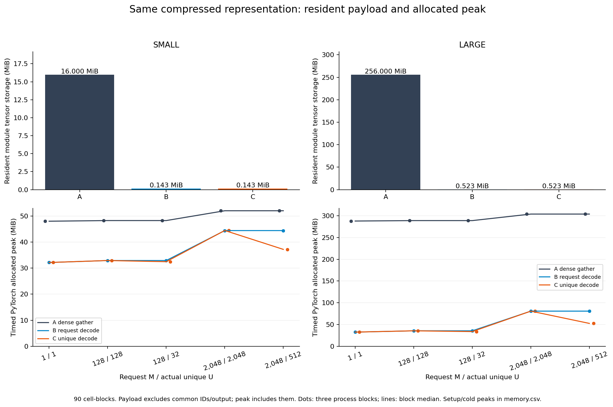
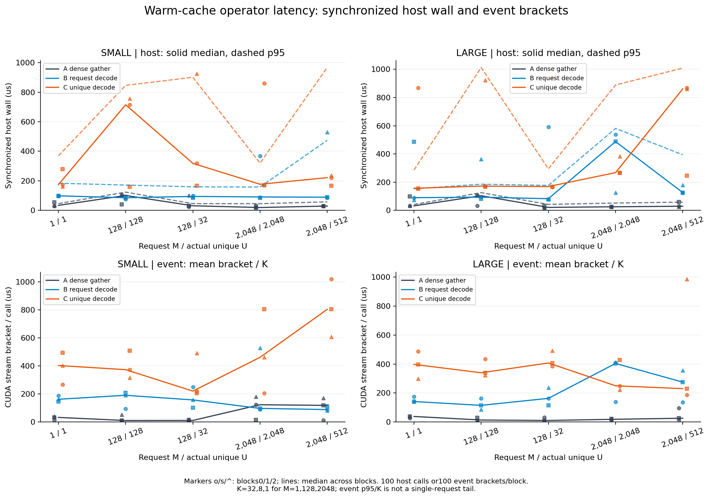

# 필요한 임베딩만 복원하면 메모리는 얼마나 줄고, 언제 느려지는가?

PLE는 **token이 각 layer에서 사용하는 추가 임베딩**이다. OPTIC의 같은 압축 표현을 전체 복원한 table에서 읽는 A, 요청마다 복원하는 B, 중복 token을 먼저 합친 뒤 복원하는 C를 비교했다. 공식 decoder를 그대로 호출하는 작은 operator 실험이다.

상주 module tensor는 SMALL **16MiB→0.143MiB**, LARGE **256MiB→0.523MiB**였다. 측정은 **30 cell /90 cell-block 모두 완료**, 모든 layer의 수치 gate를 통과했다. 실제 timed allocated peak는 module payload 외의 출력·중간 버퍼·라이브러리 잔류 할당을 포함하므로 아래 payload 배율과 다르다.

| Shape | A resident bytes | B/C resident bytes | A / B payload ratio | NPZ bytes / arrays bytes |
|---|---:|---:|---:|---:|
| SMALL | 16,777,216 | 149,568 | 112.17× | 151634 / 149504 |
| LARGE | 268,435,456 | 548,928 | 489.02× | 550998 / 548864 |

| LARGE M2048/U512 | A | B | C |
|---|---:|---:|---:|
| Timed allocated peak MiB | 304.02–304.02 | 80.79–80.79 | 52.57–52.57 |
| Timed reserved peak MiB | 338.00–338.00 | 82.00–82.00 | 102.00–102.00 |

Payload ratio and allocated/reserved/device memory are separate measurements.


중복 제거의 결과는 block별 값으로 판단한다. 전체30개 짝 중 **5개**에서 C가 B보다 빨랐다.3 block 모두 C가 빨랐던 조건은 **0개**다. 판정은 `OPERATOR_VALIDATED, MEMORY_TRADEOFF_OBSERVED, DEDUP_UNRESOLVED_BLOCK_VARIATION`이며 아래 원점과 전체 paired 표를 함께 읽어야 한다. host/event 변동이 커서 보편적인 속도 이득으로 확대하지 않는다.

| Block | A host median µs | B host median µs | C host median µs | C/B |
|---:|---:|---:|---:|---:|
| 0 | 29.55 | 123.14 | 869.78 | 7.064 |
| 1 | 60.16 | 126.41 | 247.07 | 1.955 |
| 2 | 25.35 | 178.65 | 860.85 | 4.819 |




codebook은 코드 번호로 찾는 작은 벡터 모음, decoder는 그 벡터를 각 layer 임베딩으로 바꾸는 affine 식이다. resident는 호출 사이에도 남는 메모리, workspace는 호출 도중 필요한 임시 작업 공간이다. B는 code lookup→latent 구성→GEMM→bias→BF16 cast를 수행한다. C는 unique 정렬·inverse 복원과 최종 M개 출력의 비용도 낸다.



판정: `OPERATOR_VALIDATED, MEMORY_TRADEOFF_OBSERVED, DEDUP_UNRESOLVED_BLOCK_VARIATION`. 세 block의 방향을 함께 보는 서술적 규칙은 첫 진단 run의 변동을 본 뒤, 수정된 본 측정 전에 정했다. 통계적 사전등록을 주장하지 않으며 더 빠른 개별 block도 모두 보존한다.

CPU 재현: NumPy 2.2.6/2.3.5와 Matplotlib 3.10.8을 사용했다. [재현 명령](REPRODUCE.ko.md)과 [전체 결과·방법·실패 이력](REPORT.ko.md)을 제공한다.

```bash
# From this case directory. These commands need no model, Torch, or CUDA.
python src/audit_v2.py verify
python src/audit_v2.py summarize --out /tmp/optic-summary
MPLCONFIGDIR=/tmp/optic-mpl python src/audit_v2.py figures --out /tmp/optic-figures
python tests/test_audit_v2.py -v
```

실행 범위는 같은 synthetic artifact의 raw unscaled BF16 [M,L,H] eager 조회이다. 실모델 품질·언어 능력·전체 serving의 TTFT/TPOT 결과는 측정하지 않았다. 모델/학습 데이터 다운로드, vLLM 설치, 사이트 편입, Git stage/commit/push/PR/Release를 수행하지 않았다.

공식 근거: [논문 §2·§6](https://arxiv.org/html/2610.31309v1), [고정 구현](https://github.com/VILA-Lab/optic/blob/344c712aeb6620e39eb78930fb922447f0e123f3/src/ple_eval/compact_adapter.py). [소스 연결](SOURCE_MAP.md), [재사용/기여 경계](REUSE_MAP.md), [고지](THIRD_PARTY_NOTICES.md).

Case020 • run `20261026-1235` • local candidate, uncommitted.

Base: `3e6f2c6b36fb2a3853cc3677bee84904d28567cf`  
Branch: `research/case020-optic-on-demand-decode-20261026-1215`  
Upstream: `344c712aeb6620e39eb78930fb922447f0e123f3`  
Main source/input/config bundle: `c43ea3a0a27cd28be7b9e8e26ce5cd65a42af28c070a49cd1f1b06cd77bc489b`  
Protocol SHA256: `c930534682204b99990bc58540c170925bd32ada3045a0027367e50130f34987`  
GPU worker SHA256: `fd0716a262f3444b4bbec49131ed06ecd04532337f5a962119b3367a5fdf5b77`
