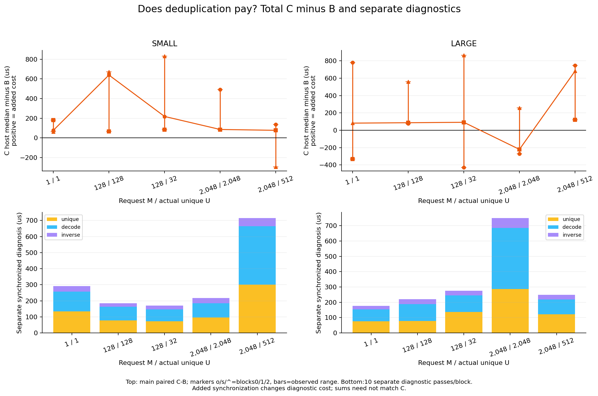

# Case020 — OPTIC decode execution cost

Resident module payload was reduced, while synchronized operator latency varied substantially across process blocks. All 90 primary cell-blocks passed numerical/resource gates. C was faster than B in5/30 paired blocks;0 conditions favored C in all three. Decision: `OPERATOR_VALIDATED, MEMORY_TRADEOFF_OBSERVED, DEDUP_UNRESOLVED_BLOCK_VARIATION`.

| Shape | A resident bytes | B/C resident bytes | A / B payload ratio | NPZ bytes / arrays bytes |
|---|---:|---:|---:|---:|
| SMALL | 16,777,216 | 149,568 | 112.17× | 151634 / 149504 |
| LARGE | 268,435,456 | 548,928 | 489.02× | 550998 / 548864 |

| LARGE M2048/U512 | A | B | C |
|---|---:|---:|---:|
| Timed allocated peak MiB | 304.02–304.02 | 80.79–80.79 | 52.57–52.57 |
| Timed reserved peak MiB | 338.00–338.00 | 82.00–82.00 | 102.00–102.00 |

Payload ratio and allocated/reserved/device memory are separate measurements.

| Block | A host median µs | B host median µs | C host median µs | C/B |
|---:|---:|---:|---:|---:|
| 0 | 29.55 | 123.14 | 869.78 | 7.064 |
| 1 | 60.16 | 126.41 | 247.07 | 1.955 |
| 2 | 25.35 | 178.65 | 860.85 | 4.819 |

## Memory and environment

Inventory walks all parameters/buffers, including nonpersistent group_offsets; storage identity deduplicates aliases. Upstream compact_resident_bytes is64bytes smaller than actual B/C module storage for both shapes. NPZ file bytes, array payload, CPU metadata, common int64 IDs, BF16 output and C's unique/inverse/intermediate/final tensors are separate. Output alone costs M*L*H*2bytes. A's table is reconstructed from the compressed artifact; it is not the original uncompressed PLE.

Warm-up output references are deleted, synchronization precedes peak reset, and no gc/empty_cache is used during timing. Reserved-start retains allocator warm-up history. Setup/cold/timed allocated peaks are separate in memory.csv and raw JSON. Module storage is not the same as allocated/reserved or total VRAM. A roughly32MiB allocated residual beyond inventoried module+IDs remained after warm-up in these workers; its exact ownership was not traced, so it is not attributed to a specific kernel or counted as user-visible payload savings. CUDA context/library memory and sampled device usage are separate. NVML device samples are not continuous peaks, and WSL process attribution is limited.

Observed hardware: RTX5080(sm_120),16303MiB, driver621.01; Ryzen7 9800X3D,16 logical CPUs; Ubuntu24.04/WSL2. GPU/CPU operator runtime: Python 3.12.14, NumPy 2.3.5, Torch 2.13.0+cu130. It is a read-only reuse of a pre-existing environment, not an independent clean-environment validation. Plotting uses a separate existing Python 3.10.19/NumPy 2.2.6/Matplotlib 3.10.8 runtime. Import paths, CPU/RAM/disk/BLAS/thread settings are recorded in provenance. Child-only OMP/MKL/OpenBLAS thread counts are1; bytecode and cache destinations are task-owned. No packages were installed or upgraded.

The FP16 GEMM FP32 out_dtype probe ran on GPU, all layers/shapes/dtypes were checked, and the separate trace includes lookup/GEMM/cast. TF32 stayed false. fp16/bf16 reduced-precision reductions were disabled; their upstream-runtime defaults were true, so this policy difference is explicit. FP16 accumulation stayed false. No dtype/CPU fallback, new kernel, compile or CUDA graph was used. The2GiB gate uses allocated peak minus initialized context baseline, including setup/cold/main peaks; reserved/context/device totals are not substituted for this gate.

Before GPU execution the compute-app list was empty and device utilization0%; device memory1844MiB. After the first diagnostic run it was again empty, utilization0%, device memory1854MiB; final primary device observations are in provenance/gpu_state_after.json. No other process was stopped, reset or reconfigured. This is a scoped device observation, not an audit that all services remained unchanged.

## Method and measurement contract

- A: the official decoder reconstructs every token into BF16 [V,L*H], in fixed256-token chunks. Compact state is deleted, garbage collection and empty_cache occur outside timing, and only dense table state remains. Setup includes loading, generation/copying into the GPU table, cleanup and synchronization. The setup coexistence peak is separate.
- B: unchanged pinned load_compact_ple/CompactOptic.forward, all layers. No bias/lookup optimization or install_compact_ple sqrt(H) scale.
- C: torch.unique(sorted=True,return_inverse=True), official decoder of U IDs, inverse index_select returning all M outputs. No precomputed unique cache.
- D: independent NumPy FP64 lookup+affine reference on stored FP16 arrays. P1 uses scalar loops versus einsum; the independent auditor uses separate per-layer matrix products. D is not timed as a competing method or claimed to be the original model embedding.

P1: V257,L3,H16,Z8,G2,D4,K256,8bit; seeds0/1/2, distinct layer weights and nonzero biases, all257tokens plus boundary/shuffled/repeated/single/multidimensional/empty inputs, zero-weight bias-only and exactly-zero controls. NPZ loading uses allow_pickle=False. Codes serialize exactly; floating outputs need not be bit-exact. There are387 arithmetic/contract-comparison records, not387 independent experiments. The official V32/L3/H16 CPU example ran first, and its stdout/stderr/exit/wall receipt is preserved.

The common input boundary validates CPU-generated int64 IDs in[0,V) before H2D. CPU negative and out-of-range IDs are explicitly rejected by both this boundary and the official index_select path. The official API silently casts int32/float inputs to long; the common boundary rejects them. Official and adapter empty outputs are BF16[0,L*H]. A meta-device mismatch probe is documented in the P1 contracts; it is outside the supported common boundary and was not timed. No illegal GPU indices were launched.

P1 gates were fixed at FP64 loop/vector rtol1e-10/atol1e-12; BF16 relativeL2≤1e-2 overall and each layer; finite required; zero-reference maxabs≤1e-6. FP64 gates are never applied to BF16-rounded values. The same numerical gates apply to all P2 cells. A/B/C happened to be bit-identical in all 90 method-pair records; bit-exact output was not a gate.

SMALL: V8192,L8,H128,Z32,G8,D4. LARGE: V32768,L16,H256,Z32,G8,D4. Dense BF16 tables are16/256MiB. These are controlled shapes, not real model shapes; Z32 differs from the paper's E4B Z644. Large storage ratios do not establish learned compression quality.

Artifact/input/order seeds61026020/61026021/61026022 use the documented SeedSequence mapping in protocol.json. M=1 has one U1 condition; M128 and2048 each have U=M and U=M/4. Repeat75 contains exactly four copies of each selected ID, then shuffles. Input manifests preserve actual U and byte hashes. Each shape uses one artifact; three process blocks are repeated executions, not three trained models or independent user workloads.

Each block shuffles30 cells. Each cell runs in a fresh serial process with autograd off. Inputs and outputs remain on GPU during timing. Validation, file IO, H2D/D2H, profiler, logging, gc and empty_cache are outside the timed functions. Output allocation is included. Warm-up20; host100 synchronized perf_counter_ns calls; event100 brackets with common K32/8/1 for M1/128/2048. Quantiles use NumPy linear. Host wall includes completion synchronization. Event elapsed/K may include launch gaps and unique-induced idle; it is not a sum of pure kernel times. Event bracket p95/K is not a single-request tail. Floors are recorded, never subtracted.

The C component diagnostics use10 additional synchronized passes per block after main timing. Dedicated correctness preflight for all inputs occurs before main timing. Their unique/decode/inverse sums need not equal C's unsplit main time. B's separate profiler trace shows lookup/GEMM/bias/cast; it was not used for latency. All seeds, inputs, tolerances and loops stayed fixed after smoke. The first-run six smoke cells executed full timing diagnostics and were already observed at the corrected source freeze. The corrected run also executed six smoke cells before main; no protocol was changed afterwards. All smoke values are excluded from primary summaries.

## Full core table

Cells below summarize three blocks: central latency is median of block statistics, brackets are observed min–max, memory peaks show block ranges. Host p95 is computed separately from each block's100 calls. Event column is the mean of 100 brackets/K within each block, then the median across blocks; it is not host p95 or pure kernel time. NPZ/array bytes per shape are in the resident table; all per-block values remain in CSV/raw.

| Shape | M/U | Method | GPU module resident MiB | timed allocated peak MiB | timed reserved peak MiB | host median µs [block range] | host p95 µs [range] | event bracket mean/K µs [range] | setup ms [range] | gate |
|---|---:|---|---:|---:|---:|---|---|---|---|---|
| SMALL | 1/1 | A | 16.0000 | 48.00–48.00 | 50.00–50.00 | 33.93 [29.10–53.60] | 46.14 [37.48–68.32] | 31.98 [13.22–40.25] | 144.65 [127.95–153.44] | PASS |
| SMALL | 1/1 | B | 0.1426 | 32.15–32.15 | 34.00–34.00 | 98.58 [97.50–99.45] | 183.90 [155.33–591.41] | 161.63 [144.88–188.63] | 5.87 [5.34–5.91] | PASS |
| SMALL | 1/1 | C | 0.1426 | 32.15–32.15 | 34.00–34.00 | 174.59 [161.65–279.13] | 369.61 [289.94–927.43] | 402.46 [266.30–493.31] | 5.99 [5.91–6.04] | PASS |
| SMALL | 128/128 | A | 16.0000 | 48.25–48.25 | 50.00–50.00 | 101.01 [39.92–105.17] | 123.55 [48.27–131.53] | 9.93 [9.79–50.68] | 135.07 [129.29–163.54] | PASS |
| SMALL | 128/128 | B | 0.1426 | 32.91–32.91 | 34.00–34.00 | 85.52 [75.97–92.91] | 171.38 [161.53–588.55] | 189.95 [93.84–206.42] | 5.95 [5.85–5.98] | PASS |
| SMALL | 128/128 | C | 0.1426 | 32.91–32.91 | 34.00–34.00 | 714.93 [160.49–756.62] | 846.32 [295.11–1028.36] | 372.82 [314.67–508.17] | 5.70 [5.38–6.26] | PASS |
| SMALL | 128/32 | A | 16.0000 | 48.25–48.25 | 50.00–50.00 | 31.23 [24.40–102.62] | 46.00 [45.29–127.29] | 10.46 [9.03–13.66] | 128.27 [126.66–159.95] | PASS |
| SMALL | 128/32 | B | 0.1426 | 32.91–32.91 | 34.00–34.00 | 94.71 [85.48–100.17] | 159.71 [144.34–377.01] | 156.89 [101.05–248.16] | 5.82 [5.24–6.15] | PASS |
| SMALL | 128/32 | C | 0.1426 | 32.46–32.46 | 34.00–34.00 | 318.42 [168.05–926.39] | 900.84 [298.74–1033.89] | 219.79 [203.67–491.71] | 5.52 [5.16–5.83] | PASS |
| SMALL | 2048/2048 | A | 16.0000 | 52.02–52.02 | 70.00–70.00 | 19.44 [19.24–32.75] | 45.39 [34.70–45.51] | 122.51 [15.73–179.52] | 150.47 [132.84–161.94] | PASS |
| SMALL | 2048/2048 | B | 0.1426 | 44.41–44.41 | 54.00–54.00 | 90.94 [85.96–367.97] | 157.95 [150.12–416.94] | 96.40 [88.61–528.30] | 5.80 [5.77–5.81] | PASS |
| SMALL | 2048/2048 | C | 0.1426 | 44.44–44.44 | 54.00–54.00 | 176.95 [168.66–859.39] | 320.25 [297.53–1107.72] | 460.73 [203.69–805.47] | 5.36 [5.36–5.58] | PASS |
| SMALL | 2048/512 | A | 16.0000 | 52.02–52.02 | 70.00–70.00 | 29.45 [28.73–30.26] | 57.79 [52.86–58.75] | 117.86 [13.18–170.29] | 149.14 [145.70–161.82] | PASS |
| SMALL | 2048/512 | B | 0.1426 | 44.41–44.41 | 54.00–54.00 | 89.12 [85.24–530.82] | 474.41 [154.69–635.57] | 88.15 [80.88–110.47] | 5.94 [5.17–6.03] | PASS |
| SMALL | 2048/512 | C | 0.1426 | 37.19–37.19 | 54.00–54.00 | 221.57 [166.47–236.37] | 967.19 [267.19–1023.57] | 803.29 [608.06–1019.15] | 5.67 [5.36–5.81] | PASS |
| LARGE | 1/1 | A | 256.0000 | 288.01–288.01 | 290.00–290.00 | 32.18 [31.64–99.49] | 42.03 [39.25–124.10] | 37.65 [26.92–38.64] | 159.55 [151.47–232.09] | PASS |
| LARGE | 1/1 | B | 0.5235 | 32.56–32.56 | 34.00–34.00 | 90.05 [74.74–486.26] | 153.04 [151.32–635.16] | 140.80 [140.22–174.60] | 6.35 [6.09–6.43] | PASS |
| LARGE | 1/1 | C | 0.5235 | 32.56–32.56 | 34.00–34.00 | 156.50 [155.42–869.30] | 286.09 [259.93–975.83] | 397.51 [298.15–488.06] | 6.69 [6.08–7.29] | PASS |
| LARGE | 128/128 | A | 256.0000 | 289.00–289.00 | 310.00–310.00 | 103.99 [33.91–104.70] | 125.65 [51.26–131.00] | 12.92 [9.77–27.66] | 145.29 [134.53–156.06] | PASS |
| LARGE | 128/128 | B | 0.5235 | 35.54–35.54 | 54.00–54.00 | 94.02 [80.54–362.85] | 185.65 [160.83–494.17] | 114.29 [84.97–161.88] | 5.83 [5.53–6.17] | PASS |
| LARGE | 128/128 | C | 0.5235 | 35.54–35.54 | 56.00–56.00 | 172.06 [166.99–922.78] | 1012.69 [304.75–1080.81] | 339.44 [322.65–435.78] | 6.44 [5.78–6.63] | PASS |
| LARGE | 128/32 | A | 256.0000 | 289.00–289.00 | 310.00–310.00 | 21.27 [18.34–33.29] | 42.55 [34.39–62.11] | 9.89 [8.75–30.94] | 154.92 [152.32–160.69] | PASS |
| LARGE | 128/32 | B | 0.5235 | 35.54–35.54 | 54.00–54.00 | 82.84 [77.30–592.29] | 177.04 [166.85–658.62] | 162.67 [114.34–235.35] | 6.14 [5.98–6.26] | PASS |
| LARGE | 128/32 | C | 0.5235 | 33.78–33.78 | 56.00–56.00 | 168.66 [163.91–945.74] | 294.45 [286.61–1062.38] | 407.17 [384.72–492.28] | 6.28 [5.66–6.51] | PASS |
| LARGE | 2048/2048 | A | 256.0000 | 304.02–304.02 | 338.00–338.00 | 25.69 [25.58–26.51] | 52.14 [42.36–119.33] | 18.21 [16.50–21.02] | 146.28 [138.72–158.13] | PASS |
| LARGE | 2048/2048 | B | 0.5235 | 80.79–80.79 | 82.00–82.00 | 487.59 [125.62–538.09] | 580.99 [423.40–641.36] | 403.84 [139.31–413.80] | 6.25 [5.70–6.79] | PASS |
| LARGE | 2048/2048 | C | 0.5235 | 80.82–80.82 | 114.00–114.00 | 267.75 [266.74–383.98] | 889.25 [393.55–910.40] | 249.58 [222.77–428.29] | 6.75 [5.77–6.95] | PASS |
| LARGE | 2048/512 | A | 256.0000 | 304.02–304.02 | 338.00–338.00 | 29.55 [25.35–60.16] | 58.45 [39.85–84.50] | 25.35 [19.54–94.81] | 147.49 [137.28–159.88] | PASS |
| LARGE | 2048/512 | B | 0.5235 | 80.79–80.79 | 82.00–82.00 | 126.41 [123.14–178.65] | 394.14 [176.42–558.16] | 274.93 [135.26–355.89] | 6.48 [6.30–6.53] | PASS |
| LARGE | 2048/512 | C | 0.5235 | 52.57–52.57 | 102.00–102.00 | 860.85 [247.07–869.78] | 1008.38 [346.12–1054.56] | 229.83 [186.01–986.72] | 5.85 [5.45–6.02] | PASS |

## Paired ratios and absolute differences

Ratios pair the same shape/ID/block. Column order is b0,b1,b2. No averaging of unrelated blocks or combining setup with request latency.

| Shape | M/U | B/A host b0,b1,b2 | C/B host b0,b1,b2 | C−B µs b0,b1,b2 |
|---|---:|---|---|---|
| SMALL | 1/1 | 3.351, 1.839, 2.931 | 1.791, 2.832, 1.625 | 77.090, 180.553, 62.194 |
| SMALL | 128/128 | 0.722, 2.327, 0.847 | 9.411, 1.727, 8.847 | 638.968, 67.580, 671.091 |
| SMALL | 128/32 | 4.104, 2.737, 0.923 | 3.179, 1.966, 9.781 | 218.256, 82.567, 831.683 |
| SMALL | 2048/2048 | 11.234, 4.468, 4.677 | 2.335, 1.962, 1.946 | 491.419, 82.701, 86.012 |
| SMALL | 2048/512 | 2.894, 3.102, 17.544 | 2.599, 1.868, 0.445 | 136.330, 77.353, -294.457 |
| LARGE | 1/1 | 2.846, 4.887, 2.322 | 9.654, 0.320, 2.094 | 779.248, -330.837, 81.755 |
| LARGE | 128/128 | 2.773, 0.774, 3.466 | 1.830, 2.073, 2.543 | 78.037, 86.454, 559.933 |
| LARGE | 128/32 | 32.290, 2.322, 3.896 | 0.277, 2.182, 11.416 | -428.374, 91.356, 862.898 |
| LARGE | 2048/2048 | 20.298, 19.063, 4.891 | 0.498, 0.547, 3.057 | -270.339, -220.851, 258.352 |
| LARGE | 2048/512 | 4.166, 2.101, 7.048 | 7.064, 1.955, 4.819 | 746.644, 120.660, 682.203 |

## Execution history, preservation and limits

**Protocol correction:** run20261026-1215 performed direct P2 A/B/C comparisons after timing, although per-worker FP64 checks preceded timing. Its90 cell-blocks are retained as DIAGNOSTIC_ONLY_PROTOCOL_ORDER. Primary run20261026-1235 adds two dedicated all-condition correctness workers before smoke/main; each timed worker verifies matching source/input preflight identity. All shapes, seeds, IDs, arithmetic, tolerances, timing loops and order stayed unchanged. All prior timings were already observed and disclosed in the new freeze. The global1800s ledger includes both runs.

P0 PASS; P1 PASS; P2 COMPLETE; P3 local candidate complete. Planned30 cells/90 cell-blocks; actual30/90; failed0; missing0. GPU workers across both run IDs: **196** (primary 99, prior diagnostic97), total **457.424s**, **1342.576s** of 1800s left. This includes worker imports/context/setup/teardown and failed-worker slots (none), including one complete protocol-order correction rerun; no budget ledger reset. All source-access/download operations were limited to7 pinned execution/doc/license files plus1 post-measurement upstream notice; no model, dataset, wheel or dependency download was required. The user-interrupted Windows→WSL switch is recorded separately; elapsed calendar time is not relabeled as GPU time.

The initial native Windows session pointed to a nonexistent C:\home\mskim\Codex_main. Read-only WSL access found /home/mskim/Codex_main and the retained Git common repository /home/mskim/inference-lab-public. That checkout contains archived-file deletions; it was neither repaired nor reset. Main was fetched and verified as3e6f2c6…, public cases001–019,40 remote branches and no open PR, and no local reserved Case020 was found. A new worktree/branch was created without stage/commit/push. Preservation snapshots cover pre-existing tracked Case trees/status and four referenced file byte hashes, not every byte on the machine.

The source freeze followed observed P1 results. Probe/smoke source is preserved in provenance/source_v1 and freeze_before_smoke.json; first-main source/config/freeze also remain under source_main_v1, protocol_run_v1.json and freeze_run_v1.json. Before main timing, raw requested-output preservation and source-identity receipts were added; arithmetic, loops, tolerances and comparison paths did not change. All 6 smoke results, including their full timing loops, were already observed and excluded from main summaries. Postprocessing/report code was written after measurements and is identified by PUBLIC_MANIFEST.json, separately from the main benchmark bundle.

Initial environment-query failures (invalid Windows cwd, sandbox WSL/NVML access, Matplotlib absent from operator runtime) were resolved without installing into an existing environment. They are not numerical or GPU-worker failures. The official CPU example has its own original receipts; a second P1 run added small BF16 raw outputs while retaining the first. Figure QA initially found clipped negative C−B points; the chart limits were corrected, with the initial image retained in the owned private directory and the change recorded in provenance. No measured cell or raw sample was changed. An early auditor draft expected45 pair records; the actual design requires3 blocks×10 inputs×3 comparisons=90, corrected before delivery. An initial no-benefit draft label was corrected to unresolved variation because10 paired blocks favored C.

The independent auditor checks frozen source/input identities, planned/actual grid, raw hashes, M/U/code bytes, timing quantiles and paired ratios, all tensor payload/storage formulas, numerical gates and alternate FP64 formulas on preserved raw BF16 values. Four mutation/positive fixtures check changed timing bytes, changed U, changed dtype payload units and a valid no-Torch path. Summary files and all 6 image files were regenerated in a fresh external output under the same CPU environments. Byte equality is an observed same-environment result, not the scientific criterion or a remote CI claim. No remote CI, other machine, trained model, generation, training, serving overlay, vLLM upgrade, paid API, Drive, Pages or publication was run.

These are warm-cache operator calls for fixed repeated ID arrays. They do not represent Zipf requests, long prefill, full-model decoding, quality retention, KV-cache reallocation, or universal latency/VRAM gains. Host/event variation is real in this run; clocks/scheduler were not controlled or causally diagnosed. Three process blocks and100 internal repetitions do not justify tiny confidence intervals. All block origins and ranges are exposed.

[Protocol](configs/protocol.json) • [Raw run](results/20261026-1235) • [Decision](results/summary/decision.json) • [Source map](SOURCE_MAP.md) • [Reproduce](REPRODUCE.md)

Case020 • run `20261026-1235` • local candidate, uncommitted.

Base: `3e6f2c6b36fb2a3853cc3677bee84904d28567cf`  
Branch: `research/case020-optic-on-demand-decode-20261026-1215`  
Upstream: `344c712aeb6620e39eb78930fb922447f0e123f3`  
Main source/input/config bundle: `c43ea3a0a27cd28be7b9e8e26ce5cd65a42af28c070a49cd1f1b06cd77bc489b`  
Protocol SHA256: `c930534682204b99990bc58540c170925bd32ada3045a0027367e50130f34987`  
GPU worker SHA256: `fd0716a262f3444b4bbec49131ed06ecd04532337f5a962119b3367a5fdf5b77`
