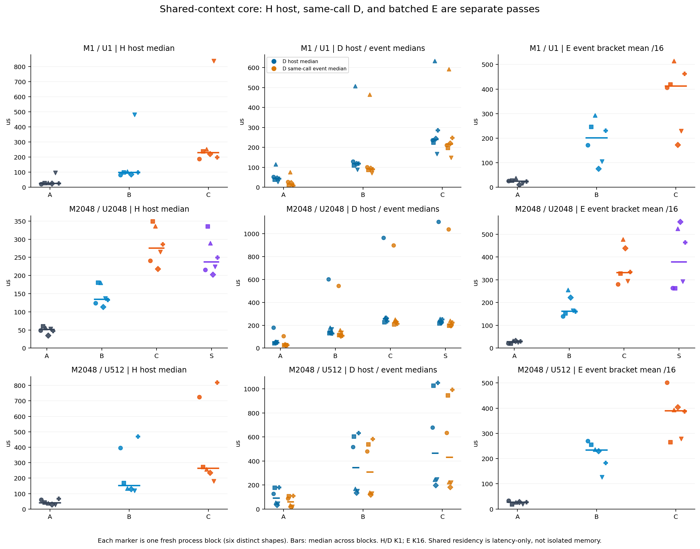
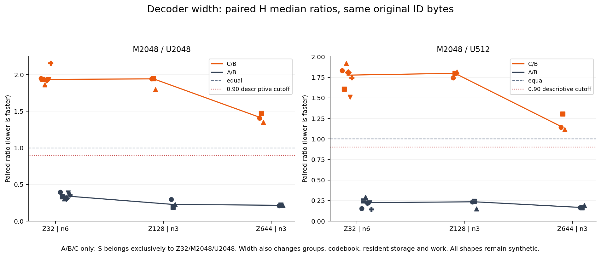
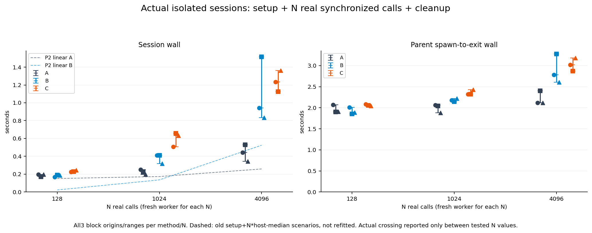
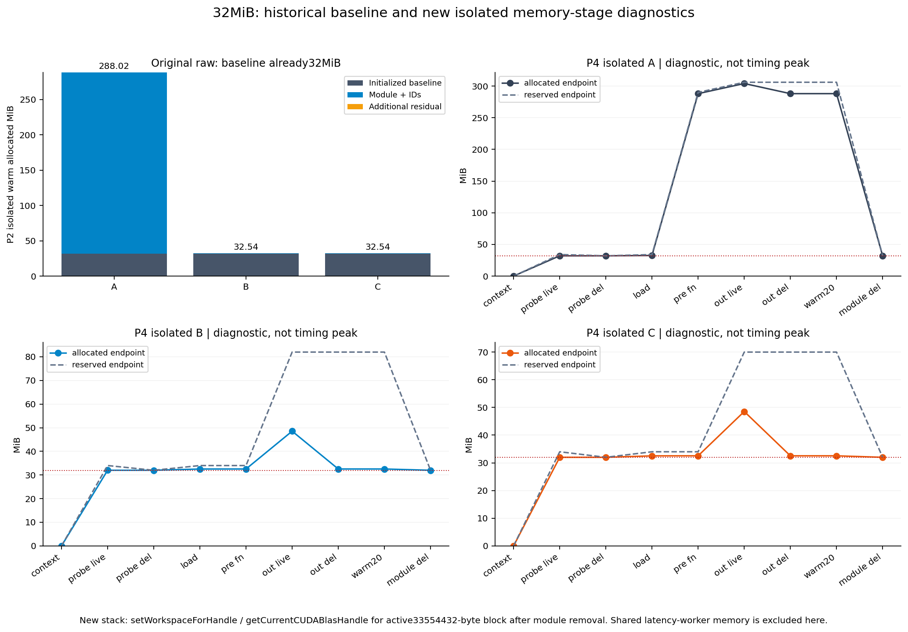

# Case020 — Request-time decode saved memory; deduplication did not repeat a latency win

**How much resident memory does request-time reconstruction save, and when does it cost latency?**

For LARGE/Z32, A's reconstructed table occupied256MiB and B/C retained about0.524MiB of module tensors. Smaller residency did not guarantee cheaper calls. With A/B/C interleaved in the same process/context, C was faster than B in0/30 primary H blocks. Actual sessions showed mixed A/B ordering at N128 and A faster in every block at N1024 and4096.

PLE is the extra embedding a token uses at each layer. OPTIC stores token codes shared across layers, a small vector dictionary (codebook), and layer-specific affine decoders. Resident tensors stay loaded; workspace is working memory used by an operator library. A is a table reconstructed from **the same compressed representation**, rather than the original uncompressed PLE.

## Choosing under a memory constraint

These are unchanged P2 final-run `20261026-1235` method-isolated results for LARGE/M2048/U512. All three blocks had the same listed memory values. No shared-latency-worker memory is included.

| method | same NPZ bytes | resident tensor bytes | warm allocated MiB | timed allocated peak MiB | timed reserved peak MiB |
|---|---|---|---|---|---|
| A | 550998 | 268435456 | 288.016 | 304.016 | 338.000 |
| B | 550998 | 548928 | 32.540 | 80.790 | 82.000 |
| C | 550998 | 548928 | 32.540 | 52.571 | 102.000 |

B/C's resident tensor payload was about489 times smaller than A's. That is not a total-VRAM reduction factor. IDs occupy16KiB and the returned output16MiB; FP32 intermediates, allocator state and library memory are additional. C reduced timed allocated peak by about34.9% versus B in this condition, while its reserved peak was higher. B is a straightforward official request-time path when retaining the table is impractical. C requires weighing a smaller allocated peak against added call cost. The historical memory advantage remains valid; P4 found no condition where it coincided with a latency win.

## Repeated calls in one process

H measures host wall from after a pre-call synchronize through fn and completion synchronize. Each ratio below is the median of blockwise `C median / B median`, not a pooled estimate from inner calls. Positive C−B means slower C.

| Z | M / U | blocks | C/B H median ratio* | block ratio range | C−B median difference* (us) | C faster |
|---|---|---|---|---|---|---|
| 32 | 1 / 1 | 6 | 2.333 | 1.742–2.595 | +138.17 | 0/6 |
| 32 | 2048 / 2048 | 6 | 1.936 | 1.864–2.155 | +140.92 | 0/6 |
| 32 | 2048 / 512 | 6 | 1.777 | 1.511–1.920 | +114.27 | 0/6 |
| 128 | 2048 / 2048 | 3 | 1.942 | 1.799–1.943 | +265.92 | 0/3 |
| 128 | 2048 / 512 | 3 | 1.800 | 1.745–1.817 | +119.73 | 0/3 |
| 644 | 2048 / 2048 | 3 | 1.409 | 1.350–1.470 | +130.53 | 0/3 |
| 644 | 2048 / 512 | 3 | 1.142 | 1.115–1.306 | +56.13 | 0/3 |

*Starred columns are medians of blockwise ratios/differences. All block origins are in [paired_block_comparison.csv](summary/paired_block_comparison.csv); absolute mean/median/p95/min/IQR are in [controlled_latency.csv](summary/controlled_latency.csv).*

The three Z32 core conditions each used six fresh processes. Each had0/6 C wins. In M2048/U2048, S/B had a1.763 median ratio and C/S1.133. S sorts and still decodes M rows. Its sorting/allocation/operator sequence differs from C, so C−S is not unique's isolated causal cost. U=M also provides no reconstructed-row reduction.

Z128/G32 and Z644/G161 extended decoder width. Z644/U512 narrowed the C/B penalty to1.142, but C remained slower in3/3 blocks. The Z32→128→644 trend was not monotonic; groups, codebooks, resident memory and work changed together. These are not a pure Z-only causal effect or a trained-artifact claim. No condition met the fixed10%/direction-consistency benefit rule. That descriptive result is separate from implementation validity and experiment completion.

Absolute variation remained: core M1 B block medians ranged82.27–480.79us and C187.00–837.36us. Slow observations were retained. Markers are process blocks; short bars are medians across blocks. Shared residency and interleaving differ from P2, so samples are not pooled and process isolation is not assigned as the sole cause of the historical variation.

## What the clocks and historical wins mean

Re-reading all90 final P2 raw records reproduced C/B host-median wins5/30, event-mean wins4/30, common wins0/30 and9/30 direction disagreements. Three host wins had U=M; no condition won all three host blocks (0/10). Matching median with median gives host5/event4/common1/disagreements7; matching means gives8/4/1/10. Mixing statistics is not a complete explanation: historical event measurements were a separate pass with K32/8/1.

P4 D stores host/event observations for the **same call**, but its host interval includes two event records and a wait. E uses common K16 and stream elapsed/16, potentially including launch gaps and C's internal waits. Neither replaces primary H; event elapsed is not a sum of pure kernel durations. All means, medians and p95s retain pass/clock identity. The p95 of bracket averages is not single-call tail p95.

## Reusing the table across actual calls

The lifecycle input is identical LARGE/Z32/M2048/U512 repeated N times. Each method/N/block has a fresh process and no warm-up; the first call counts toward N. Session wall begins before artifact reading and includes IDs H2D, A's full reconstruction/compact cleanup, N synchronized calls and final owned-tensor cleanup. Parent worker wall also includes imports, context initialization and process exit. All27 session and worker points follow.

| N | method | session s: b0 / b1 / b2 | median session s | parent worker s: b0 / b1 / b2 |
|---|---|---|---|---|
| 128 | A | 0.196851 / 0.169624 / 0.196438 | 0.196438 | 2.072030 / 1.898246 / 1.904284 |
| 128 | B | 0.168025 / 0.190640 / 0.185433 | 0.185433 | 2.009308 / 1.854379 / 1.887632 |
| 128 | C | 0.224380 / 0.229143 / 0.245484 | 0.229143 | 2.086732 / 2.058524 / 2.039747 |
| 1024 | A | 0.252050 / 0.223652 / 0.195350 | 0.223652 | 2.060568 / 2.041846 / 1.878002 |
| 1024 | B | 0.410242 / 0.410329 / 0.318430 | 0.410242 | 2.180281 / 2.144023 / 2.216770 |
| 1024 | C | 0.507840 / 0.655918 / 0.632942 | 0.632942 | 2.318672 / 2.321995 / 2.431254 |
| 4096 | A | 0.442087 / 0.530962 / 0.342683 | 0.442087 | 2.117734 / 2.402362 / 2.118920 |
| 4096 | B | 0.941224 / 1.514844 / 0.832234 | 0.941224 | 2.781958 / 3.278795 / 2.605198 |
| 4096 | C | 1.234773 / 1.125446 / 1.362115 | 1.234773 | 3.017688 / 2.867949 / 3.179739 |

B beat A in2/3 N128 blocks and had the lower median. A beat B in3/3 blocks at both N1024 and4096. The observed median ordering changes between128 and1024; no exact operational crossover is interpolated. Historical setup+N×warm-host-median scenarios remain unchanged at about920–2319 calls. New cold first calls were roughly92–119ms for B and122–164ms for C; A's first gather was about1.2–2.1ms after already exercising the decoder during table setup. These observations show why a warm linear scenario and a real cold session differ; no unprofiled cause is assigned to the cold cost.

C had higher median session wall than B at all three N values. One N4096 block had lower C than B, so C was not slower in every individual lifecycle run. All three origins remain visible. Session/N is an amortized mean including setup, not per-call p95. Parent process startup is neither service end-to-end latency nor GPU busy time.

## Where the32MiB appeared

All90 historical records already had33,554,432 allocated bytes at the library-initialized baseline, before artifact reading. Subtracting baseline, module and IDs from warm endpoints leaves0–952 bytes. Historical raw has no separate after-load or after-output-release endpoints, limiting retrospective stage attribution.

The three new isolated memory diagnostics show context0→small FP16 GEMM32MiB→module/ID removal32MiB. The remaining active block's C++ stack contains `at::cuda::setWorkspaceForHandle`, `getCurrentCUDABlasHandle` and the FP16 cuBLAS GEMM helper. This identifies **Torch cuBLAS handle workspace in the new replay**. No historical stack was captured, so the new stack is not retroactive direct evidence about an old allocation. This integrated explanation supplements the unchanged original REPORT.

## Completion and reproduction

Completed30/30 P4B timing workers,96/96 method-blocks,27/27 P4C lifecycle workers, plus3 preflight,1 smoke and3 memory workers. Failed/retried/missing workers:0. Optional profiling workers:0. All16-layer numerical gates and the additional2GiB allocated-peak gate passed. Dedicated preflight/source/config/input identities preceded main measurements. The15:03:17 KST freeze states this is a post-P2 follow-up; the15:04:16 main freeze records the already-seen preflight/smoke observations.

Parent-observed GPU-related worker wall is196 original workers at457.424303870s plus64 new workers at265.775915436s, totaling723.200219306s with1076.799780694s left under1800s. Only budget costs are combined; diagnostic/final/P4 performance samples remain separate. The64 common small GEMM probes are included in those64 workers, not additional debits.

All747 original Case files and18 external originals retain their bytes/hashes. The unchanged historical verifier passed on a temporary copy containing exactly its original manifest scope. Independent CPU audit, fresh external regeneration, mutation rejection and inspection of all four figures are documented in [reproduction](REPRODUCE.md) and provenance. No installation, runtime upgrade, remote CI or publication was performed.

## Scope

This is an eager operator study on one RTX 5080. Identical synthetic artifacts and GPU ID arrays are reused in warm-cache calls returning all16 layers as raw, unscaled BF16. Trained OPTIC quality, LLM inference, TTFT/TPOT, KV redistribution and server concurrency were not measured. Z644 matches only the E4B latent width, not its V/L/H or quality. OS file caches may be warm and GPU/CPU clocks were not fixed. WSL device samples are neither continuous peaks nor complete per-process attribution. P2 isolated workers and P4 shared-context workers retain separate contracts and denominators. Process blocks are the repetition unit; inner calls are not independent models or user tasks. Power samples are not converted to energy or monetary cost.

The codec and Torch GEMM/allocator are reused. Original contributions here are fixtures, A/C/S wrappers, interleaving, timing/lifecycle/accounting, independent FP64 references, CPU audit, figures and documentation. See [SOURCE_MAP](SOURCE_MAP.md), [REUSE_MAP](REUSE_MAP.md) and the [detailed report](REPORT.md).
