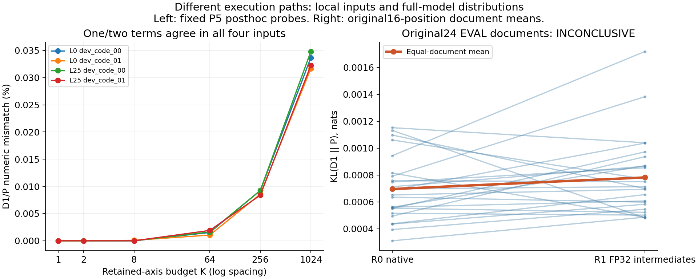

# Case021 — 같은 INT4인데 왜 계산 결과가 달라질까?

[English](README.md) · [상세 보고서](REPORT.ko.md) · [CPU 검산](REPRODUCE.ko.md)

같은 압축 숫자를 사용해도 중간 반올림과 계산 경로에 따라 마지막 값이 달라질 수 있습니다. Qwen3-0.6B의 기존 INT4 artifact, 즉 다시 실행할 수 있게 저장한 정수 code와 배율 scale 묶음으로 **저장 표현, dense/Marlin 실행, 그 뒤 Q/K 계산의 정밀도**를 나누어 조사했습니다.

검사한 단일항에서는 두 실행이 일치했지만, 실제 activation(모델 내부에서 다음 계산에 전달하는 값)을 결합하면 작은 차이가 남았습니다. 더 정밀한 중간 계산도 두 실행의 최종 일치도를 일관되게 높이지는 않았습니다.

| 경로 | 쉬운 뜻 |
| --- | --- |
| D0 | 저장 artifact를 원래 순서로 복원한 dense 참조 |
| D1 | code와 BF16 scale로 BF16 가중치를 먼저 복원한 일반 행렬곱 |
| P | 같은 code/scale을 압축 형태로 Marlin GPU 연산에 전달 |
| R0 /R1 | 공통 Q/K norm–RoPE의 기본 중간 반올림 /중간 FP32 유지 |

- **전체 모델:** 합성 EVAL24문서의512길이 입력에서 R1이 KL을 줄였는지 확정하지 못했습니다. KL은 다음 토큰 후보 분포의 차이이며 정답률이 아닙니다. 원 판정은 **INCONCLUSIVE**입니다.
- **단일항:** 두 q_proj에서 D1/P가 같았습니다. 첫 block의406,626 판별 좌표에서는 둘 다 가중치를 먼저 반올림하는 후보 A와 맞았습니다. 이 수는 fixture·행·출력 좌표 합계이며, fixture 사이 같은 계수의 재사용까지 제거한 고유 표본 수는 아닙니다.
- **여러 항:** 두 층×기존 DEV2문서의 고정 희소 입력은 K1·2에서 같았습니다. 첫 차이를 본 K는 한 조합에서8, 세 조합에서64였습니다. K는 남긴 입력축 예산이고 입력 크기도 함께 변하므로 보편적인 경계가 아닙니다.

왼쪽은 남긴 항 수에 따른 국소 출력 불일치, 오른쪽의 선 하나는 원 EVAL 문서 하나입니다. 문서 내부16위치 평균을 구한 뒤 문서를 동일하게 가중했습니다. 두 패널은 같은 오차나 같은 분모가 아닙니다.

이 작업에서 만든 것은 fixture·adapter·계측·정확한 이진 반올림 및 CPU 검산·설명 도구입니다. Marlin kernel, Torch 행렬곱·메모리 관리와 기존 양자화 artifact는 재사용했습니다. 내부 누적 순서·부분합·scale 적용 위치를 한 가지 원인으로 확정하지 않았습니다.

[방법과 용어](METHOD_CONTRACT.ko.md) · [모든 주요 표와 반대 사례](REPORT.ko.md) · [공개/비공개 재현 범위](REPRODUCE.ko.md) · [출처·직접 구현 범위](SOURCE_MAP.md)
