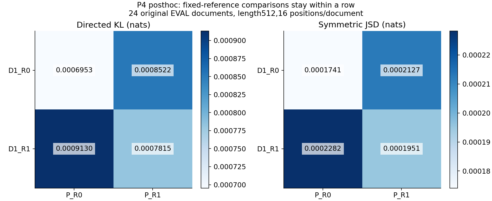

# Case021 통합 보고서 — 표현, 실행, 후속 계산을 나누어 보기

[요약](README.ko.md) · [English](REPORT.md) · [재현](REPRODUCE.ko.md)

## 질문과 관측

같은 INT4 artifact의 복원 표현을 바꿀 때 생기는 차이와, 표현을 맞춘 뒤 dense/Marlin 실행 사이에 남는 차이를 구분했습니다. 마지막 P5에서는 검사한 단일항이 같았지만 여러 실제 값의 결합에서 차이가 나타났습니다. Q/K 계산의 국소 참조 오차가 작아져도 두 전체 모델 실행의 일치도가 일관되게 좋아지지는 않았습니다.

## 1. 원 계약과 자료

Qwen3-0.6B revision c1899de289a04d12100db370d81485cdf75e47ca의196개 projection, group64 D16 artifact를 사용했습니다. D16은 Case013의 기존 W4A16 설정명으로, INT4 weight code와 BF16 activation을 사용하는 경로입니다. 16비트 가중치라는 뜻이 아닙니다. 실제 projection bias는 없고 beta는 입력에 한 번만 적용합니다. D0도 원 미압축 checkpoint가 아니라 artifact의 dense 참조입니다.

| 경로 | 쉬운 뜻 |
| --- | --- |
| D0 | 저장 artifact를 원래 순서로 복원한 dense 참조 |
| D1 | code와 BF16 scale로 BF16 가중치를 먼저 복원한 일반 행렬곱 |
| P | 같은 code/scale을 압축 형태로 Marlin GPU 연산에 전달 |
| R0 /R1 | 공통 Q/K norm–RoPE의 기본 중간 반올림 /중간 FP32 유지 |

D0–D1에는 `(codes×gamma)×alpha_inv`의 원 순서와 combined scale 표현·반올림 차이가 함께 들어갑니다. D1–P는 같은 signed code와 BF16 scale 뒤 남는 실행 차이입니다. 둘을 scale cast 하나나 순수 누적 순서 효과로 좁혀 부르지 않습니다. Marlin은 실제 kernel symbol로 확인한 INT4 저장/BF16 MMA이며 native INT4 MMA나 새 kernel이 아닙니다.

R1은 Q/K norm(벡터 크기 정규화)–RoPE(위치에 따른 Q/K 회전)의 중간값을 FP32로 유지한 뒤 최종 Q/K를 BF16로 전달합니다. native BF16 cos/sin 값을 재사용하고 V·attention·GEMM·모델 나머지를 바꾸지 않습니다. 모델 전체 FP32 변경이나 원문 RL 실행 스택 정렬 재현이 아닙니다. 두 경로의 R0는 원래 공통이었습니다.

DEV8/EVAL24는 설명·key-value·코드·JSON의 합성 원문32개입니다. 128길이는 같은 문서의512 prefix이므로 별도 독립 문서로 합치지 않습니다. batch1, teacher-forcing prefill, use_cache=False이며 모든 위치 lm_head를 계산한 뒤 고정16위치의 전체 vocabulary 분포를 저장했습니다. 원 full forward384, 반복54, local block replay384, 교체 DEV32/EVAL24는 서로 다른 분모입니다.

## 2. 원 주 결과와 반대 관측

| EVAL512 /24 documents | Value (nats) |
| --- | --- |
| E0: KL(D1_R0 ∥ P_R0) | 0.0006952504144 |
| E1: KL(D1_R1 ∥ P_R1) | 0.0007815328033 |
| delta = E0−E1 | -0.0000862823889 |
| Paired95% /seed61027023 | [-0.0002068221560, 0.0000390900519] |
| Verdict | INCONCLUSIVE |

KL은 자연로그 단위 nats의 분포 차이로 정답률이나 능력 점수가 아닙니다. delta가 양수면 감소지만 여기서는 평균이 음수이고 구간에0이 포함됩니다. 문서 단위 paired bootstrap10,000회, seed61027023, linear quantile을 유지했습니다. tau_abs=1e-10이며 반복54회에서 보존된 같은 경로 logits가 bit-identical이었어도 모든 입력의 오차 상한을 증명하는 것은 아닙니다.

원32-token D0–P relative_RMSE 약0.02605433은 기존0.02 gate 밖입니다. probe02/03은 reduction 설정이 같은 통제 비교가 아니었습니다. 형식을 맞춘 D1을 새 아이디어처럼 제시하지 않습니다. DEV에서 선택한 layer25 block-output 교체는 DEV 평균 KL을 줄였지만 EVAL 평균은 증가했습니다. 국소 변화의 전달 민감도와 일반 개선은 다릅니다. [원 관측·선택 이력](history/p0p3/REPORT.md.txt)

## 3. P4A: 어느 쪽을 고정했는가

기존 EVAL24, length512,16위치의 문서 평균입니다. 행 안에서는 D1 참조가 고정되고 P만 바뀝니다.

| Fixed reference | P_R0: KL /JSD | P_R1: KL /JSD |
| --- | --- | --- |
| D1_R0 | 0.0006952504 / 0.0001740831 | 0.0008521777 / 0.0002127459 |
| D1_R1 | 0.0009130131 / 0.0002282488 | 0.0007815328 / 0.0001951464 |

D1_R0를 고정하면 P_R1이 더 멀어졌고, D1_R1을 고정하면 P_R1이 더 가까웠습니다. K00−K10은 참조까지 바뀌므로 한쪽만 바꾼 개선으로 읽지 않습니다. 같은 R모드가 더 가까운 관측도 원래 전체 불일치의 유일 원인이라는 증거는 아닙니다.

| 고정 참조 | P 변경 효과 K0−K1 | 사후95% 구간 /seed61027025 |
| --- | --- | --- |
| D1_R0 | -0.0001569272545 | [-0.0003351114788, -0.0000262346295] |
| D1_R1 | 0.0001314802600 | [0.0000142299660, 0.0002537434723] |

원 주 구간과 사후 bootstrap의 seed·문서 순서를 구분해 CPU로 재계산했습니다. 이미 본 EVAL을 새 확인시험으로 부르지 않습니다. 고정 D0_R0에서의 drift는 다음과 같으며, D1에 가까워지는 것과 별개입니다.

| Fixed D0_R0 reference | Mean KL (nats) |
| --- | --- |
| D1_R0 | 0.0009939798 |
| D1_R1 | 0.0010561329 |
| P_R0 | 0.0009719356 |
| P_R1 | 0.0010312041 |

## 4. P4B/P5A: 개별 정확도와 오차 상쇄

동일 D0_R0 block input의 선택 Q/K 좌표를 FP64 국소 식과 비교했습니다. 96은24문서×2층(25/27)×Q/K의 파생 조합입니다. R1에서 양쪽 개별 참조 오차 합은96개 모두 줄었으나 두 경로 gap은34증가/57감소/5동일이었습니다.

`d`는 FP64 식의 두 projection 입력 차이가 만든 출력 차이, `n`은 두 경로의 계산 오차 차이입니다. `G=||d||²+N+C`, N=||n||², C=2⟨d,n⟩이고, 같은 입력의 R0→R1 변화는 ΔG=ΔN+ΔC입니다. C는 음수 상쇄 또는 양수 결합이 가능합니다.

| 증가34개 분류 | 개수 | 그중 원래 음의 cross가 약해진 수 |
| --- | --- | --- |
| ΔN≤−tolerance, ΔC>tolerance | 13 | 12 |
| ΔN>tolerance, ΔC>tolerance | 17 | 12 |
| ΔN>tolerance, ΔC≤−tolerance | 4 | 0 |
| tolerance 부근/기타 | 0 | 0 |

tolerance=max(1e-12,1e-10×해당 셀 G/N/C 최대 절대값)로 P5 파생 표 관측 전에 고정했습니다. ΔC가 증가한30개 모두를 음의 상쇄 소멸로 부르지 않습니다. 실제 그 패턴은24개이며 새13/17/4 분류와 다릅니다. 작은 ΔG로 나눈 기여율이나 전체 KL의 인과 분해를 만들지 않았습니다.

## 5. P5B: 단일항 후보 A/B

A=R_BF16(a×R_BF16(c×s)), B=R_BF16(a×c×s). c는 signed INT4 code, s는 실제 BF16 scale, a는 beta 이후 BF16 입력입니다. A는 가중치를 먼저 반올림하고, B는 단일 곱의 끝에서 반올림하는 구분용 식입니다. kernel 전체의 모형이 아닙니다.

설명용 합성 c=3,s=1.0078125: a=1이면 둘 다3.03125, a=0.125이면 둘 다0.37890625, a=1.5이면 A4.5625/B4.53125입니다. 실제 artifact에 이 숫자가 있다고 가정하지 않았고 exact Fraction과 nearest-even으로 검산했습니다.

층0/25 q_proj에서5 fixture×512행, 첫 block10,485,760 출력 좌표를 비교했습니다. D1/P와 D1/A 불일치는0입니다. A/B 판별406,626좌표 모두 P의 A_only였고,10,079,134는 both입니다. B_only/neither는0입니다. 판별하지 못하는 both를 증거에 더하지 않습니다.

406,626은 (projection,fixture,row,output-axis) 기록 좌표를 첫 block에서 한 번 센 수이며, process3반복을 포함하지 않습니다. 입력 행5,120회 중 (layer,axis,coefficient) 고유 조합은4,102개로1,018회가 fixture 사이 재사용입니다. 따라서 독립 workload나 중복 제거한 수학적 input-output 쌍으로 설명하지 않습니다. 선정 challenge1,024좌표는 ALL_VALID의 부분집합입니다. GPU 실제 계수 행은 CPU 후보 pool의 DEV2문서 중 첫 문서 dev_code_00에서 선택됐다는 범위도 유지합니다.

## 6. P5C: 실제 값 유지·희소 replay

P5B가 안정적으로 같았을 때만 동결한 조건 D를 실행했습니다. 같은 DEV2문서, 두 projection, M512/I1024/O2048/group64, K={1,2,8,64,256,1024}입니다. 남긴 BF16 bit를 바꾸지 않고 나머지만0으로 했습니다.

| Layer /document | First observed K | K1024 relative_RMSE | K1024 mismatched % /max steps |
| --- | --- | --- | --- |
| 0 / dev_code_00 | 64 | 0.0001055513265 | 0.033665% / 17 |
| 0 / dev_code_01 | 8 | 0.0001047640272 | 0.031662% / 2 |
| 25 / dev_code_00 | 64 | 8.487991352e-05 | 0.034809% / 33 |
| 25 / dev_code_01 | 64 | 7.582970442e-05 | 0.032234% / 44 |

| Layer /document | Nonzero elements at K=1/2/8/64/256/1024 (512 rows) |
| --- | --- |
| 0 / dev_code_00 | 512 / 1024 / 4096 / 32768 / 131072 / 524288 |
| 0 / dev_code_01 | 512 / 1024 / 4096 / 32768 / 131072 / 524288 |
| 25 / dev_code_00 | 511 / 1023 / 4094 / 32758 / 131010 / 524043 |
| 25 / dev_code_01 | 512 / 1024 / 4096 / 32756 / 131021 / 524058 |

각 출력 분모는512×2048입니다. 실제 비영 수와 norm도 K와 함께 변하며, 처음 관측한 K는 보편적인 임계값이 아닙니다. 96개 반복 hash 대조가 일치했고 K1024의 입력·D1/P 출력8개는 P4와 bit가 같습니다. 이 마지막 대조는 다른 시점/process 사이 비교입니다.

P5A의 기존 DEV8×3층 출력25,165,824원소 중7,823개가 달랐습니다. BF16 representable-step1/2/>2는7,496/133/194, 최대27,892였습니다. ULP는 인접 표현값 간 단계이지 내부 반올림 횟수가 아니며 ±0 수치 동일성과 음수 순서를 처리했습니다.

두 oracle(dense64: 실제 D1 weight 승격; exact64: code×실제 BF16 scale)은 원 미압축 모델의 정답이 아닙니다. P5C의24조건 SSE 순서는 dense64 기준 P가 작음11/D1이 작음2/동일11, exact64는7/6/11입니다. K1024 exact64에서 층0 두 문서는 D1, 층25 두 문서는 P가 더 작았습니다. 작은 차이의 이 순서를 일반 우위로 쓰지 않습니다. 정확한 dyadic subset768행은 midpoint tie264행을 포함하며 FP64 최종 반올림 불일치0이었습니다. 나머지231,110 oracle-조건 좌표는 판정 불확실 UNRESOLVED로 보존했습니다.

## 7. 비용과 범위

| Phase | Recorded GPU parent wall (s) | Recorded CPU worker wall (s) |
| --- | --- | --- |
| P0–P3 | 1971.504192 | See original CPU-cost receipt |
| P4 | 82.207145 | 789.183164 |
| P5 | 229.252607 | 61.077458 |
| Campaign | 2282.963944 | Not added to GPU debt |
| Publication | 0 | Separate delivery receipt |

| Path /mode | Blocks ×calls | Host median of block medians ms [range] | Event median of block medians ms |
| --- | --- | --- | --- |
| D0/R0 | 3 ×10 | 26.993 [25.822, 27.246] | 26.948 |
| D0/R1 | 3 ×10 | 28.168 [25.710, 29.124] | 28.116 |
| D1/R0 | 3 ×10 | 26.913 [22.738, 28.597] | 26.860 |
| D1/R1 | 3 ×10 | 28.313 [23.265, 28.569] | 28.264 |
| P/R0 | 3 ×10 | 26.603 [26.289, 27.370] | 26.553 |
| P/R1 | 3 ×10 | 27.571 [26.747, 34.632] | 27.526 |

원 비용 표는 DEV1문서512의 진단 forward입니다. host에는 같은 호출의 event record/wait가 포함되고 event는 stream elapsed입니다. R0에도 no-op dispatch wrapper가 남아 있으며 서비스 TTFT/TPOT나 kernel 순수시간이 아닙니다. R1 첫 호출은 같은 process의 R0 뒤에 왔습니다. public scalar 원점은 [timing raw](evidence/p0p3/timing_raw.csv)에 있습니다.

P5는 compute worker12개, B60+C144 본 core 호출, 기술 대조16·profiler4를 합해224호출입니다. 새 full-model/input-extraction forward는0입니다. GPU229.252607초에는 foreign PID 때문에 기다린131.266670초와 gate/종료 확인이 포함됩니다. 이번 출판은 GPU0이며 CPU 재집계·사이트 빌드·CI 비용을 별도 delivery 장부에 기록합니다. allocated/reserved와 장치 전체 VRAM, CPU process time과 parent wall은 구분합니다.

## 8. 실패·변경·한계·재현

원 driver610.88→621.01의 drift, 큰 vocabulary 순차 합산의 첫 감사 실패 후 같은 tolerance의 math.fsum 검산, 원 idle guard가 실패했는데 shell의 다음 명령이 이어진 제어 결함을 보존했습니다. 당시 supervisor의 별도 gate 결과와 shell guard를 혼동하지 않습니다. P4는 gate-success 분기 안에서만 spawn하고 fake nonzero/예외/timeout에서 spawn0을 검증했습니다. P4A 최초 timeout348.003570초와 수정 source/freeze, 감사 합산/schema 수정도 보존했습니다.

P5 초기 scalar shift와 signed-zero 감사 실패, C 실행문 dict 해석 실패, 자원 gate 거절은 원 receipt와 수정 이유를 남겼습니다. 다른 GPU 작업을 중단하지 않았고 전후 PID 표본을 연속 독점 증명으로 부르지 않습니다. [실행 이력과 원문 snapshot](HISTORY.md)

P0–P5 원 source/raw/보고서/장부는 로컬에서 그대로 보존했습니다. 공개본에는 scalar 표·합성 입력·source·작은 receipt만 포함하며 실제 Z/weight/전체 logits·단일항 원출력은 제외합니다. 공개 summary 재집계는 원 logits에서 KL을 새로 계산하는 감사가 아닙니다. [범위별 재현](REPRODUCE.ko.md), [출처](SOURCE_MAP.md), [재사용](REUSE_MAP.md), [NOTICE](NOTICE.md)를 참조하십시오. 능력·RL 안정화·서빙 속도·모든 입력 동등성을 주장하지 않습니다.

## 기록된 실행 분모와 메모리

| Phase /scope | Actual count |
|---|---|
| P0–P3 main /repeat /local block | 384 /54 /384 |
| Original replacement DEV /EVAL | 32 /24 |
| Original timing workers /timed /cold /warm-up forwards | 9 /180 /18 /54 |
| Original preflight full /historical isolated block /replacement auxiliary block | 38 /9 /58 |
| P0–P3 GPU workers | 34 |
| P4 GPU /CPU workers | 10 /18 (one CPU timeout retained) |
| P5 compute workers /GPU accounting records /CPU workers | 12 /15 /21 |
| P5B /P5C main core calls | 60 /144 |
| P5 additional core controls /profiler | 16 /4 |
| Publication new GPU/model/GEMM | 0 /0 /0 |

P5 projection-only worker의 최대 PyTorch allocated peak는 50,668,032 bytes (48.321 MiB), reserved peak는 81,788,928 bytes (78 MiB)였습니다. 전체 장치 VRAM이나 이번 출판의 메모리 실측이 아닙니다. 같은 입력의 반복·oracle·출력 좌표를 독립 workload로 더하지 않습니다.
