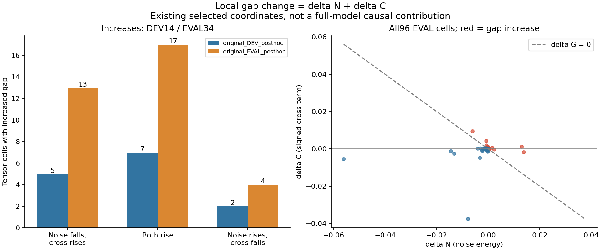
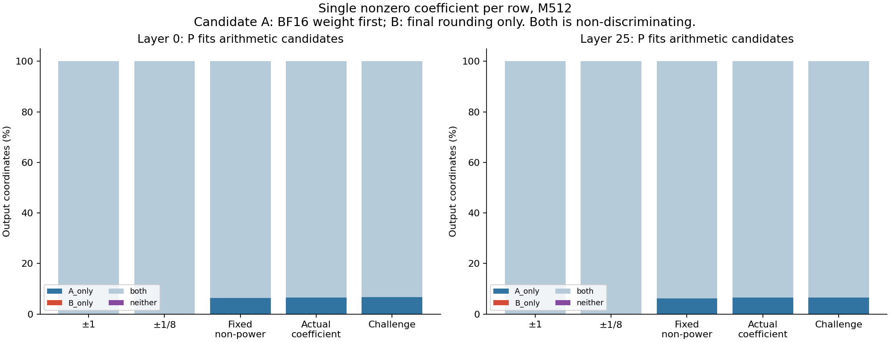

# Case021 P5 — Single products and combinations of actual values

The fixed probes found no D1/P single-term difference in two actual projections. Combining multiple actual values did produce differences. This narrows the input conditions associated with execution differences; it does not identify one internal arithmetic cause. The original full-model verdict remains **INCONCLUSIVE**.

**P5A: changes in the existing local gap.** We read128 same-input, same-coordinate P4 tensor pairs:32 DEV and96 EVAL, keeping Q/K, layers25/27, documents, heads and positions distinct. The identity ΔG=ΔN+ΔC holds. The34 EVAL gap increases split into13 cases with falling noise energy and rising cross term,17 with both rising, and4 with rising noise and falling cross term. No increasing case was near the sign tolerance. The24 earlier cases with weakening negative cross terms are a different classification, distributed12/12/0 here. The new sign tolerance max(1e-12,1e-10×the cell's largest absolute G/N/C) was frozen before these tables; the original exact-sign flag remains available. These energy components are not causal shares of full-model KL.

Across the first P4 block for DEV8 and layers0/25/27, 7,823 of 25,165,824 output coordinates differed numerically (0.031086%). Representable-step distances1/2/>2 contained7,496/133/194 mismatches, with a maximum of27,892. Signed ordering and numeric equality of ±0 are handled. A large distance near zero or across signs does not count internal rounding operations. P5A did not newly attribute these coordinates to FP64 midpoint behavior.

**P5B: discriminating arithmetic candidates.** A=R(a×R(c×s)); B=R(a×c×s), with BF16 nearest-even R. For synthetic c=3,s=1.0078125: a=1 gives3.03125 in both, a=0.125 gives0.37890625 in both, and a=1.5 gives A4.5625/B4.53125. Exact Fraction arithmetic checks direct BF16 rounding without an FP32 double-rounding shortcut. These explanatory values are not claimed to occur in the artifact.

The bounded CPU pool uses at most4096 candidates per projection from two fixed DEV documents and fixed coefficients. Selection takes the first discriminator before new GPU outputs. Although both dev_code_00/01 enter the pool, the actual-coefficient GPU rows and challenges come from dev_code_00 under this ordering. The GPU single-term sample therefore does not cover two documents. Both cores receive the same saved post-beta Z, with no extra beta, for layer0/25 q_proj, I1024/O2048/group64/M512 and no bias.

All five fixtures per projection contain512 valid rows: ±1,±1/8, fixed non-power values, actual coefficients and selected challenges. Across 10,485,760 first-block coordinates, D1/P and D1/A have zero numeric mismatches. P matches A_only=406,626, B_only=0, both=10,079,134, neither=0. All1,024 selected challenge coordinates match A only. ALL_VALID, actual-coefficient and selected-coordinate scopes overlap and must not be added. All40 repeat hashes agree. Agreement with A on these inputs does not prove the kernel's complete internal rounding sequence.

**P5C: the frozen conditional branch.** Stable equality for actual single-term coefficients activated branch D. The nested masks were generated before GPU outputs: retained BF16 bits are unchanged, other values become zero, and no renormalization is applied. Two layers×two DEV documents×K={1,2,8,64,256,1024} were run. Every mismatch count below has512×2048 output coordinates.

| Layer | Document | First observed K | Mismatches at K=1/2/8/64/256/1024 |
|---|---|---:|---|
| 0 | dev_code_00 | 64 | 0 / 0 / 0 / 16 / 97 / 353 |
| 0 | dev_code_01 | 8 | 0 / 0 / 1 / 11 / 90 / 332 |
| 25 | dev_code_00 | 64 | 0 / 0 / 0 / 17 / 97 / 365 |
| 25 | dev_code_01 | 64 | 0 / 0 / 0 / 20 / 88 / 338 |

K, actual nonzero counts and input norm change together. The first observed K is not a universal threshold, and maximum step distance is not monotone. All96 repeat hashes agree. At K1024, input bytes and all8 method outputs match P4; that is a comparison across time/processes, not one shared-worker control.

The two FP64 references use actual D1 BF16 weights promoted to FP64 (dense64), or codes times actual BF16 scales (exact64). Neither is a full-precision model-quality oracle. Chunked matmul is followed by independent math.fsum reductions of SSE/energy. There are768 exact dyadic audit rows spanning preselected coordinates and explicitly posthoc mismatch/uncertain coordinates:264 exact midpoint ties and0 final-rounding disagreements on that subset. Another231,110 oracle-condition coordinates remain UNRESOLVED under the FP64 error bound and limited exact subset. Repeated coordinates, modes and two oracles are not independent samples.

**Execution, costs and history.** Eager inference, TF32/reduced reduction OFF, Marlin FP32 reduce=true and atomic=false were retained. Four separate profiler calls identify torch.ops._C.marlin_gemm and actual CUDA Marlin symbols. This is existing packed INT4 storage/BF16 MMA machinery, not a new kernel or native INT4 MMA claim. Existing runtime reuse is not a clean-environment validation. Maximum allocated peak was48.321MiB, below2GiB; it is not device-wide VRAM.

Main calls: B60+C144=204; beta/module-core checks16; profiler4; total224. New full-model and input-extraction forwards:0. The ledger includes12 compute workers, one pre-spawn gate rejection, one read-only availability wait and one closeout query. A foreign compute PID prevented C from spawning; eligibility returned after about131 seconds and was checked again. Endpoint samples do not prove continuous exclusive GPU use.

New GPU parent wall: 229.252607s; campaign total 2282.963944s/7200s. New CPU worker wall: 61.077458s. Code/document editing wall is separately NOT_MEASURED. These are accounting values, not GPU busy time or serving latency. See the [budget](summary/budget.json) for its accounting snapshot.

The initial NumPy scalar-shift fixture failure, Fraction signed-zero audit failure and outer C-command dictionary-unpacking failure are retained. Fixes specify the dtype, honor numeric ±0 equality, and access dictionary keys respectively; they do not change scientific input meaning or loosen tolerances. The first two were resolved before new GPU outputs. The initial C gate rejection is a separate event. See [identity/history](records/identity.json), [reuse](REUSE_MAP.md), [preservation](summary/preservation.json) and [reproduction](REPRODUCE.md).

**Closeout.** No new model, installation, training, generation, isolated norm/RoPE intervention, holdout, speed sweep, Git publication or Pages deployment was performed. Actual activations/codes/scales/single-term outputs remain private. The explicit P0–P4 roots, two artifacts, selected runtime files and Git states are unchanged. This is not an audit of every unrelated project or whole model weight.

Counterexamples from both oracles are retained. Across24 fixed conditions, raw SSE ordering is P lower11/D1 lower2/equal11 for dense64, and7/6/11 for exact64. This descriptive ordering applies no effect-size threshold and is not a superiority decision. At K1024, D1 has lower exact64 SSE for both layer0 documents, while P has lower SSE for both layer25 documents. Neither oracle is selectively discarded.
