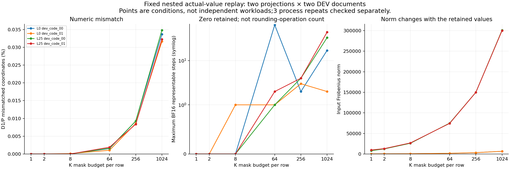

# Case021 — 단일항은 같았지만 실제 값의 결합에서 차이가 남았다

같은 INT4 가중치를 사용해도 계산 방법이 다르면 결과가 달라질까요? 이 마지막 진단에서는 **실제 입력값 하나를 곱할 때는 같았고, 여러 값을 결합할 때 차이가 나타났습니다.** Qwen3-0.6B의 기존 자료에서 두 projection(층0·25의 q_proj)만 사용했습니다.

D1은 작은 정수와 배율로 가중치를 BF16 숫자로 먼저 만든 뒤 곱합니다. P는 같은 정수와 배율을 Marlin GPU 연산에 전달합니다. BF16은 표현할 수 있는 숫자 간격이 제한된 형식입니다. 같은 수학식도 어느 단계에서 반올림하는지에 따라 다른 값이 될 수 있습니다.

- **단일항:** 고정값과 실제 계수를 넣은 10개 입력 조건에서 D1/P 출력이 같았습니다. 가중치를 먼저 반올림하는 후보 A와 마지막에만 반올림하는 후보 B가 달랐던 406,626좌표에서는 두 실행 모두 A와 맞았습니다. A/B가 같은 좌표는 구분 증거로 세지 않았습니다.
- **여러 항:** 두 층×두 문서의 고정 입력에서 K=1·2는 같았습니다. 첫 차이를 본 K는 한 조합에서 8, 세 조합에서 64였습니다. K는 남기는 입력축 수이며, 실제 비영 값 수와 입력 크기도 함께 달라집니다.
- **오차 상쇄:** 기존 EVAL의 국소 차이가 커진 34조합은 반올림 오차 차이의 에너지와 교차항 변화에 따라 13/17/4로 나뉘었습니다. 개별 계산이 더 정확해져도 두 실행이 서로 더 가까워지는 것은 아닙니다.

그림 읽는 법: 왼쪽은 서로 다른 출력 원소의 비율, 가운데는 BF16 숫자 간격, 오른쪽은 입력 크기입니다. 가로축 K는 로그 간격입니다. 점은 고정 조건이며 독립 사용자 작업 수가 아닙니다.

| 비교 | 이번에 확인한 범위 |
|---|---|
| 단일항 | 두 층×5 fixture, 각512행; 3 process 반복의 출력 일치 |
| 실제 값 결합 | 두 층×DEV2문서×6개의 K; 각512행, 3 process 반복 |
| 전체 모델의 기존 결론 | **INCONCLUSIVE 유지**; 새로운 전체 모델 forward는0회 |

이번 결과는 여러 항을 처리하는 실행 과정과 관련된 차이를 좁혀 줍니다. 내부 누적 순서·부분합·scale 적용 위치 중 무엇이 원인인지는 분리하지 못했습니다. 원래 전체 모델 결과의 구간은 여전히0을 포함하며, 이 사후 진단으로 모델 품질이나 RL 안정화·서비스 가속을 입증하지 않습니다.

[상세 P5 보고서](P5_REPORT.ko.md) · [P0–P5 통합 설명](CONSOLIDATED_REPORT.ko.md) · [CPU 검산 안내](REPRODUCE.ko.md) · [English](README_PUBLIC.md)

이 폴더는 **로컬 공개 후보**입니다. 실제 입력·가중치를 드러낼 수 있는 단일항 원출력은 포함하지 않습니다. 공개 CPU 명령은 집계표·그림과 작은 합성 수식을 검산합니다. 전체 로컬 원자료 재계산과 공개본 검산의 범위는 재현 안내에서 구분했습니다.
