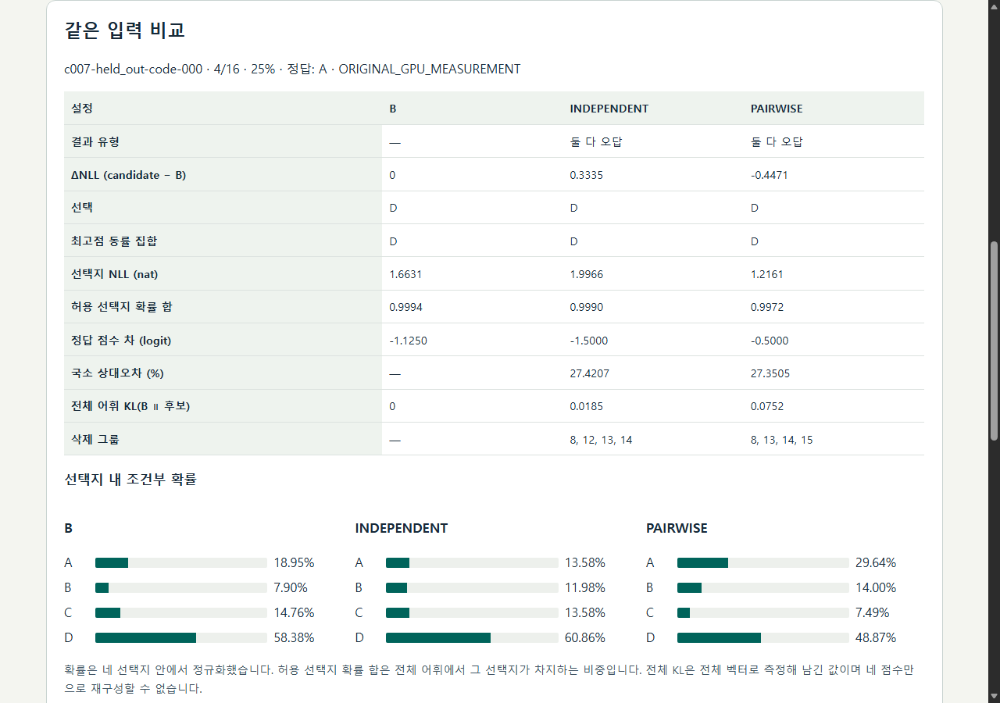

# Tools, implementation and technical collaboration

English | [한국어](../ko/PORTFOLIO.md) · [Home](../../README.md)

[New here?](START_HERE.md) · [Plain-language glossary](GLOSSARY.md)

[Practical model guides](LLM_GUIDE.md) connect verified Qwen3-4B execution paths with quality, failures and mitigation. English summaries link to the complete Korean detail.

## A 30-second introduction

<!-- claims: c008-tracks c008-artifact-implementation c007-implementation -->
A smaller model can use less storage yet lose correct answers or leave a requested task unfinished. In DIOVA, I built tools to save and restart changed models, compare answers and execution costs on matching questions, and verify actual tool actions. The evidence uses public models and recorded runs on an RTX 5080 16GB.

The implementations relate to local AI execution, inference optimization and quality checks after model changes. See the [technical collaboration scope](#technical-collaboration) for work you can discuss.

[Featured work and runnable tools](https://munsik-kim.github.io/inference-lab/en/index.html#featured-stories) · [Compare your own records](../../packages/diova-compare/examples/compare/README.md)

## Featured A · Smaller artifacts through actual requests

Connected Case008 Q’s **conversion with an existing compression method (GPTQ) → inspection of converted and saved model files (artifacts) → restart in a new process** to Case009’s **comparison of request time, memory and answer quality**. [Conversion](../../tools/modelpack/quantized.py) · [Artifact checks](../../tools/modelpack/qartifact.py) · [Serving runner](../../cases/009-q-serving-quality/scripts/serving.py).

Case008 Q reduced weight files from **8.045 GB → 2.652 GB, 67.0% smaller**. Peak PyTorch GPU allocation in that experiment was **10.4868 → 5.3971 GiB, about 48.5% lower**. This eager, single-request run used a 1 GiB cache and includes initialization and execution. [File and allocator records](https://munsik-kim.github.io/inference-lab/en/qwen3-4b.html#storage).

In the separate Case009 experiment, the highest whole-GPU memory samples were **14.08–14.51 → 9.08–9.52 GiB**, saving **4.98–5.06 GiB / 34.4–35.8%** within matching rounds. These are one-second samples from three graph rounds with the same 4 GiB cache, including startup, warmup and desktop use. [VRAM values, calculations and conditions](https://munsik-kim.github.io/inference-lab/en/qwen3-4b.html#device-memory). File size and the two memory measures have different boundaries.

Case008 R is a separate one-block reduction and restoration study on Qwen3-0.6B. [Case008 Q implementation](https://munsik-kim.github.io/inference-lab/en/case008.html#track-q) → [Case009 request comparison](https://munsik-kim.github.io/inference-lab/en/case009.html#serving).

**Technical judgment — current design:** a small file can still fail to load or use the intended computation, so the implementation starts a new process to check it. Models with 16-bit weights (BF16) and four-bit weights (W4) are compared under the same execution mode: prepared GPU execution graphs (graph) or operations dispatched as they occur (eager). This keeps execution-mode differences separate from weight changes. Evidence: [boundary tests](../../cases/008-build-reconstruct-reload/tests/test_boundaries.py) and [request protocol](../../cases/009-q-serving-quality/configs/serving_protocol.json). Other-device gains and abnormal Case009 quality-process exits remain unresolved. This explains the current code and records rather than asserting an unrecorded design history.

## Featured B · diova-compare on matched questions

Built an independent CPU comparison tool. It checks that two files describe the same questions and answer keys (gold), then lists questions that lost a correct answer, gained one or changed to another wrong answer. If the original program’s exit status is supplied, the report retains it alongside scores. [Runnable synthetic example](../../packages/diova-compare/examples/compare/README.md) · [Input format and command usage](../../packages/diova-compare/README.md) · [Core](../../packages/diova-compare/src/diova_compare/core.py) · [Tests](../../packages/diova-compare/tests/test_compare.py).

**Technical judgment — current design:** the two example files both score 2/4, but one answer changes from correct to wrong and another from wrong to correct. Matching each question before comparing (paired comparison) reveals what the overall score hides. Basic comparison needs no raw model scores (logits). For freely generated text, users supply correctness judgments and identifiers for inputs and saved results; file checks do not authenticate the underlying data. A new task needs suitable grading and question-matching rules.

## Featured C · Verify actual tool-task completion

A final message claiming success could appear even when the AI had not changed the test file or run the required check. Built restrictions that allow only registered tool names and explanations for call errors, then checked recorded actions and actual changes to the prepared test files. [Tool-name restriction code](../../research/agent_tool_contract_repair_20261014/guard.py) · [Actual-action record analysis](../../research/agent_tool_contract_repair_20261014/analyze.py) · [Tests](../../research/agent_tool_contract_repair_20261014/test_guard.py) · [Report](../../research/agent_tool_contract_repair_20261014/records/REPORT.md).

**Same eight existing tasks used during setting development (DEV) · small sample:** D16 changed 6/8 → 8/8, D4 0/8 → 2/8, leaving six D4 failures. D16 stores weights as four-bit integers (INT4) with BF16 calculation inputs; D4 uses the same weights and also quantizes those inputs to INT4. Both restore compressed values to BF16 to check quality (reference computation). Results on new tasks and acceleration from directly computing with packed low-bit data remain unverified.

**Technical judgment — current design:** grading only the final JSON message would miss actions that never happened. Tool-name restrictions, error explanations and their combination were compared separately. Restricting names (ENUM) and combining both changes (BOTH) tied, so an additional benefit from error explanations was not established. New tasks and the remaining D4 failures need further checking.

## Research and numerical engineering

[Case014](https://munsik-kim.github.io/inference-lab/en/case014.html#overview) is a separate research study: adjust weights to reduce compression error while keeping the converted matrices’ INT4 storage bytes unchanged. It reports improved text-prediction scores on PG19 books and the absence of the same gain on ArXiv articles. This does not establish higher task accuracy, faster execution, lower GPU memory (VRAM) or equal total saved-model size.

[All cases](CASEBOOK.md) retain Case006/007, Case008 R and Case010–012, including negative results. The code tour below provides deeper implementation evidence.

## Structure-aware loading and paired evaluation

*Local Edge screenshot: the first fixed CODE input, 25% deletion. [Case006 readout screen](../../presentation/screenshots/case006-readout.png) shows the separately labelled same-input diagnostic. These are selected views for navigation, not aggregate performance summaries.*

For restoring a checkpoint with one reduced Qwen3-0.6B MLP, follow the [code tour](#code-tour). Other studies remain in the [Casebook](CASEBOOK.md).

## Working capabilities and their evidence

| Project implementation | Upstream components | Code and tests |
|---|---|---|
| Check saved model files (artifacts), prevent incomplete saves, and reject incompatible reloads | PyTorch · Transformers · safetensors | [code](../../tools/modelpack/artifact.py) · [tests](../../cases/008-build-reconstruct-reload/tests/test_core.py) |
| Connect Q model conversion, copying and checks in a newly started inference process | GPTQ · LLM Compressor · compressed-tensors · vLLM/Marlin | [code](../../tools/modelpack/quantized.py) · [tests](../../cases/008-build-reconstruct-reload/tests/test_boundaries.py) |
| Fit output weights to reduce a smaller block’s error (ridge regression) and save the correction | NumPy · CPU FP64 · ridge regression · Cholesky · channel-reconstruction research | [code](../../tools/modelpack/numerics.py) · [tests](../../cases/008-build-reconstruct-reload/tests/test_core.py) |
| Measure matching inputs and report their individual before/after changes (paired comparison) | vLLM benchmark · lm-evaluation-harness · comparison metrics | [code](../../packages/diova-compare/src/diova_compare/core.py) · [tests](../../packages/diova-compare/tests/test_compare.py) |
| Save a model’s changing memory in fewer bits, preserve failures, and resume in a new process | NumPy · PyTorch · ComplexKDA recurrence | [implementation](../../cases/010-ckda-finite-precision-memory-horizon/versions/v2/source/online_v2.py) · [synthetic restart tests](../../cases/010-ckda-finite-precision-memory-horizon/versions/v2/tests/test_online_v2.py) |
| Change only the answer-reading layer on the same stored state; save/reapply its two arrays | ComplexKDA · PyTorch L-BFGS · NumPy | [adapter](../../cases/011-frozen-state-readout-adaptation/source/adapter.py) · [patch tests](../../cases/011-frozen-state-readout-adaptation/tests/test_fitting_patch.py) |
| Generate from the same initial noise; compare steps, internal repeats, time and requested count/color/left-right conditions | Looped-DiT · FLAN-T5 · PyTorch · Pillow | [adapter](../../cases/012-looped-dit-inference-budget/source/adapter.py) · [CPU tests](../../cases/012-looped-dit-inference-budget/tests/test_analysis.py) |
| Convert weights to four-bit integers (INT4) with their scaling factors; recheck recorded quality results | DualQuant public equations · PyTorch · NumPy | [solver](../../cases/013-dualquant-reference-quality/source/paper_int4.py) · [CPU audit](../../cases/013-dualquant-reference-quality/analysis/audit.py) |
| Collect intermediate values altered by earlier layer compression at the next layer, fit corrections, save/reload INT4 and check whole-model text quality | Guo compensation · PyTorch · Transformers · NumPy | [code](../../cases/014-quantization-compensation/followups/p2_core/source/run_p2.py) · [tests](../../cases/014-quantization-compensation/followups/p2_core/tests/test_p2.py) |
| API rename, received-result and state regression testing | Qwen · PyTorch · Transformers · Python stdlib | [runner](../../cases/015-tool-interface-sensitivity/followups/order-api-regression-v1/src/order_regression/runner.py) · [tests](../../cases/015-tool-interface-sensitivity/followups/order-api-regression-v1/tests/test_order_contracts.py) |
| Measure GPU time and memory on matched inputs | vLLM · CUDA · NVML · PyTorch SDPA · SageAttention | [runner](../../cases/002-bf16-fp8-document-extraction/scripts/run.py) · [timing boundary](../../cases/004-low-precision-attention-break-even/src/timing.py) |
| Recalculate public records and verify displayed values | Python · NumPy · JavaScript · unittest · GitHub Actions · Pages | [recalculation](../../tools/showcase/replay_selection.py) · [display tests](../../tests/showcase/test_showcase.py) |

- **Runtime diagnosis:** a before/after runner checks an existing library fix for choosing GPU operations on the RTX 5080 architecture (SM120). [Case001 runner](../../cases/001-sm120-int8-fallback/run.py).
- **Cost measurement:** attention adapters time a whole information-combining operation, including adjusting value ranges (smoothing), reducing precision (quantization) and converting data. [Case004 adapters](../../cases/004-low-precision-attention-break-even/src/backends.py).
- **Numerical analysis:** separate the EFQ method’s number mapping from the scaling used for comparison, and record when no tested speed/error setting meets the preset criteria. [Case003 analysis](../../cases/003-efq-softmax-numerical-audit/ANALYSIS.md) · [Case005 analysis](../../cases/005-attention-precision-pareto/ANALYSIS.md).

## Code tour

**Start with artifact creation and reload.** [`save_dense()`](https://github.com/Munsik-Kim/inference-lab/blob/9bc8b8fced8dfd5147f9bfdc67564eda04670810/tools/modelpack/artifact.py#L32) saves the number arrays (tensors) and a list of the model structure; [`load_dense()`](https://github.com/Munsik-Kim/inference-lab/blob/9bc8b8fced8dfd5147f9bfdc67564eda04670810/tools/modelpack/artifact.py#L109) starts from an empty model structure (meta), adjusts each layer’s size and assigns every saved weight. It reconnects shared weights and restores working arrays for position encoding (rotary buffers). [`fit_ridge()`](https://github.com/Munsik-Kim/inference-lab/blob/9bc8b8fced8dfd5147f9bfdc67564eda04670810/tools/modelpack/numerics.py#L13) uses 64-bit arithmetic (FP64) on CPU to fit weights that reduce a smaller block’s output error. [Original storage tests](../../cases/008-build-reconstruct-reload/tests/test_core.py) reject missing tensors and incompatible structures. [The standalone CPU demo](../../tools/modelpack_demo/roundtrip.py) runs this loader in another process.

<!-- claims: c006-implementation -->
1. **Control a native attention call.** Start at [`ScopedAttention`](https://github.com/Munsik-Kim/inference-lab/blob/bc1da81a82bff2e2827c5b4cabc9082cb6db5484/cases/006-attention-decision-stability/src/intervention.py#L30). `route` permits replacement only in layer 13 while first reading the prompt (prefill), when the numbers of query and key positions match (square attention). `__exit__` restores the previously registered function. Read the [restoration-on-exception test](https://github.com/Munsik-Kim/inference-lab/blob/bc1da81a82bff2e2827c5b4cabc9082cb6db5484/cases/006-attention-decision-stability/tests/test_core.py#L193).
2. **Make the matrix smaller.** [`sliced`](https://github.com/Munsik-Kim/inference-lab/blob/bc1da81a82bff2e2827c5b4cabc9082cb6db5484/cases/007-interaction-aware-mlp-pruning/src/surgery.py#L6) maps retained groups to gate/up rows and down columns. `masked` supplies the reference; `replace_mlp` restores the original module in `finally`. The [array-size, bias and computation-matching test](https://github.com/Munsik-Kim/inference-lab/blob/bc1da81a82bff2e2827c5b4cabc9082cb6db5484/cases/007-interaction-aware-mlp-pruning/tests/test_core.py#L62) covers that contract.
3. **Reject incomplete evidence.** [`assess`](https://github.com/Munsik-Kim/inference-lab/blob/bc1da81a82bff2e2827c5b4cabc9082cb6db5484/cases/006-attention-decision-stability/src/validity.py#L10) requires full-output and routing checks. Pair joins reject missing, duplicate or mismatched inputs in the [original tests](https://github.com/Munsik-Kim/inference-lab/blob/bc1da81a82bff2e2827c5b4cabc9082cb6db5484/cases/006-attention-decision-stability/tests/test_core.py#L249). The new [display checker](../../tools/showcase/check.py) compares the extracted display data with these preserved sources.

## A 60–90 second demonstration script

*Run the synthetic CPU example while presenting. This document is a script, not a recording.*

- **0–15s:** explain how equal accuracy can hide a lost correct answer.
- **15–40s:** validate both [fixture files and compare them](../../packages/diova-compare/examples/compare/README.md); label this as stored synthetic answers on CPU.
- **40–65s:** open the generated report.md and pairs.csv; inspect sum-01's loss and sum-02's gain.
- **65–90s:** open the [core](../../packages/diova-compare/src/diova_compare/core.py) and [transition/rejection/failure-preservation tests](../../packages/diova-compare/tests/test_compare.py).

Historical GPU records are a separate route: [Case008 Q](https://munsik-kim.github.io/inference-lab/en/case008.html#track-q) → [Case009 quality](https://munsik-kim.github.io/inference-lab/en/case009.html#quality). The random tiny-model [CPU save/reload demo](GETTING_STARTED.md#tiny-model-demo) remains another implementation example.

## Evaluating the tools

<!-- claims: c007-transfer c007-quality c006-native c006-readout -->
Case008 R reduced deletion-induced local squared output error by **94.1–95.4%** in one Qwen 0.6B MLP on 192 short synthetic held-out prompts. Gold-score changes differed by probability metric and repaired structure. Its measured request-time ratio intervals included 1, so a faster complete request was not established. Inspect the [Q quality and runtime comparison](https://munsik-kim.github.io/inference-lab/en/case008.html#q-evaluation) and the [R comparison](https://munsik-kim.github.io/inference-lab/en/case008.html#r-evaluation).

At 25% MLP deletion, choosing groups using their joint effects (PAIRWISE) slightly lowered local error and kept more original-model answers. Choosing groups separately (INDEPENDENT) nevertheless gave better correct-answer probability loss (gold NLL; lower is better). At 50%, the selected modules were identical; the original status is **completed without a clear benefit under the preset rule (`COMPLETED_NO_CLEAR_TRANSFER`)**. In Case006, A_PUBLIC changed 5 of 192 standard choices and V4 changed 8 of 192. A same-input readout follow-up examines ties and the final vocabulary projection. These examples make both implementation choices and competing evaluation objectives visible. [Casebook](CASEBOOK.md) · [Open the local screen](GETTING_STARTED.md#local-showcase).

<!-- claims: c004-cost c005-stop -->
Measured complete attention cost and retained **the decision to stop at setting development (`STOP_DEV_SCREEN`)** alongside the observed precision–cost trade-off. [Case004 cost](../../cases/004-low-precision-attention-break-even/README.md) · [Case005 decision](../../cases/005-attention-precision-pareto/README.md).

## Contribution and reuse

<!-- claims: attribution -->
The project's work is comparison execution, scoped adapters, matrix surgery, validity checks, numerical/behavioral analysis and evidence viewers. Qwen and Red Hat AI provide checkpoints; Transformers, PyTorch and vLLM provide model/runtime components; SageAttention provides low-precision kernels. hclsys authored the Case001 guard. Han and coauthors developed EFQ-Softmax. HOPE studies removal in a separate mixture-of-experts (MoE) model, where inputs use selected specialist blocks, and motivates considering their interactions. Here the MLP computes all its channels (dense MLP); the group-selection score is derived directly from that block’s output contributions.

GPTQ is the upstream quantization method; LLM Compressor and compressed-tensors implement conversion/storage, and safetensors provides the weight format. Case008 adds artifact validation, a layer-aware loader and fixed-structure ridge fitting. [Case008 attribution](../../cases/008-build-reconstruct-reload/NOTICE.md).

OpenAI Codex assisted implementation, local execution, tests, analysis and writing. [Case001](../../cases/001-sm120-int8-fallback/NOTICE.md), [Case003](../../cases/003-efq-softmax-numerical-audit/NOTICE.md), [Case006](../../cases/006-attention-decision-stability/NOTICE.md) and [Case007 notices](../../cases/007-interaction-aware-mlp-pruning/NOTICE.md) credit reused work. Project code uses [Apache-2.0](../../LICENSE); model/upstream terms remain applicable.

## Technical collaboration

The public implementations demonstrate capabilities for these tasks:

- Compare local quantization/execution settings and diagnose bottlenecks.
- Evaluate answer and tool-action regressions after model changes.
- Turn measurement, recording and reanalysis into reusable tools.

You can start with the practical problem: which model or task is involved, what fails or needs comparing, and what result would count as useful. The detailed measurement boundary and metrics can then be chosen together. [Repository issues](https://github.com/Munsik-Kim/inference-lab/issues) provide a public technical-question channel; keep credentials and private customer data out of public reports.

The evidence covers specific models and one device, with synthetic studies and the separate official tasks in Case009. Production deployment is **not assessed (`NOT_ASSESSED`)**. CPU audits recalculate saved numerical values; they do not reconstruct excluded full arrays or independently repeat GPU model execution. The [reproduction guide](GETTING_STARTED.md) explains those separate requirements.

## Case010 — State storage and failure persistence

Built storage that packs the model’s changing memory (recurrent state) into fewer bits, carries a correction for storage error (residual transport), completes each row update together, and saves failures so a restart cannot silently erase them. Follow the [v2 implementation](../../cases/010-ckda-finite-precision-memory-horizon/versions/v2/source/online_v2.py), [fresh-process synthetic tests](../../cases/010-ckda-finite-precision-memory-horizon/versions/v2/tests/test_online_v2.py) and [byte-budget/readout comparison](../../cases/010-ckda-finite-precision-memory-horizon/REPORT.md). [CPU guide](GETTING_STARTED.md#case010-cpu). The [notice](../../cases/010-ckda-finite-precision-memory-horizon/NOTICE.md) separates ComplexKDA transitions and training from the project’s codec and evaluation tools.

## Case011 — Replace the readout on the same state

Three answer-reading layers (readouts) use the same saved state. The loader checks the two changed number arrays’ sizes and the identity of the original model before applying them in a new process. Read the [model-state reading adapter](../../cases/011-frozen-state-readout-adaptation/source/adapter.py), [saved-change loader](../../cases/011-frozen-state-readout-adaptation/source/head_patch.py), [save/reapply rule tests](../../cases/011-frozen-state-readout-adaptation/tests/test_fitting_patch.py) and [independent auditor](../../cases/011-frozen-state-readout-adaptation/analysis/audit.py) in that order.

Additional storage for the model’s changing memory is 0 B. The correct-answer probability loss (cross-entropy, CE; lower is better) improved at positions outside those used for fitting. Even so, with INT8 storage, the average number of consecutive correct steps before the first error fell for all three model checkpoints. [Walkthrough](https://munsik-kim.github.io/inference-lab/en/case011.html) · [Detailed results and fitting-calculation exit status](../../cases/011-frozen-state-readout-adaptation/REPORT.md) · [CPU checks](GETTING_STARTED.md#case011-cpu). [Attribution](../../cases/011-frozen-state-readout-adaptation/NOTICE.md) distinguishes PyTorch/NumPy and ComplexKDA from the project integration.

## Case 013 — Scale-preserving INT4 and quality readback

[Four-bit conversion and model adapter](../../cases/013-dualquant-reference-quality/source/paper_int4.py) · [Pack and restore four-bit values](../../cases/013-dualquant-reference-quality/source/reference_int4.py) · [Recheck recorded numerical values](../../cases/013-dualquant-reference-quality/analysis/audit.py)

<!-- case014-entry -->
## Case014 — Own-trajectory compensation and full-model quality

Collected at each next layer the intermediate values altered by earlier layer compression, fitted error corrections in 64-bit arithmetic (FP64), and built INT4 storage and independent reload. The analysis separates three sources of error and compares matching document excerpts. It retains the PG19 text-quality gain alongside the ArXiv limits.

[Implementation](../../cases/014-quantization-compensation/PORTFOLIO.md) · [Code](../../cases/014-quantization-compensation/followups/p2_core/source/run_p2.py) · [Tests](../../cases/014-quantization-compensation/followups/p2_core/tests/test_p2.py) · [CPU reproduction](../../cases/014-quantization-compensation/REPRODUCE.md)

<!-- case015-entry -->

## API rename regression testing

Check whether an AI finishes the same task after a tool rename. The example is **read item count and price per item → calculate the purchase total → save it → validate the record**. Functions and input formats stay fixed; only names change, such as `read_order` to `readOrder`. Across 16 problems, BF16 was **15/16→16/16**, RTN **16/16→16/16**, and D16 **12/16→12/16**. The [task and terminology guide](../../cases/015-tool-interface-sensitivity/README.md) explains orders as purchase records, unit price as price per item, and how to read the results. The 96 runs of the earlier P1 study and the new A1 application are counted separately.